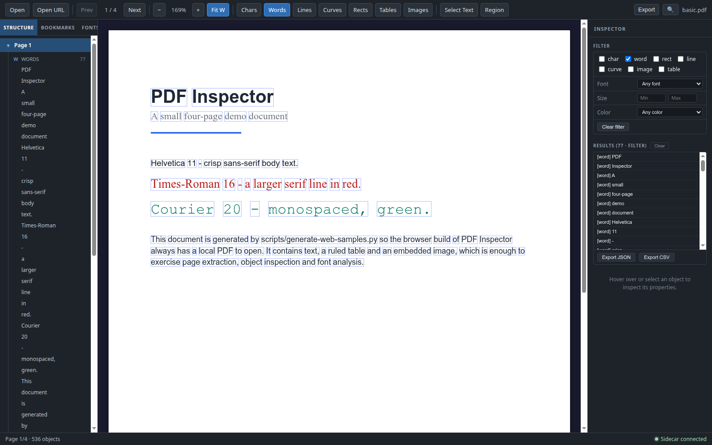
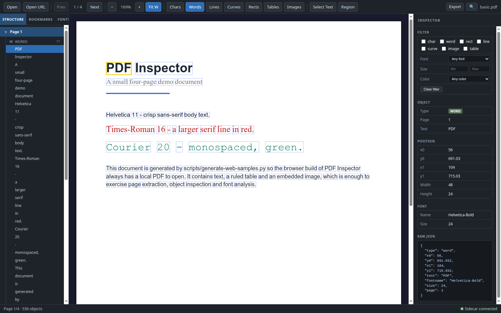
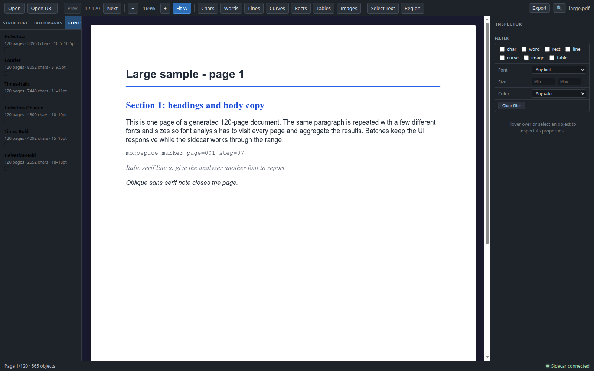
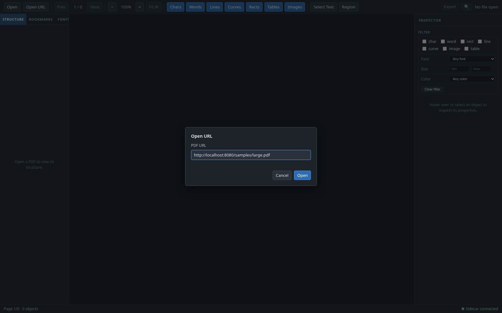

# PDF Inspector

面向开发者的 PDF 结构检查工具——在 PDF.js 渲染结果之上叠加 pdfplumber 的坐标级对象数据，直观检查字符、单词、线条、曲线、矩形、表格和图片。提供 Electron 桌面应用与浏览器（Node HTTP 后端）两种运行方式。

[](https://github.com/EthanCheung-gh/pdf-inspector/actions/workflows/ci.yml)
[](https://github.com/EthanCheung-gh/pdf-inspector)
[GitHub](https://github.com/EthanCheung-gh/pdf-inspector) · [GitCode](https://gitcode.com/EthanCheung/pdf-inspector)

|  |  |
| :---: | :---: |
|  |  |
|  |  |

*截图来自 Web 构建；桌面端使用同一套 React UI，界面与功能一致。*

## 功能特性

### 渲染与检查

- PDF.js 多页渲染，支持翻页、缩放与适合页面宽度。
- char / word / line / curve / rect / table / image 七类对象的边界框叠加层，可按类型独立开关。
- 悬停或点击选中对象，Inspector 面板展示页码、坐标、字体、字号、颜色及原始 JSON；图片对象提供内嵌预览。
- 文本选择层支持直接选中页面文字。

### 导航与结构

- 左侧结构树按页展示全部对象，页面节点可折叠/展开。
- 读取 PDF 书签（outline），点击条目直接跳转到对应页面。
- 当前页码显示与上一页/下一页导航，并实时显示缩放比例。

### 搜索与导出

- `Ctrl/Cmd+F` 跨页全文搜索，逐条导航并高亮匹配位置。
- 导出当前页或整份文档，格式为 JSON 或 CSV；导出时可勾选要包含的元素类型（char / word / line / curve / rect / table / image）。桌面端使用原生保存对话框，Web 端触发浏览器下载。
- CSV 按对象类型分段，便于在表格工具中继续分析。

### 过滤与叠加层

- 按对象类型开关叠加层；按字体、字号、颜色、类型组合筛选对象。
- 拖拽框选区域，支持“相交（intersect）”与“包含（contain）”两种匹配方式。
- 筛选或框选结果在画布上高亮，并在 Inspector 中列出，可直接导出该子集。

### 字体分析

- 统计整份文档的字体使用情况：页数、字符数、字号范围、颜色。
- 按每 10 页一批顺序分析，并实时显示进度。
- 分批处理让页面提取有机会穿插执行，分析长文档时界面保持可用。
- 点击字体条目跳转到首个使用页，并通过筛选高亮该字体的对象。

### 打开方式

- 打开本地 PDF，或通过 `http(s)` URL 打开远程文档（先下载到临时目录再解析）。
- 桌面端与 Web 端能力一致，仅底层通道不同。

### 桌面与 Web

- **桌面端**：Electron 主进程负责窗口、原生菜单/对话框与 Python 侧车生命周期。
- **Web 端**：React UI 在浏览器中运行，由无 Electron 依赖的 Node HTTP 后端提供同样的文档与侧车能力。

### 键盘快捷键

| 快捷键 | 作用 |
|--------|------|
| `T` | 切换文本选择模式 |
| `R` | 切换区域框选模式（与文本选择互斥） |
| `Ctrl/Cmd+F` | 打开搜索 |
| `Ctrl/Cmd+滚轮` | 缩放文档；向上滚放大，向下滚缩小（触控板捏合同样生效） |
| `Esc` | 清除选中、筛选与框选结果 |

## 快速开始

### 环境要求

- **Node.js ≥ 22.12**（见 `.nvmrc`；jsdom 需要 `require(esm)` 支持）
- **Python 3.10+**
- Python 包：`pdfplumber`、`Pillow`（见 `sidecar/requirements.txt`）；运行测试还需 `pytest`、`reportlab`

### 安装

```bash
npm ci

python3 -m venv .venv
.venv/bin/pip install -r sidecar/requirements.txt

# 运行 Python 测试时
.venv/bin/pip install pytest reportlab
```

Windows 下将 `.venv/bin/pip` 换成 `.venv\Scripts\pip`，Python 解释器对应 `.venv\Scripts\python`。

### 桌面端

```bash
npm run dev      # Vite 开发服务器 + Electron（HMR）
npm start        # 构建 main 进程并启动 Electron
```

桌面模式需要 Electron 二进制，`npm install` / `npm ci` 默认会下载。若设置了 `ELECTRON_SKIP_BINARY_DOWNLOAD=1`（例如 CI 中只为跑测试），则无法启动桌面应用。

### Web 端

```bash
npm run web        # 构建 Web 前端与 HTTP 后端，然后启动服务
npm run web:start  # 直接启动已构建的 dist-web-server/server.mjs
```

默认监听 <http://localhost:8080>。可用环境变量：

| 变量 | 默认值 | 说明 |
|------|--------|------|
| `HOST` | `0.0.0.0` | 监听地址；仅本机访问可设为 `127.0.0.1` |
| `PORT` | `8080` | 监听端口 |
| `PDF_INSPECTOR_PYTHON` | 优先使用 `.venv` 中的解释器，否则 `python3` | 启动 Python 侧车使用的解释器 |

生成演示 PDF：

```bash
python scripts/generate-web-samples.py
```

随后在 Web 界面打开 `/samples/basic.pdf`（小型示例，含表格与图片）或 `/samples/large.pdf`（多页文档，便于观察字体分批分析）。

> **安全提示**：Web 服务没有身份认证，任何能访问该端口的人都可以上传/下载文档、调用解析接口。默认绑定 `0.0.0.0`，请仅在可信网络使用；本机使用时建议 `HOST=127.0.0.1 npm run web`。

## 使用说明

1. **打开文档**：点击 Open 选择本地 PDF，或点击 Open URL 输入 `http(s)` 地址。
2. **浏览结构**：在左侧结构树展开/折叠页面节点，或通过书签跳转；也可用工具栏的 Prev/Next 翻页。
3. **检查对象**：在画布上悬停查看轮廓，点击后在右侧 Inspector 查看坐标、字体、颜色与原始数据。
4. **筛选对象**：在 Inspector 中按字体/字号/颜色/类型筛选，或切到 `R` 模式拖拽框选区域，再选择相交/包含匹配。
5. **字体分析**：切换到 Fonts 标签页开始分析，查看进度；点击字体条目跳转到使用页并高亮。
6. **搜索与导出**：`Ctrl/Cmd+F` 搜索；通过 Export 选择当前页/整档、JSON/CSV 与要包含的元素类型。

## 架构

同一套 React 渲染层，桌面端通过 Electron IPC 访问侧车，Web 端通过 HTTP 访问 Node 后端；两侧最终都使用 stdio 上的 JSON-RPC 驱动 Python 侧车。

```
桌面模式
┌──────────────────────────────────────────────┐
│ Electron Main                                │
│ 窗口 / 原生对话框 / Python 侧车生命周期       │
└───────────┬──────────────────────────┬───────┘
            │ IPC (contextBridge)      │ spawn
            ▼                          ▼
┌───────────────────────┐   ┌───────────────────────┐
│ Renderer (React)      │   │ Python Sidecar        │
│ PDF.js / 叠加层 / UI  │   │ pdfplumber / 页缓存   │
└───────────────────────┘   └───────────────────────┘

Web 模式
┌──────────────────────────────────────────────┐
│ Browser (React + PDF.js)                     │
│ `window.pdfInspector` 由 src/web 适配器实现   │
└───────────┬──────────────────────────────────┘
            │ HTTP：/api/*、/doc/*、/samples/*
            ▼
┌──────────────────────────────────────────────┐
│ Node HTTP Server（server/web-server.ts）      │
│ 上传/下载临时文件、文档注册表、静态资源       │
└───────────┬──────────────────────────────────┘
            │ spawn + JSON-RPC over stdio
            ▼
      Python Sidecar（同上）
```

Python 侧车通过 stdin/stdout 上的行分隔 JSON-RPC 通信，提供 `open`、`extract_page`、`extract_metadata`、`analyze_fonts`、`get_image_data`、`shutdown` 等方法，并用 LRU 缓存复用已解析页面。

## 技术栈

| 层 | 技术 |
|----|------|
| 桌面容器 | Electron 28 |
| Web 后端 | Node.js 内置 `http`（无额外运行时依赖） |
| 前端 | React 18 + TypeScript + Vite + Zustand + CSS Modules |
| PDF 渲染 | pdfjs-dist 4.x |
| 提取引擎 | Python 3 + pdfplumber（JSON-RPC over stdio 子进程） |
| 前端测试 | Vitest + Testing Library + jsdom |
| Python 测试 | pytest + reportlab（生成测试用 PDF） |

## 项目结构

```
pdf-inspector/
├── src/
│   ├── main/              # Electron 主进程：窗口、IPC、URL 下载、侧车管理
│   ├── preload/           # contextBridge → window.pdfInspector
│   ├── renderer/          # React UI、PDF.js 渲染、叠加层、hooks、store、services
│   ├── shared/            # 主进程/渲染进程共享常量与工具
│   └── web/               # 浏览器入口与 HTTP 版 IPC 适配器
├── server/
│   └── web-server.ts      # 无 Electron 依赖的 Node HTTP 后端
├── sidecar/               # Python 侧车（extractor / cache / models / main）
│   ├── __tests__/         # pytest 测试
│   └── requirements.txt
├── scripts/
│   ├── generate-web-samples.py  # 生成 web-samples/*.pdf
│   ├── generate-icon.js
│   └── freeze-sidecar.sh
├── docs/
│   ├── packaging.md       # 打包说明
│   ├── images/            # README 截图
│   └── superpowers/       # 设计与实施文档（specs / plans）
├── web-samples/           # 生成的演示 PDF（已 gitignore）
├── .github/workflows/ci.yml
├── index.html             # Electron 入口
├── index.web.html         # 浏览器入口
└── package.json
```

## 开发与测试

```bash
# TypeScript：Node/main 项目与 Web 项目
npx tsc -b
npx tsc -p tsconfig.web.json

# 前端单元测试
npx vitest run

# Python 侧车测试（请使用虚拟环境中的解释器，确保依赖可用）
.venv/bin/python -m pytest sidecar/__tests__ -q
```

`npx tsc -b` 使用项目引用，会同时检查 main、preload、renderer 与 shared。提交前建议执行上面的全部命令。

CI 由 `.github/workflows/ci.yml` 定义：在推送到 `main`、推送 `v*` 标签、Pull Request 及手动触发时，执行上述类型检查与测试，并构建桌面端、Web 前端、Web 后端及生成演示 PDF。

## 打包发布

```bash
npm run freeze:sidecar   # PyInstaller 冻结 Python 侧车
npm run dist             # 当前平台安装包（electron-builder）
npm run dist:win         # Windows
npm run dist:mac         # macOS
npm run dist:linux       # Linux
```

打包产物包含冻结后的侧车，最终用户无需安装 Python。PyInstaller 不支持交叉编译，每个平台需在对应宿主上构建。详细步骤、平台依赖与产物说明见 [docs/packaging.md](docs/packaging.md)。

## 配置与安全

- **Electron 桌面端**只通过 IPC 与本机侧车通信，不监听网络端口。
- **Web 端**默认监听 `0.0.0.0:8080`，没有认证与访问控制；请用 `HOST` 限制监听地址，或放在带认证的反向代理之后。
- Web 端的当前文档、上传与下载文件存放在系统临时目录，正常关闭时清理；崩溃或强杀进程可能残留。
- URL 打开仅接受 `http(s)`，下载受超时限制。
- 侧车请求有超时保护；桌面端会自动重启侧车，Web 后端会在请求时自动拉起进程，并提供 `/api/restart` 接口。
- 测试或 CI 中可用 `ELECTRON_SKIP_BINARY_DOWNLOAD=1` 跳过 Electron 二进制下载（仅影响桌面端启动）。

## 已知限制

- 侧车一次处理一个请求；单批字体分析执行期间，其他解析请求需要等待，批次之间会插入处理。
- 字体分析按 10 页一批顺序执行，超大文档需要较长时间，但可分页浏览并查看进度。
- Web 模式同一时间只维护一份“当前文档”，且没有多用户隔离或认证。
- 临时文件清理为尽力而为，异常退出后可能需要手动清理系统临时目录。
- Web 模式需先构建 `dist-web` 与 `dist-web-server`；未构建时服务会提示构建后刷新。
