# PDF Inspector

English | [简体中文](README.zh-CN.md)

PDF Inspector is a developer-focused PDF structure viewer. It overlays coordinate-level pdfplumber object data on PDF.js rendering so you can inspect characters, words, lines, curves, rectangles, tables, and images, and read annotations, links, form fields, the raw object tree, and content streams without editing the PDF. Export the current page or a selected region as PNG/SVG, generate a self-contained HTML inspection report, choose Dark / Islands / Light / System themes, and switch the UI between English and Simplified Chinese. It runs as an Electron desktop app or in a browser backed by a Node HTTP server.

[](https://github.com/EthanCheung-gh/pdf-inspector/actions/workflows/ci.yml)
[](https://github.com/EthanCheung-gh/pdf-inspector)
[GitHub](https://github.com/EthanCheung-gh/pdf-inspector) · [GitCode](https://gitcode.com/EthanCheung/pdf-inspector)

> The detailed design notes under [`docs/`](docs/) are currently written in Chinese. This README is the English overview; commands, API names, file names, and UI labels are kept exact.

|  |  |
| :---: | :---: |
|  |  |
| 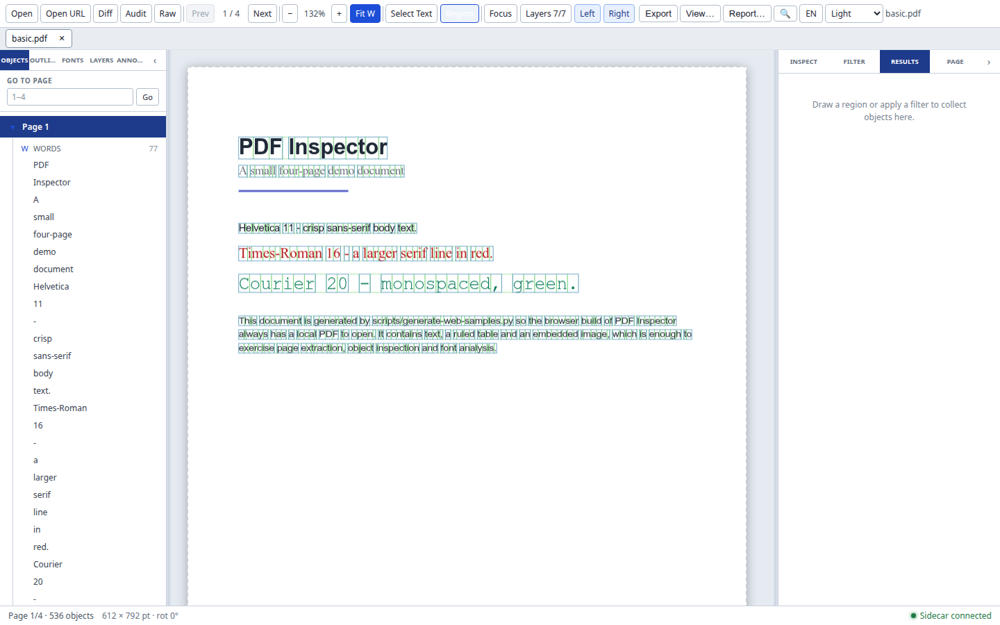 | **Four themes**<br>A native `Theme` select on the right side of the toolbar offers `Dark`, `Islands`, `Light`, and `System`. `System` follows `prefers-color-scheme`; the choice persists across restarts, and `data-theme` carries the resolved palette. |
|  |  |
|  | **Layers**<br>Seven object-type toggles with counts, All/None, Solo, and opacity. |
|  | **Export by element type**<br>Choose current page or whole document, JSON or CSV, the element types to include, and an editable file name. Unchecked types are omitted. |
| 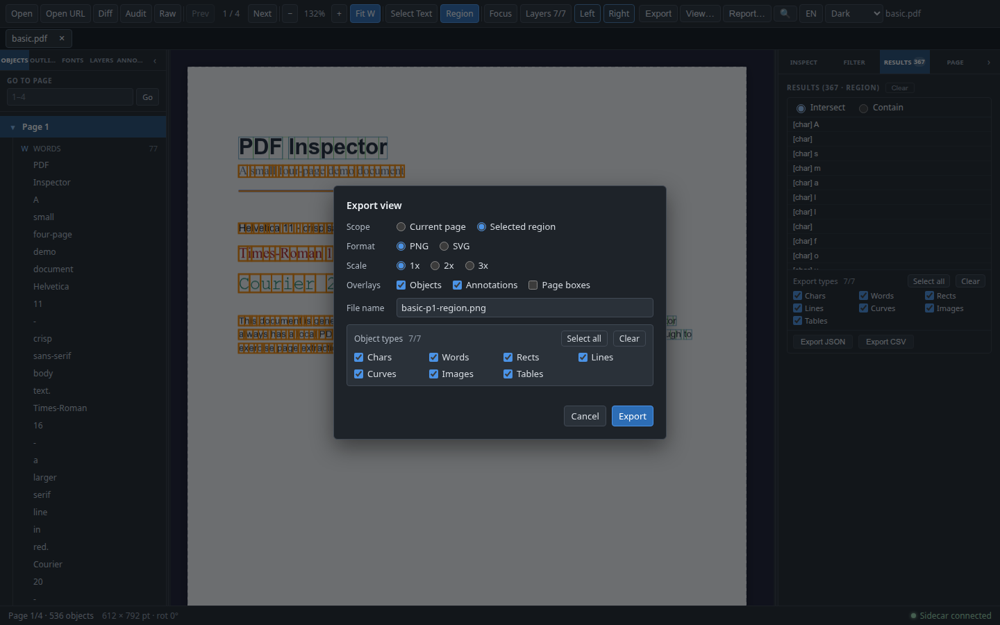 | **Export view (PNG/SVG)**<br>Export the current page or a selected region at 1x/2x/3x, with Objects / Annotations / Page boxes overlays and an object-type filter. PNG is saved as binary; SVG embeds a PNG raster base plus vector overlays. |
| 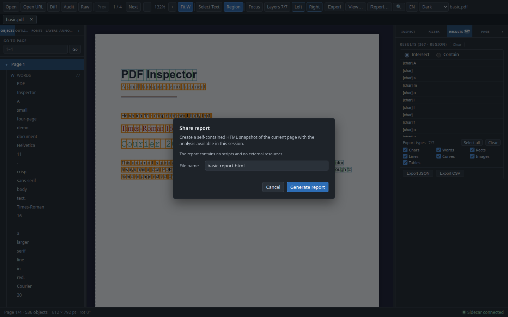 | **Share report (HTML)**<br>Generate a self-contained HTML inspection report for the current page with a screenshot, page composition, fonts, annotation index/issues, and audit findings. Inline CSS, no scripts, no external resources. |
| 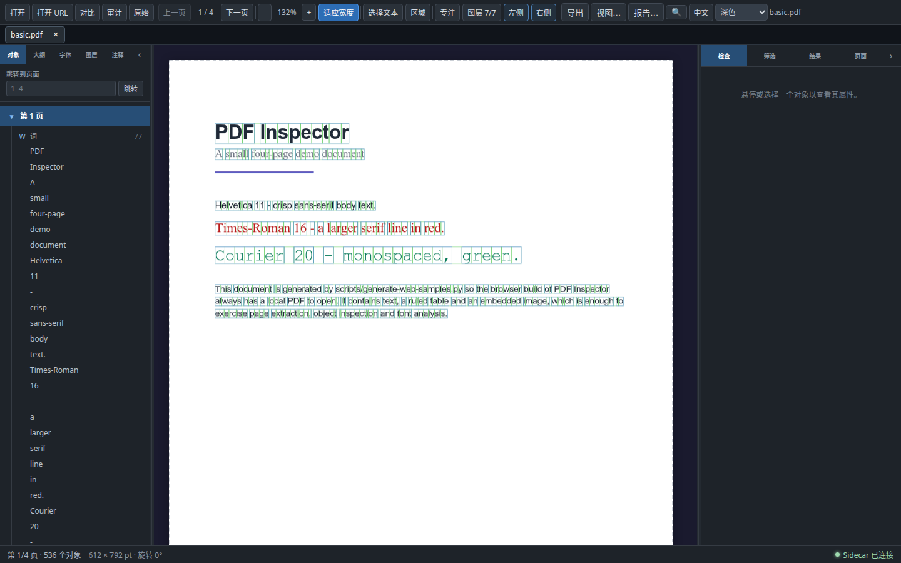 | **English / 简体中文**<br>The toolbar language control switches between `EN` and `中文`; English is the default and the choice persists. UI strings are translated, while command names, JSON/CSV fields, and sidecar/CLI errors stay English. |
|  | **Table cells**<br>Select a table to see a cell grid with merged/missing markers and the selected cell's BBox. Hovering or clicking a cell highlights it on the canvas. |
|  | **Page geometry**<br>The `Page` tab lists MediaBox / CropBox / TrimBox / BleedBox / ArtBox, with pt/mm switching and canvas rulers. |
|  | **PDF Diff**<br>Compare old and new pages side by side. The left side summarizes changes per page; selecting an item shows old/new text, BBoxes, and field differences on the right. Old/new files can be changed and the result exported as JSON. |
|  | **Overlay mode**<br>Overlay old/new object boxes on one page: removed red, added green, moved orange, modified blue. Useful for locating changes in the same region. |
|  | **Visual pixel comparison**<br>Switch the Diff workspace to `Visual` to blend the old page over the new page (`Blend`) or draw a per-pixel heatmap (`Heatmap`); the page bar shows `changed / total px`. `Boxes` only shows object boxes. |
|  | **Ignore regions**<br>Turn on `Ignore region`, drag a rectangle on either page, and review page/side/bbox rows on the left with a synchronized dashed outline. `Apply & re-run` filters intersecting changes. |
|  | **Page alignment and reordering**<br>Pages are paired by content fingerprints; the list and page bar show `Old 2 → New 1` style old/new numbers. Inserted/deleted pages stay one-sided, and `--fail-on reordered` can gate page-order changes in CI. |
| 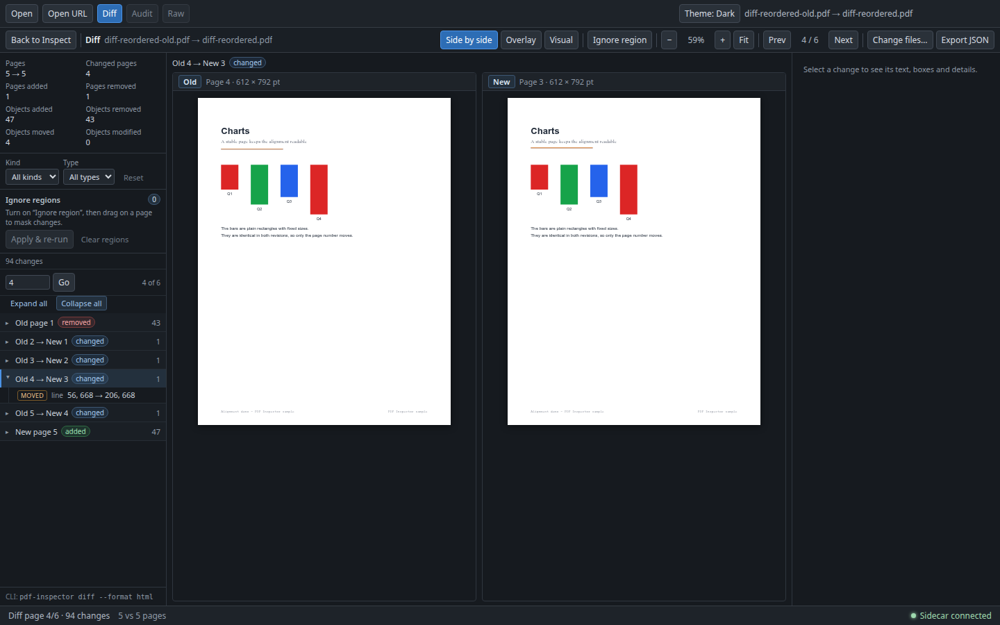 | **Collapsible Diff page groups**<br>Each page is an independent collapsible group whose header keeps its status and change count. `Go to page` clamps and reveals the target page; `Expand all` / `Collapse all` control the list. |
|  | **Document audit**<br>Whole-document checks across fonts, pages, images, metadata, structure, and security. Filter by severity/category, inspect evidence and recommendations, and jump to the referenced page. Switch to `Structure` for the tagged structure tree, or to `Resources` for attachments, JavaScript, actions, signatures, encryption, and permissions. |
|  | **Audit report (HTML)**<br>CLI `audit --format html` writes a single-file report with document information, severity summary, and findings (evidence and recommendations). Inline CSS, no scripts, no external resources. |
| 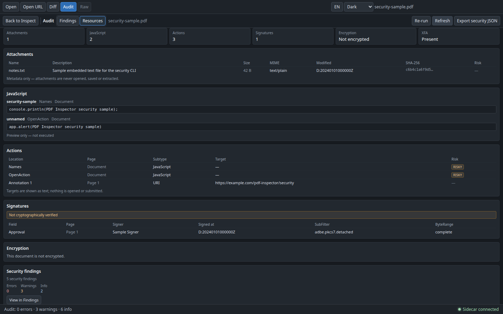 | **Document security resources**<br>The Audit header switches between `Findings` and `Resources`. `Resources` shows attachment, JavaScript, action, signature, encryption, and XFA cards, then the `notes.txt` attachment, inert script previews, risky actions, the unverified signature field, and security finding counts. Attachments are metadata only and cannot be opened or downloaded. |
| 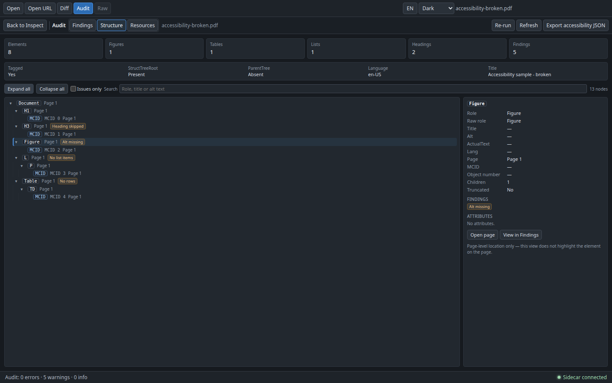 | **Audit Structure**<br>The Audit header switches between `Findings` / `Structure` / `Resources`. `Structure` shows the tagged structure tree with roles, Alt/ActualText, reading order, page and MCID, with search and `Issues only`. Details are read-only and offer `Open page` and `View in Findings`; no tag is edited and no element is highlighted on the page. |
|  | **Annotations, links, and forms (current page)**<br>`Annots` in `Current page` mode lists links, form fields, markup, and annotations on the current page. Canvas boxes stay in sync; select one to inspect values, options, and link targets in the Inspector. |
| 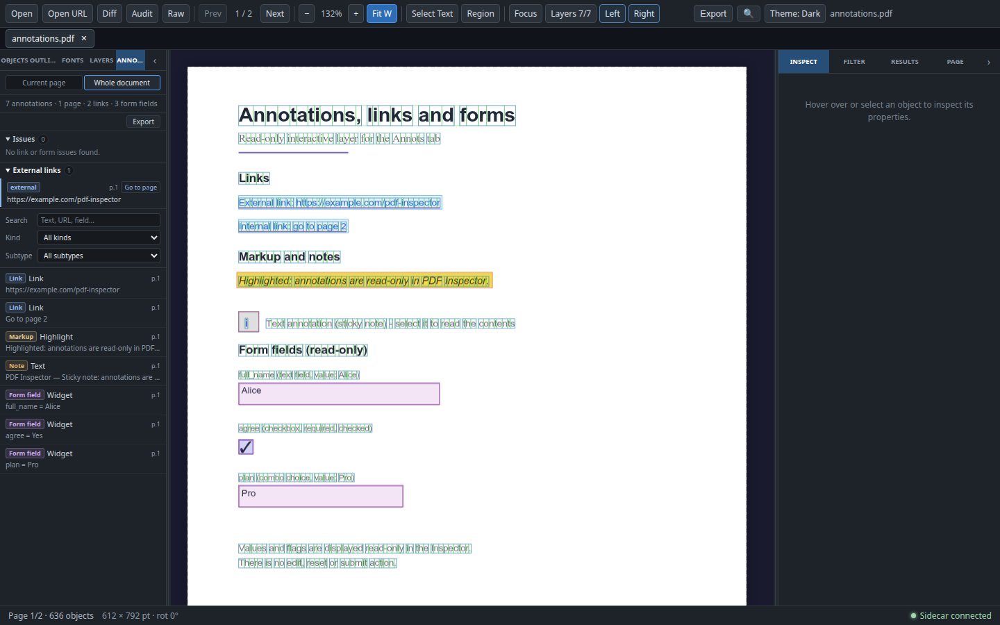 | **Whole-document annotation index**<br>Switch to `Whole document` to read the entire PDF in 10-page batches. The header shows `7 annotations · 1 page · 2 links · 3 form fields`; `Issues` opens by default, `External links` is collapsed, and the list supports page targeting, search, and global filters. |
| 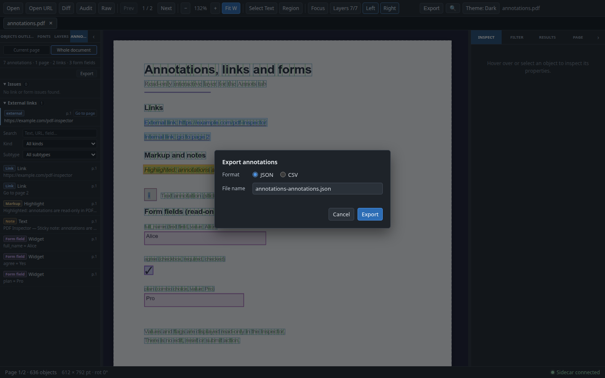 | **Annotation export**<br>After indexing, `Export` opens a dialog for JSON or CSV with an editable file name. JSON includes document information, summary, per-page annotations, link/form issues, and merged fields, and never writes local absolute paths. |
|  | **Raw object tree**<br>The toolbar `Raw` button opens a read-only workspace. The tree starts at the trailer root and follows references lazily; expand `Pages`, a page, and `Resources` to inspect dictionaries, arrays, and stream metadata. |
|  | **Content streams**<br>The `Content stream` tab decodes a page's content stream and lists offsets, operators, and operands. `BT` / `Tf` / `Tj` / `Do` and other operators are read, never executed. |
|  | **Large-document page list and jump**<br>Open the 1000-page sample and use CSS windowing in the page tree. Go to page clamps input to `1..pageCount` and expands only the current page's objects. |
|  | **Batched search index**<br>Search builds the text index in 10-page batches and shows `Indexing done/total…` in the SearchBox. Closing search or switching documents cancels the build. |
| 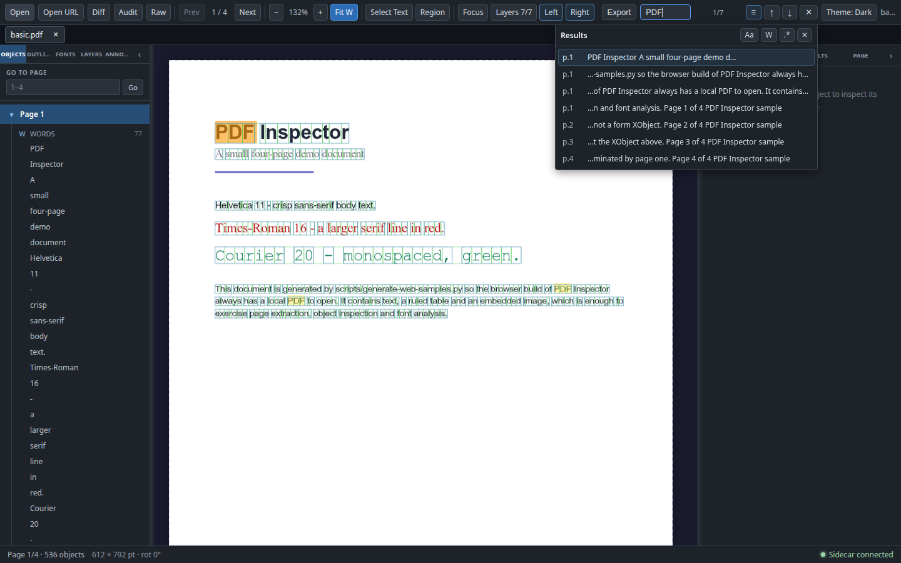 | **Search 2.0 results**<br>`Ctrl/Cmd+F` opens in-document search; `Aa` / `W` / `.*` toggle case, whole-word, and regex matching. The results panel lists `p.N` rows with context; click or use the keyboard to jump. Results are capped at 5,000 with an explicit truncation notice. |
| 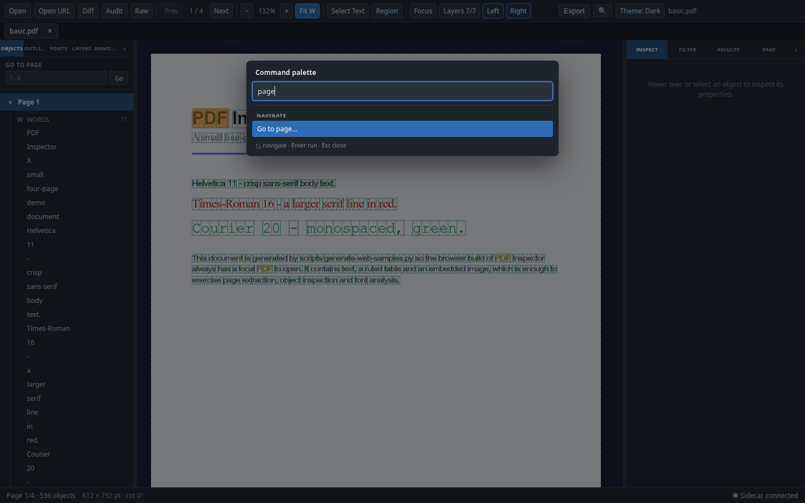 | **Command palette**<br>`Ctrl/Cmd+K` opens a grouped, filterable list of registered commands (File / Navigate / View / Analyze / Export). Document-dependent commands disable when unavailable, and the Go to page subview clamps input to `1..pageCount`. |
|  | **Desktop document tabs**<br>The desktop app keeps multiple document tabs and restores page, zoom, overlays, and panel tabs when switching. Web tabs activate a server-side `documentId` instead. |
|  | **Web document tabs**<br>Web and desktop both show the document tab bar. Switching activates by `documentId` and restores the view snapshot; inactive documents remain readable at `/doc/:id`, and closing a tab removes only that document's temporary copy. |
| 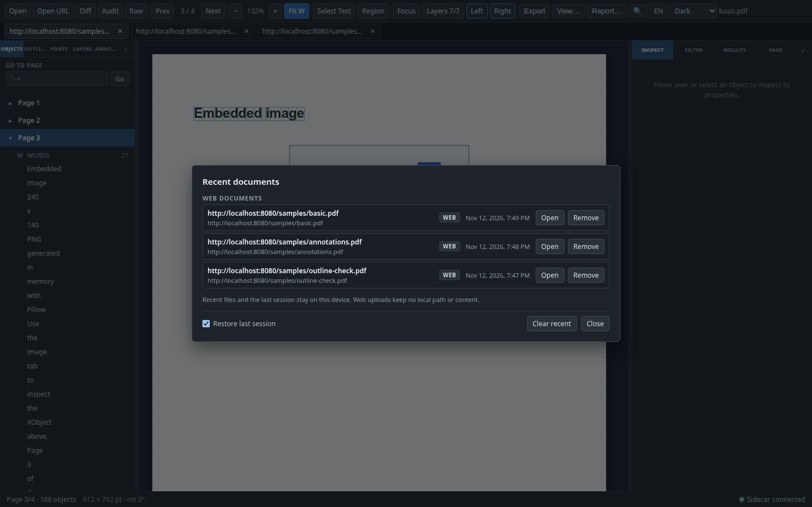 | **Session restore and recent documents**<br>The empty state reopens a recent document or restores the last session, and `File: Recent documents…` lists local, URL, and Web documents grouped by kind. Only locators and view snapshots are stored under `pdf-inspector:session:v1` / `pdf-inspector:recent:v1`; PDF content and analysis results never are. |

*Screenshots come from the Web build and a real Electron desktop build. Page list / Search 2.0 / command palette, annotation index/export, themes, export dialogs, Chinese UI, Diff/Audit/Raw, Audit Resources, Audit Structure, and session restore/recent documents are 1440×900. Desktop tabs were captured from Electron + `xvfb` through CDP at a 1440×900 viewport. See [docs/export.md](docs/export.md), [docs/themes-i18n.md](docs/themes-i18n.md), [docs/search.md](docs/search.md), [docs/large-docs.md](docs/large-docs.md), [docs/annotations.md](docs/annotations.md), and [docs/session.md](docs/session.md).*

## Features

### Rendering and inspection

- Multi-page PDF.js rendering with page navigation, zoom, and fit-to-width.
- Bounding-box overlays for seven object types: char, word, line, curve, rect, table, and image. The Layers tab controls visibility and opacity by type.
- Hover or click to select an object. The Inspector's `Inspect` tab shows page number, coordinates, font, size, color, and raw JSON; image objects include an inline preview.
- A text-selection layer lets you select text directly on the page.

### Navigation and structure

- The left panel has five tabs: `Objects` (all objects by page), `Outline` (PDF bookmarks), `Fonts` (font statistics), `Layers` (overlay controls), and `Annots` (annotations, links, and form fields for the current page or the whole document).
- The `Objects` tree groups all objects by page; page nodes can be collapsed and expanded.
- The `Outline` tab reads PDF bookmarks and jumps to a page when an entry is clicked.
- Current-page display, previous/next navigation, and a live zoom indicator.

### Workspace and layout

- Drag the splitters to resize the left and right panels, or collapse them. The toolbar Left/Right buttons and the in-panel collapse buttons stay synchronized.
- When a panel is collapsed, an `Objects` / `Inspector` restore rail appears on the canvas edge; Focus mode shows a `Show panels` button in the top-left corner.
- Press `F` or click Focus to hide both side panels and keep only the canvas. Press `F` again or click Focus to leave.
- The Inspector has four tabs: `Inspect / Filter / Results / Page` for object properties, combined filters, filtered or box-selected results, and page geometry.
- Panel widths, collapsed state, Focus mode, active tabs, and overlay opacity are stored in localStorage and restored on the next launch.

### Themes

- The toolbar has a native `Theme` select with four options: `Dark`, `Islands`, `Light`, and `System`. The selected label is the preference; the applied palette is written separately to `data-theme`.
- `Dark` is the default and keeps the compact, seamless panel look. `Islands` uses a near-black gradient canvas and turns the toolbar, document tab bar, side panels, canvas, Inspector, Diff / Audit / Raw workspaces, and status bar into floating cards with 1px borders, rounded corners, and soft shadows. `Light` uses white panels, light gray surfaces, and a blue accent for bright rooms.
- `System` is a mode, not a palette: it follows `prefers-color-scheme` and resolves to `Dark` or `Light`, updating live when the OS appearance changes. `data-theme-mode="system"` keeps the user's choice visible while `data-theme="dark|light|islands"` drives the CSS tokens.
- Themes are appearance-only: panel widths, splitter dragging, Focus mode, and layout dimensions at 1280 / 1440 / 1600 remain unchanged, with no horizontal overflow.
- The preference is persisted under `pdf-inspector:theme:v1` in localStorage and applied before the first frame. The old `dark` / `islands` values remain valid; if storage is unavailable (private mode, jsdom, etc.), it falls back to `Dark`.
- Structural colors live in CSS variables in `src/renderer/theme.css`; PDF page white, object-type colors, annotation-type colors, and page-box colors do not change with the theme.

### Language and i18n

- The toolbar language control shows `EN` or `中文`. English is the default; the choice is explicit and is not inferred from the browser language, so first runs and screenshots stay stable.
- The locale is persisted under `pdf-inspector:locale:v1`, mirrored to `<html lang="en|zh-CN">` and `data-locale`, and restored before the first render. A reload keeps the selected language.
- `Ctrl/Cmd+K` also exposes `Language: English` and `Language: 简体中文`, alongside the four theme commands. Toolbar, document tabs, panel tabs, status bar, dialogs, workspaces, empty states, and command palette strings are translated.
- Intentionally English: command identifiers and API names, JSON/CSV schema fields and PDF object identifiers, raw PDF syntax, sidecar/CLI error text, and the body prose of the generated HTML report. Those are data or protocol boundaries, not UI copy. See [docs/themes-i18n.md](docs/themes-i18n.md) for the architecture and how to add a key or theme.

### Search and export

- `Ctrl/Cmd+F` opens in-document full-text search. The `Aa` (case-sensitive), `W` (whole-word), and `.*` (regex) options re-run immediately; the results panel lists hits by page with context previews. Click a row or use the keyboard to jump and highlight.
- Input is debounced by 300ms, and the text index is built and cached in 10-page batches. Toggling options reuses the cached index instead of rebuilding it. Matches never span pages; invalid regex shows an inline error; zero-length matches are skipped.
- Results are capped at 5,000 hits and show `Showing first 5,000 matches` when truncated. Patterns are limited to 500 characters. In the search box, `Enter` / `Shift+Enter` jump to the next/previous hit; `Escape` closes the results panel first, then search.
- Export the current page or the whole document as JSON or CSV. Choose the element types to include (char / word / line / curve / rect / table / image) and edit the output file name. Desktop uses the native save dialog; Web triggers a browser download.
- CSV is grouped by object type for further analysis in spreadsheet tools.
- JSON export adds optional fields: `metadata.fontInfo` (embedding details), per-page `page.boxes` / `page.rotation`, table `table.cellBoxes` / `table.cellSpans`, and image `content_hash` (SHA-256 when available). CSV section schemas are unchanged.
- Annotations, links, and forms have a separate whole-document export: use `Export` in `Annots → Whole document` to write JSON or CSV without changing the object-export schema.

### Export view (PNG/SVG)

- The toolbar's `View…` button opens a dialog for the current page or the current region selection. The label is short to keep the toolbar on one line; its accessible name, tooltip and the command palette entry (`Export view…`) keep the full wording. The region option is enabled only when a region has been dragged.
- Choose PNG or SVG, `1x` / `2x` / `3x`, and any combination of `Objects` / `Annotations` / `Page boxes` overlays. The object type selector reuses the same seven types as the Layers tab, with Select all / Clear.
- The default file name is `<document>-p<N>.png|.svg` (or `-region` for a crop) and stays editable. Desktop uses the native save dialog; Web starts a browser download.
- PNG is written as binary: the renderer captures to an off-screen canvas, sends base64 over the save channel, and the desktop/browser adapter decodes it back to bytes. SVG is a self-contained document with the PNG as a raster `<image>` base plus vector overlay rectangles; it is not a vector re-render of the PDF content.
- Captures are independent of the current zoom. The requested scale is clamped to a longest side of 8192 px and 32 MP total; an empty region falls back to the full page with a warning. Rotated pages omit object/annotation overlays and report that limitation instead of drawing misaligned boxes.

### Share report (HTML)

- The toolbar's `Report…` button (command palette: `Share report…`) builds a single self-contained HTML file for the current page. As with `View…`, only the visible toolbar label is shortened; the accessible name and tooltip are still `Share report…`. The file name defaults to `<document>-report.html` and is editable.
- Sections: document summary, page snapshot, page composition (object counts and page boxes), fonts when font analysis is available, current-page annotations plus the document index/link/form issues when that index belongs to the open document, and audit findings when the report belongs to the current file. Missing analysis degrades to a note.
- The report is safe to attach to an email or ticket: inline CSS, one `data:image/png;base64` screenshot, no `<script>`, no external fonts/images/links, a restrictive CSP, and HTML-escaped document/annotation text.
- Limits: current page only, screenshot longest side targeted at 2400 px (capture scale 1–2), and a 20 MB report cap. The dialog is localized, but report section labels and prose are English.

### Command palette

- `Ctrl/Cmd+K` opens a command palette grouped by `File` / `Navigate` / `View` / `Analyze` / `Export`. It focuses the filter input on open; type a title or keyword (for example `page`) to filter. `↑/↓` moves, `Enter` runs, and `Escape` closes.
- Commands cover Open PDF, Open URL, Search document, Go to page, the four themes plus Cycle theme, Language: English / 简体中文, Focus mode, left/right panels, Layers, Diff, Audit, Raw, Export objects, Export view, Share report, Clear selection, and Close palette. `Go to page…` switches to a page-number subview that clamps input to `1..pageCount`.
- Commands are registered by the components that own the handler. The palette only calls existing handlers and stores, so there is no duplicated IPC, file-open, or export logic. Document-dependent commands are shown disabled when no document or workspace permits them.
- Registration is explicit: there are no user-defined commands, plugins, or shortcut editor. `Ctrl/Cmd+F` still opens search directly; `Ctrl/Cmd+K` only handles the command palette.

### Large documents and multiple documents

- **Dual-lane sidecar:** the interactive lane handles `open` / `extract_page` / `extract_metadata` / `get_image_data`; the background lane handles `analyze_fonts` / `audit_*` / `raw_*` / `diff_documents`. The shared `laneForMethod()` routing table keeps desktop and Web behavior aligned, so page navigation is not blocked by a running font, audit, Raw, or Diff request.
- **Lazy background lane:** the second Python process starts only on the first font/audit/Raw/Diff request. Both lanes open the same document; switching documents re-opens it asynchronously in the background, and a background failure only affects background features.
- **Batched search with progress:** search builds the current document's text index in 10-page batches and shows `Indexing 40/1000…` in the SearchBox. Clearing the query, closing search, switching documents, or leaving Inspect cancels the build; stale builds never publish results. The index stores text only, not PDF.js page objects.
- **Windowed page list and jump:** the 1000-page `Objects` list uses CSS `content-visibility` to lay out only rows near the viewport. Only the current page expands its object groups. Go to page accepts `1..pageCount`, clamps out-of-range values, ignores invalid input, and uses the same guarded navigation as Prev/Next.
- **Object display caps:** the current page shows at most 50 Words and 200 entries in each other object group. Beyond that, `Showing first N of M …` is displayed; selection still maps back to the full object.
- **Desktop document tabs:** opening multiple local files or URL documents adds tabs at the top of the workspace. Reopening the same path/URL focuses the existing tab. Switching saves the old tab's page, zoom, overlays, left/right panel tabs, and search query, then restores them after reopening; font, audit, and Raw results are not snapshotted and must run again. Closing the active tab activates its neighbor; closing the last tab returns to the empty state.
- **Desktop URL tabs:** a URL document is downloaded to a temporary copy owned by the current document. Switching deletes the previous copy, so re-activating a desktop URL tab downloads it again while keeping the same `sourceUrl` and tab identity. Web URL copies are retained by the registry (see below).
- **Web document tabs:** Web and desktop both show the document tab bar. Web documents are registered server-side by `documentId`; only the active document is open in the sidecar (both lanes open the same one). Switching activates the id, re-opens that file in the same sidecar, and restores the tab's page, zoom, overlays, panel tabs, and query. The registry holds at most 8 documents / 512 MiB total and evicts least-recently-active inactive documents. Closing a tab deletes only that document's temporary copy; closing the last tab clears the active document. Reopening the same `sourceUrl` deduplicates and reuses the retained download. The tab set and each tab's view snapshot are persisted locally and restored on the next launch (see Session restore and recent documents); this does not change the Web authentication boundary (there is none).
- **Cleanup and limits:** desktop and Web tabs store view snapshots only; they do not retain N PDF.js documents or analysis caches. Web has no per-document sidecar, so switching is a serialized re-open. The background lane has no idle shutdown in this phase, and cleanup after an abnormal exit is best-effort. See [docs/large-docs.md](docs/large-docs.md) for the full routing table, snapshot semantics, Web multi-document API, and verification record.

### Session restore and recent documents

- **Empty state:** with no document open, the canvas offers `Open PDF…`, `Open URL…`, `Recent documents…`, `Restore last session` (enabled when the saved session has tabs), the five most recent documents as quick buttons, and a one-line privacy note. It is not rendered while a document is open.
- **What is stored:** two localStorage records, `pdf-inspector:session:v1` (tabs, active index, saved time, restore preference) and `pdf-inspector:recent:v1` (recent list). Each tab is a locator (local path, source URL, or Web `documentId`) plus its view snapshot; the recent list keeps a display name, kind, locator, and last-opened time. PDF bytes, page objects, font/audit/Raw/Diff results, search indexes, and the current selection are never written. Caps are 20 tabs and 20 recent entries; identical documents are deduplicated by path/URL/registry id, over-long strings are truncated, and corrupt or unavailable storage falls back to memory without breaking startup.
- **Restore rules:** the desktop re-opens local paths with `openPdfPath` and URL documents with `openPdfUrl` (downloading again). Web restores a server registry id with `activatePdfDocument`; when the server no longer has that id, a URL document is re-downloaded from its `sourceUrl`, while an upload is skipped. Documents open serially in tab order, the saved active tab is re-activated, and one failure never blocks the rest; the status bar shows `Restoring n/m documents…`, then a dismissible `N documents could not be restored` notice (count only, no paths).
- **Automatic vs. manual:** startup restore is on by default and can be turned off with `Restore last session` in the recent-documents dialog; turning it off keeps the recent list and only skips the unattended open. The empty-state button and `File: Restore last session` always restore the saved session on request (still only into an empty canvas). Closing the last tab saves an empty session, so closed documents are not restored next time.
- **Recent documents dialog:** groups `Local files` / `URL documents` / `Web documents` (uploads belong to the Web group) with name, path/URL, kind, last-opened time, `Open`, and `Remove` per row. Opening a row uses the same opener as restore and lands at the default view (page 1, 100%); failures stay on their row. An upload from an earlier Web session that the server no longer has says the upload is no longer available and must be uploaded again. The footer has the restore toggle, a two-step `Clear recent`, and `Close`.
- **Commands:** `File: Recent documents…`, `File: Restore last session`, and `File: Clear recent documents` expose the same actions from `Ctrl/Cmd+K`.
- **Privacy:** local paths stay in the local browser/Electron localStorage; the Web server receives no local path, file content, or recent-file record for uploads (a Web upload's recent entry keeps only its display name and registry id). Restore failure notices contain no paths. See [docs/session.md](docs/session.md).

### Filtering and overlays

- The seven object-type toggles moved from the toolbar to the `Layers` tab: each row shows the current-page count and offers All / None, Solo, and an Opacity slider. The toolbar `Layers n/7` button opens this tab.
- Filtering remains in Inspector → `Filter`: combine font, size, color, and type criteria.
- Drag a region to box-select objects, using either intersect or contain matching.
- Filtered or box-selected results appear in Inspector → `Results`, are highlighted on the canvas, and can be exported as a subset.

### Font analysis

- Summarizes font usage across the document: page count, character count, size range, and colors.
- Each font shows an embedding badge: `Embedded` / `Standard 14` / `Not embedded` / `Unknown`, with subset status (`Subset`) and subtype (for example `Type1`).
- Expand a font row for embedding status, subtype, subset flag, Encoding, ToUnicode, and font-file type.
- The header counts missing and Standard 14 fonts separately (for example `8 fonts · 0 not embedded · 8 standard 14`); Standard 14 fonts are not treated as missing.
- Analysis runs sequentially in 10-page batches with live progress.
- Batching lets page extraction interleave with analysis, so the UI stays usable on long documents.
- Click a font row to jump to its first usage page and highlight matching objects through a filter.

### Table cells

- Selecting a table shows a cell grid aligned with `cells` in Inspector → `Inspect`. Merged-covered slots show `▨`; slots without geometry show `∅`.
- Hover a cell to preview it; click to select it and inspect row, column, span, text, BBox, and dimensions. The canvas overlay draws the table's cell grid and highlights the hovered or selected cell.
- Table text is still exported as the `cells` matrix; the CSV table section columns (`page, table_index, row, col, text`) are unchanged.

### Page geometry

- The Inspector's `Page` tab shows the current page size and `/Rotate` angle, with pt/mm switching.
- Lists raw MediaBox, CropBox, TrimBox, BleedBox, and ArtBox coordinates. Each box can be shown or hidden independently; the canvas overlays them with distinct colors and dash patterns.
- The canvas can show top and left rulers in pt or mm. The status bar shows page size, rotation, and the cursor position relative to the MediaBox origin, matching Inspector object coordinates.

### Annotations, links, and forms

- **Two scopes:** the top of `Annots` switches between `Current page` and `Whole document`. `Current page` is the default and keeps the page-level list, canvas boxes, and Inspector behavior. `Whole document` lists every annotation, link, and form field in the PDF.
- **Whole-document index:** the first switch to `Whole document` reads annotations through PDF.js in the renderer, in 10-page batches that yield between batches. The panel shows `Indexing annotations 40/120…` and a progress bar. Paging, zooming, and current-page Inspect remain usable during indexing. Switching back to `Current page` neither cancels nor discards a completed index; returning reuses it.
- **Summary, search, and filters:** document mode summarizes as `7 annotations · 1 page · 2 links · 3 form fields`. Search covers page number, subtype/kind, title and contents, link target, and form name/type/value/options. Kind and Subtype filters are global and combine with search.
- **Targeting and selection:** clicking a document-mode row jumps to the annotation's page and requests selection. Once the target page loads, the annotation is selected by id and the Inspector switches in. If the id is missing or does not match the current page data, only the page jump occurs.
- **Link health:** `unresolved` (neither a safe external URL nor a resolved internal page) and `unsafe` (`mailto:` / `file:` / `data:` / `javascript:` and other non-`http(s)` targets) count as `Issues`. Openable `http(s)` targets are listed in the collapsed-by-default `External links` section as information, not errors, and are never opened or probed automatically.
- **Form health:** unnamed widgets and duplicate field-name type conflicts are warnings; the same field name across pages is an info-level common form pattern rather than an error by default. Every link/form issue carries a page number and supports `Go to page`.
- **Export:** after indexing, `Export` opens a dialog for JSON or CSV with an editable file name. JSON contains `schemaVersion`, document information, summary, per-page annotations, link/form issues, and merged form fields. CSV has `# annotations` / `# links` / `# form_fields` sections, a BOM, and RFC 4180 escaping, and never writes local absolute paths.
- **Canvas boxes and selection:** links are blue, form fields purple, markup yellow, annotations orange, stamps cyan, and others gray. Hover brightens, selection uses a gold outline. Clicking an annotation selects it and switches to the Inspector; clicking an object clears annotation selection, so only one is highlighted. `Show boxes` applies to the current page only.
- **Inspector details:** `Inspect` shows subtype / kind / page / Rect, title and contents, modification time, color, and opacity. Links also show the target and `Open link` / `Go to page N`; form fields show name, type, value, default value, Flags, and options.
- **Internal and external links:** external links open only when the user explicitly clicks `Open link`, and only `http(s)` is allowed. PDF.js `unsafeUrl` is display-only; unsafe targets disable the button and show an http(s)-only message. The renderer, desktop main process, and Web adapter validate again; a failed open does not affect document state. Internal targets resolve to a page and use the same guarded navigation as Prev/Next.
- **Read-only forms:** field values, defaults, Flags, and options are rendered as text. There are no inputs, reset/submit buttons, or write-back paths; signature fields are shown as fields and marked unverified.
- **Hidden and popup annotations:** popup annotations are not listed separately (the parent annotation's content is shown); hidden annotations carry a `Hidden` marker but do not draw canvas boxes by default.
- **Read-only data source:** current-page and whole-document views are read-only, do not modify the PDF, and add no sidecar annotation RPC. Whole-document export serializes the existing index instead of re-parsing pages. See [docs/annotations.md](docs/annotations.md) for index batching, origin caching, JSON/CSV schemas, health-check semantics, and non-goals.

### Raw object tree and content streams

- **Raw workspace:** the toolbar `Raw` button opens a separate read-only workspace, mutually exclusive with Diff and Audit. Inspect stays mounted but hidden, preserving page, zoom, selection, and filters; `Back to Inspect` returns at any time. Raw does not add a sixth left-panel tab, so the left panel still has five tabs at its 200px minimum width.
- **Trailer roots:** the object tree starts from trailer `Root` (catalog), `Info`, `Encrypt`, `ID`, and the catalog `Pages` reference. Only these roots are read; no full graph traversal is performed.
- **Lazy references:** a reference such as `15 0 R` is itself a node and is read only when expanded or clicked. References do not recursively resolve automatically; cycles do not loop, and the tree is limited to 8 levels with a depth-limit notice.
- **Dictionaries, arrays, and streams:** the right-hand `Object` tab shows a summary and value tree for null / boolean / number / string / name / reference / array / dictionary / stream. Dictionaries and arrays expand; streams show length, filters, Subtype, and a bounded text preview, never binary bytes.
- **Content-stream operators:** the `Content stream` tab decodes page content and lists sequence number, offset, operator, and operands (`BT` / `Tf` / `Tj` / `Do` / `cm`, etc.). References in operands jump to the corresponding object; all text is rendered as plain text and operators are read, never executed.
- **Limits and truncation:** nesting is capped at 4 levels, 100 items per container, 4096 characters for strings and previews, 5000 operators per page, and 20 content streams per page. Over-limit data is marked `truncated` in the UI instead of being silently cut.
- **Read-only:** objects cannot be edited, streams rewritten, encryption removed, or content executed. There is no raw diff, export, or CLI. See [docs/raw.md](docs/raw.md) for serialization semantics, limits, and security boundaries.

### PDF Diff (2.0/3.0)

The current Diff combines the 2.0 page-alignment and visual-review workflow with the 3.0 long-run protections (page signatures, heartbeat/timeout recovery, change caps, and opt-in character-level comparison). Object-level results remain authoritative.

- **Object-level changes:** compare word / char / rect / line / curve / image / table objects page by page and report `added` / `removed` / `moved` / `modified`. Each change carries old/new page numbers, BBoxes, text, and details such as font, size, color, stroke/fill, content hash, and table cells.
- **Page-level changes:** detect added/deleted pages and page-size or `/Rotate` changes. These are shown as page-level notes rather than object boxes.
- **Table cells:** compare tables by cell text; `details.cellChanges` lists changed rows/columns with old/new text and reports row/column count changes.
- **Tolerances and ignores:** adjust position tolerance (pt, default 1.0) and text comparison (`exact` / `normalized` / `case-insensitive`, default `normalized`), and ignore fonts, colors, images, or selected object types. The setup dialog exposes position tolerance plus font/color/image ignores; text tolerance and `--ignore-types` are CLI options.
- **Comparison workspace:** a top summary (page counts, page changes, object counts) and left-hand per-page change list with Kind / Type filters. The center shows Side by side, Overlay, or Visual views sharing page and zoom; the right side shows old/new text, BBoxes, and field differences for the selected change.
- **Collapsible page groups and Go to page:** each page is an independent collapsible group. Headers show `Old page N`, `Old N → New M`, or `New page N`, plus status and change count. The current or first changed page opens by default; Prev/Next, `Go to page`, or jumping from change details automatically expands the target group. `Go to page` accepts `1..totalPages`, ignores empty/decimal/non-numeric input, clamps out-of-range values, and shows `N of M`. `Expand all` / `Collapse all` control the list; filtering never merges pages.
- **Page signatures and fast path:** each page is fingerprinted from normalized page boxes, rotation, decoded content-stream bytes, and a bounded resource digest. Pairing uses a separate alignment key. If paired signatures match, the page is emitted as `unchanged` without pdfplumber layout or object extraction. Byte-identical files only scan page geometry; one-sided pages are extracted normally. `match.score` is 1.0 for identical signatures, 0.7 for paired-but-changed pages, and `match` is null for one-sided pages.
- **Visual and ignore regions:** `Visual` renders old/new pages into one bitmap with `Blend`, `Heatmap`, or `Boxes` and reports `changed / total px`. Ignore regions are media-box-coordinate rectangles created by dragging on Side by side or Overlay, applied with `Apply & re-run`, and also accepted by CLI/action as JSON. Visual comparison runs only in the browser UI; CLI/JSON/HTML remain object-level and render-free.
- **50,000-change cap:** a run keeps at most `MAX_DIFF_CHANGES = 50_000` changes. Beyond that, results carry `truncated: true` and `summary.changesTruncated: true`; page status remains complete.
- **Heartbeat and timeout recovery:** `diff_documents` reports progress per page and side. While a diff runs, the sidecar emits a 5-second heartbeat so a slow page does not look idle. The budget is 300s of **no progress** (not a total-time cap), renewed by progress or heartbeat. A timeout means the Python process may still be computing: desktop and Web restart only the background lane, then return the original timeout error (Web 504); restart failure is logged without masking the original error.
- **Character-level changes are opt-in in the UI:** the engine and CLI compare all types by default; the UI starts with `"char"` in `ignoreTypes` so it reports word-level changes. The `Character-level changes` checkbox enables character-level diffs; large text PDFs can otherwise produce huge change lists, which is why the 50k cap and truncation flag also exist.
- **Overlay colors:** overlay mode uses the page's owning document as the base (old pages for existing pages, new pages for added pages) and draws old/new object boxes: removed red, added green, moved orange, modified blue.
- **Export JSON:** export the current result as `DiffResult` JSON (`schemaVersion: 1`).
- **Does not disturb Inspect:** Diff runs on separate old/new files; the Inspect document, page, zoom, and selection remain unchanged. `Back to Inspect` returns to the original document.

#### Page alignment, reordering, and visual review

- **Page alignment and reordering:** pages are paired by content fingerprints (page size, rotation, text hash, object counts, table text). Each `DiffPage` gains `match: { score, reordered }`, and the summary gains `pagesReordered`. `reordered` means a paired page moved to a different page number (`oldIndex != newIndex`), not that objects changed order. Inserted/deleted pages remain one-sided (`match: null`). The page list and page bar show old/new numbers such as `Old 2 → New 1`.
- **Visual comparison:** `Visual` uses the new page as the base, overlays the old page semi-transparently (`Blend`), or computes a per-pixel heatmap (`Heatmap`); `Boxes` shows object boxes only. The page bar reports `changed / total px (percentage)`. Pixel comparison runs in a browser canvas with a fixed channel-difference threshold of 24 and a bounded bitmap; results are not written to CLI/JSON.
- **Ignore regions:** turn on `Ignore region`, drag on Side by side or Overlay, and regions are recorded per page in MediaBox coordinates (`DiffIgnoreRegion`: `oldPage` / `newPage` / `bbox`). Dashed outlines and the left-hand region list update together. `Apply & re-run` explicitly reruns the diff; changes intersecting a region disappear from JSON/UI/HTML, and `Remove` followed by a rerun restores them. Regions are read-only and never modify the PDF.
- **Ignore-region CLI/action:** `--ignore-regions PATH` reads the same camelCase JSON array as the UI; the action exposes the same `ignore-regions` input.
- **Reordering gate:** `--fail-on reordered` returns 1 when `pagesReordered > 0`, so page-order changes can be a separate CI gate. Existing `added` / `removed` / `modified` / `page-count` / `none` semantics are unchanged.
- **Sample files:** `web-samples/diff-visual-old.pdf` / `diff-visual-new.pdf` (small text, color, and position changes on page 1) and `web-samples/diff-reordered-old.pdf` / `diff-reordered.pdf` (a removed draft cover, an appended release note, and four reordered paired pages) are generated deterministically by `scripts/generate-web-samples.py`.
- **Details:** see [docs/diff.md](docs/diff.md) for page-alignment semantics, Visual mode, region JSON, CLI/action examples, and thresholds.

#### Object-level results remain authoritative

- Changes, filters, JSON export, CLI, and actions are based on extracted objects and their metadata. Visual mode is an additional UI view; it does not replace object-level results or perform OCR.

### Document audit

- **Whole-document checks:** deterministic checks across fonts, pages, images, metadata, structure, and security, including unembedded fonts, missing ToUnicode, mixed page sizes, rotated pages, page boxes outside their bounds, low-resolution images, image-only pages, scanned pages, empty pages, missing metadata, encryption, and untagged PDFs.
- **Severities:** findings are `error` / `warning` / `info`; there is no health score. Page extraction failure is the current `error` source. Unembedded fonts are warnings, and Standard 14 fonts are not treated as missing.
- **Batched progress:** after document-level checks, page checks run sequentially in 10-page batches with `Auditing pages N/M…`; the UI stays usable between batches.
- **Dedicated workspace:** the toolbar `Audit` button opens the audit workspace (mutually exclusive with Diff). The header shows the file and `Run` / `Re-run`; the left side summarizes by severity and supports severity/category filters; the middle lists findings; the right shows the selected finding's explanation, evidence, and recommendation.
- **Jump to page:** findings with a page number offer `Open page`, which closes Audit and navigates Inspect to that page. The Inspect document, page, zoom, and selection remain unchanged, and `Back to Inspect` returns at any time.
- **JSON export:** `Export JSON` writes the full `AuditReport` (`schemaVersion: 1`) with tool, document, summary, and findings. CLI `audit --format json` uses the same schema.
- **Reports and integration:** CLI supports `summary` / `json` / `html`. HTML is a single file with inline CSS and no scripts. `audit/action.yml` runs the audit in CI and uses `fail-on` to decide the step result. See [docs/audit.md](docs/audit.md).
- **Heuristic checks:** audit uses extracted objects, font information, page boxes, and catalog metadata. It does not certify PDF/A, verify signatures, or perform OCR. Findings on rotated or CropBox-offset pages are page-level only.

### Document security and attachments

- **Audit `Resources` view:** the Audit workspace switches between `Findings` and `Resources` with a segmented control. `Audit → Resources` shows summary cards for attachments, JavaScript, actions, signatures, encryption, and XFA, followed by an attachment table (name, description, size, MIME, modification date, SHA-256, risk), inert JavaScript previews, action and signature tables, and encryption/permissions with `Allowed` / `Denied` / `Unknown` badges. `Refresh` re-reads the document, `Export security JSON` writes the full `SecurityReport` (suggested `<name>.security.json`), and `View in Findings` jumps back with the category filter set to `security`. The report is cached per file; switching files or Audit `Re-run` drops it.
- **Read-only inventory:** embedded attachments (metadata only), JavaScript sources as bounded previews, Launch/URI/SubmitForm/ImportData actions, XFA forms, signature fields, and encryption/permissions — without executing scripts, following actions, opening or downloading attachments, decrypting streams, or verifying signatures. Attachments cannot be opened or downloaded, and no attachment bytes are exported.
- **Findings and severities:** the same inventory feeds `security` category findings into the audit engine. JavaScript (especially OpenAction/`/AA`), Launch/SubmitForm/ImportData, XFA, encryption, and risky attachment names are warnings; embedded files and signature fields are info. Signature fields are always reported as present (`verified: false`) and are never cryptographically verified.
- **Engine and CLI:** the same engine backs `pdf-inspector security` with summary, deterministic JSON, and single-file HTML output. See [docs/security.md](docs/security.md) and the [Security CLI](#security-cli) section below.
- **Bounded and heuristic:** name trees, actions, script previews, and attachment hashing are capped; malformed objects degrade to `null` or are skipped instead of failing the report.

### Accessibility and structure

- **Audit `Structure` view:** the Audit header switches between `Findings` / `Structure` / `Resources`. `Structure` reads the tagged structure tree and shows summary cards (Elements, Figures, Tables, Lists, Headings, Findings) plus document facts (Tagged, StructTreeRoot, ParentTree, Language, Title). The tree expands the root and first level by default, with `Expand all` / `Collapse all`, `Issues only`, and a search across role, raw role, title, Alt, and ActualText. Selecting a node shows role, Alt/ActualText/Lang, page, MCID or object number, bounded attributes, and its findings; `Open page` jumps to that page in Inspect and `View in Findings` switches back with the `structure` category filter. The report is cached per file; `Refresh` re-reads it, `Export accessibility JSON` writes the full `AccessibilityReport` (suggested `<name>.accessibility.json`), and switching files or Audit `Re-run` drops the cache.
- **What is read:** catalog `/StructTreeRoot`, `/MarkInfo`, `/Lang`, `/RoleMap`, `/ParentTree`, page `/StructParents`, and `/K` entries as nested `StructElem`, `MCID`, `/MCR`, or `/OBJR`. Roles, reading order (depth-first `/K` order), page numbers, MCIDs, object numbers, and bounded attributes come from the structure tree; no page content stream, text extraction, or bbox is used.
- **Heuristic findings:** the same structure feeds `structure` findings for untagged PDFs, a missing `/ParentTree`, pages without `/StructParents`, missing/unknown/cyclic roles, `Figure`/`Formula` without Alt, `Link` without a description, skipped heading levels, lists without `LI`, list items without `LBody`, tables without `TR`, header cells without `Scope`, and truncated or skipped parses. These are heuristics, not PDF/UA or WCAG conformance, and the view never highlights an element on the page (page-level location only).
- **CLI:** `pdf-inspector accessibility` writes a summary, deterministic `AccessibilityReport` JSON, or single-file HTML:

  ```bash
  pdf-inspector accessibility report.pdf
  pdf-inspector accessibility report.pdf --format json --output report.accessibility.json
  pdf-inspector accessibility report.pdf --format html --output report.accessibility.html
  pdf-inspector accessibility report.pdf --fail-on warning
  ```

  `--format summary|json|html` (default `summary`), `--output PATH`, `--fail-on error|warning|none` (default `none`), and `--quiet`; exit codes are `0` (no threshold matched), `1` (`--fail-on` matched), and `2` (argument, input, read, or report error). See [docs/accessibility.md](docs/accessibility.md).
- **Samples:** `web-samples/accessibility-valid.pdf` (Document → H1 → P → Figure with Alt → Table with rows and header scope) and `web-samples/accessibility-broken.pdf` (Figure without Alt, H1 → H3, list without `LI`, table without `TR`, no ParentTree) are committed; regenerate them with `python scripts/generate-accessibility-samples.py`. CI's `accessibility-cli` job regenerates both, checks the JSON/HTML output, and asserts `--fail-on warning` returns 1.
- **Read-only:** no tag is edited, created, or deleted; no content stream is executed; no OCR is performed; and the tool never certifies PDF/UA or PDF/A compliance.

### Opening documents

- Open a local PDF, or open a remote document through an `http(s)` URL (downloaded to a temporary directory before parsing).
- Desktop and Web have the same capabilities; only the underlying transport differs.

### Desktop and Web

- **Desktop:** the Electron main process owns the window, native menus/dialogs, and the Python sidecar lifecycle.
- **Web:** the React UI runs in a browser, backed by an Electron-free Node HTTP server that provides the same document and sidecar capabilities.
- **Multiple documents:** both desktop and Web support document tabs. Desktop tabs reopen a document by local path or URL; Web tabs activate a registered document by its server-side `documentId`. Both store only view snapshots, not a second PDF.js document or analysis cache. The tab set and each tab's view snapshot are persisted locally and restored on the next launch (see Session restore and recent documents).

### Keyboard shortcuts

| Shortcut | Action |
|----------|--------|
| `T` | Toggle text-selection mode |
| `R` | Toggle region-selection mode (mutually exclusive with text selection) |
| `F` | Toggle Focus mode (hide both side panels) |
| `Ctrl/Cmd+F` | Open and focus in-document search |
| `Enter` / `Shift+Enter` | In the search box, jump to the next / previous hit |
| `↑` / `↓` | Move the current item in the search-results panel or command palette |
| `Ctrl/Cmd+K` | Open the command palette; when open, focus its filter or return to the command list |
| `Ctrl/Cmd+wheel` | Zoom the document; scroll up to zoom in and down to zoom out (trackpad pinch works too) |
| `Esc` | Close the results panel or command palette; in the search box, close search next; with no overlay, clear selection, filters, and box-selection results |

## Quick start

### Requirements

- **Node.js ≥ 22.12** (see `.nvmrc`; jsdom needs `require(esm)` support)
- **Python 3.10+**
- Python packages: `pdfplumber`, `Pillow` (see `sidecar/requirements.txt`); tests also need `pytest` and `reportlab`

### Install

```bash
npm ci

python3 -m venv .venv
.venv/bin/pip install -r sidecar/requirements.txt

# For Python tests
.venv/bin/pip install pytest reportlab
```

On Windows, use `.venv\Scripts\pip` instead of `.venv/bin/pip`, and `.venv\Scripts\python` for the interpreter.

### Desktop

```bash
npm run dev      # Vite dev server + Electron (HMR)
npm start        # Build the main process and start Electron
```

Desktop mode needs an Electron binary, which `npm install` / `npm ci` downloads by default. If `ELECTRON_SKIP_BINARY_DOWNLOAD=1` is set (for example, in CI that only runs tests), the desktop app cannot launch.

### Web

```bash
npm run web        # Build the Web frontend and HTTP backend, then start the server
npm run web:start  # Start the already-built dist-web-server/server.mjs
```

It listens on <http://localhost:8080> by default. Environment variables:

| Variable | Default | Description |
|----------|---------|-------------|
| `HOST` | `0.0.0.0` | Listen address; use `127.0.0.1` for local-only access |
| `PORT` | `8080` | Listen port |
| `PDF_INSPECTOR_PYTHON` | Prefer the interpreter in `.venv`, otherwise `python3` | Interpreter used to launch the Python sidecar |

Generate sample PDFs:

```bash
python scripts/generate-web-samples.py
```

Then open `/samples/basic.pdf` (small sample with a table and an image), `/samples/large.pdf` (multi-page document for batched font analysis), `/samples/huge.pdf` (1000-page text sample for the page list, Go to page, and search-index progress), `/samples/annotations.pdf` (two-page sample with external/internal links, text annotations, highlights, and form fields for `Annots`), or `/samples/raw.pdf` (two-page sample with named font resources, an image XObject, and `BT`/`Tf`/`Tj`/`Do` operators for the `Raw` workspace).

Diff samples are generated in old/new pairs and can be selected in the comparison dialog:

| Sample | Purpose |
|--------|---------|
| `web-samples/diff-visual-old.pdf` → `web-samples/diff-visual-new.pdf` | Two pages; page 1 has small status-badge color/text, block color/position, and body-number changes; page 2 is identical. Use for `Visual` Blend/Heatmap and pixel statistics. |
| `web-samples/diff-reordered-old.pdf` → `web-samples/diff-reordered.pdf` | Five pages; revision B removes the draft cover, appends release notes, and shifts the header rule, producing 4 reordered pairs, 1 removed page, and 1 added page. Use for page alignment and `--fail-on reordered`. |

> **Security note:** the Web server has no authentication. Anyone who can reach the port can upload/download documents and call parsing endpoints. It binds to `0.0.0.0` by default; use it only on trusted networks, and prefer `HOST=127.0.0.1 npm run web` locally.

## Usage

1. **Open a document:** click Open to choose a local PDF, or Open URL to enter an `http(s)` address.
2. **Browse structure:** expand/collapse page nodes in `Objects`, or jump by bookmark in `Outline`. Prev/Next in the toolbar also changes pages.
3. **Inspect objects:** hover the canvas for outlines; click to see coordinates, font, color, and raw data in the Inspector's `Inspect` tab. A selected table shows its cell grid; hover to preview and click to inspect span and BBox.
4. **Filter objects:** use Inspector → `Filter` to combine font/size/color/type criteria, or press `R` and drag a region, then choose intersect or contain matching in `Results`.
5. **Analyze fonts:** open the `Fonts` tab to start analysis, watch progress and embedding badges, expand rows for Encoding/ToUnicode, and click a font to jump to its first usage page and highlight it.
6. **Inspect page geometry:** use Inspector → `Page` for page size, rotation, and the five page boxes; switch pt/mm, toggle box overlays, and enable canvas rulers.
7. **Control overlays:** use `Layers` to toggle the seven object types, see current-page counts, use Solo, and adjust opacity. Press `F` for Focus mode.
8. **Search and export:** `Ctrl/Cmd+F` opens search; use `Aa` / `W` / `.*` for case, whole-word, and regex; browse `p.N` rows with context and click to jump. `Ctrl/Cmd+K` opens the command palette for open, jump, theme, language, panel, Diff/Audit/Raw, export, and clear commands. `Export` writes current-page or whole-document JSON/CSV; the toolbar's `View…` (`Export view…` in the command palette) writes the current page or selected region as PNG/SVG; `Report…` (`Share report…` in the palette) writes a self-contained HTML inspection report.
9. **Compare revisions:** click `Diff`, choose Old/New PDFs, adjust position tolerance and ignores, then Compare. Select changes in the left list or switch Side by side / Overlay / Visual (Visual supports Blend/Heatmap/Boxes and pixel stats). `Ignore region` lets you mask a region, then `Apply & re-run`; `Export JSON` saves the result.
10. **Audit a document:** click `Audit` to run whole-document checks, review the severity summary, filter by severity/category, inspect evidence and recommendations, use `Open page` when available, or `Export JSON` for the full report. Switch to `Resources` for attachments, JavaScript, actions, signatures, encryption, and permissions; use `Refresh` to re-read, `Export security JSON` for the full `SecurityReport`, or `View in Findings` to jump back with the `security` category filter.
11. **Review accessibility and structure:** with Audit open, switch to `Structure` to read the tagged structure tree and document facts. Use `Expand all` / `Collapse all`, `Issues only`, or search by role/Alt text; select a node for role, Alt/ActualText, page, and MCID details, then `Open page` to jump to the page or `View in Findings` for the `structure` findings. `Refresh` reparses the document, and `Export accessibility JSON` saves the full report.
12. **Inspect annotations, links, and forms:** open `Annots` (default `Current page`), switch to `Whole document` to build the index (`Indexing annotations N/M…`), use search and global Kind/Subtype filters, and click rows to jump and select when possible. `Issues` summarizes broken links and form issues; `External links` lists openable `http(s)` targets. `Export` writes the index as JSON/CSV. External links require `Open link`; internal links use `Go to page N`; form fields are read-only.
13. **Inspect raw objects and content streams:** click `Raw` to open the read-only workspace. Expand `Catalog` → `Pages` → a page → `Resources` in the tree, and click references to inspect values on the right. Switch to `Content stream` for decoded operators and operands. `Back to Inspect` returns with page and zoom unchanged.
14. **Handle large and multiple documents:** open `/samples/huge.pdf`, use Go to page (out-of-range values clamp), and keep only the current page expanded. `Ctrl/Cmd+F` shows `Indexing N/1000…`; closing search cancels the build. Both desktop and Web can open more files or URL documents and switch through the top tab bar. Web tabs activate by server `documentId` and restore their view snapshot; closing a tab removes only that document's temporary copy.
15. **Return to a previous document:** with no document open, the empty state lists the five most recent documents and offers `Recent documents…`, which opens the grouped dialog (`Open` / `Remove`, a two-step `Clear recent`, and the automatic `Restore last session` toggle), plus `Restore last session`, which reopens the saved session immediately even when automatic restore is off. `File: Recent documents…`, `File: Restore last session`, and `File: Clear recent documents` do the same from `Ctrl/Cmd+K`. Recent files and view snapshots stay in local `localStorage`; PDF content and analysis results are never stored. See [docs/session.md](docs/session.md).

## CLI and CI

Diff can run outside the UI. The CLI accepts local PDF paths only (rejecting `http(s)` URLs), writes summary, JSON, or self-contained HTML, and maps `--fail-on` to an exit code.

```bash
# Direct Python CLI; requires Python 3.10+ and sidecar/requirements.txt
python sidecar/cli.py diff old.pdf new.pdf

# Through the bin/pdf-inspector.mjs wrapper (install/link it to call pdf-inspector)
pdf-inspector diff old.pdf new.pdf
npm run diff -- old.pdf new.pdf

# Gate page-order changes: returns 1 when reordered pairs exist
python sidecar/cli.py diff old.pdf new.pdf --fail-on reordered

# Mask intersecting changes with a JSON region file (same regions as the UI)
python sidecar/cli.py diff old.pdf new.pdf --ignore-regions regions.json --format json --output diff.json
```

Common options:

| Option | Description |
|--------|-------------|
| `--format` | Output format: `summary` (default) / `json` / `html` |
| `--output PATH` | Write the formatted result to a file as well; stdout still prints the summary |
| `--fail-on` | Choose which differences return 1; default `any`; values `added` / `removed` / `modified` / `page-count` / `reordered` / `none` |
| `--position-tolerance PT` | Position tolerance in PDF pt; default `1.0` |
| `--text-tolerance` | Text comparison: `exact` / `normalized` (default) / `case-insensitive` |
| `--ignore-types TYPES` | Skip object types, comma-separated and repeatable |
| `--ignore-fonts` / `--ignore-colors` / `--ignore-images` | Ignore font/color/image differences |
| `--ignore-regions PATH` | JSON array masking intersecting changes by page and MediaBox coordinates (same `DiffIgnoreRegion` as the UI) |
| `--quiet` | Suppress the human summary and keep only JSON/HTML output |

Exit codes: `0` means no differences, or all differences were excluded by `--fail-on`/ignore options; `1` means the `--fail-on` condition matched; `2` means an argument, input, parse, or output error. `--fail-on none` never returns 1, but input errors still return 2. `added` / `removed` cover both objects and pages, `modified` covers modified/moved plus page size/rotation changes, `page-count` covers page additions/deletions, page counts, and page geometry changes, and `reordered` covers paired pages that changed page number (`pagesReordered > 0`).

`--format json` emits a standalone `DiffResult` (`schemaVersion: 1`), not the same schema as the Inspector object export. It contains `tool` / `options` / `old` / `new` / `summary` / `pages`; each change has kind, type, old/new page and BBox, text, and `details`. Output has no timestamps or absolute paths and is stable, so identical inputs and options produce byte-identical JSON suitable for commits, diffs, or caches.

### Audit CLI

Document audit also runs outside the UI and reuses the same check engine. The CLI accepts local PDF paths only (rejecting `http(s)` URLs), writes a summary, `AuditReport` JSON, or single-file HTML, and maps `--fail-on` to an exit code.

```bash
# Direct Python CLI; requires Python 3.10+ and sidecar/requirements.txt
python sidecar/cli.py audit report.pdf
python sidecar/cli.py audit report.pdf --format json --output report.audit.json
python sidecar/cli.py audit report.pdf --format html --output report.audit.html

# Return 1 when warnings/errors are found, for a quality gate
python sidecar/cli.py audit report.pdf --fail-on warning

# Through the bin/pdf-inspector.mjs wrapper (install/link it to call pdf-inspector)
pdf-inspector audit report.pdf
node bin/pdf-inspector.mjs audit report.pdf --format json --output report.audit.json
```

Common options:

| Option | Description |
|--------|-------------|
| `--format` | Output format: `summary` (default) / `json` / `html` |
| `--output PATH` | Write the formatted result to a file as well; stdout still prints the summary |
| `--fail-on` | Choose which findings return 1; default `none`; values `error` / `warning` / `none`. `warning` includes errors; `error` includes only errors |
| `--quiet` | Suppress the human summary and keep only JSON/HTML output |

Exit codes: `0` means no finding reached `--fail-on`; `1` means it matched; `2` means an argument, input, read, or audit error. `--fail-on none` never returns 1, but input errors still return 2. Page extraction failure is the only current `error` source, so `--fail-on error` only blocks truly unreadable pages.

`--format json` emits `AuditReport` (`schemaVersion: 1`) with `tool` / `document` / `summary` / `findings`; each finding has category, severity, page (`null` for document-level), title, description, evidence, and recommendation. Output has no timestamps or absolute paths and is stable, so the same PDF produces byte-identical JSON. HTML reports are single-file with inline CSS, no scripts, no external resources, and all PDF text escaped. See [docs/audit.md](docs/audit.md) for the full schema, checks, and thresholds.

### Security CLI

`security` inspects one local PDF and reuses the same engine that produces the audit `security` findings. It never executes JavaScript, follows actions, opens attachments, or verifies signatures.

```bash
# Direct Python CLI; requires Python 3.10+ and sidecar/requirements.txt
python sidecar/cli.py security report.pdf
python sidecar/cli.py security report.pdf --format json --output report.security.json
python sidecar/cli.py security report.pdf --format html --output report.security.html

# Return 1 when warnings/errors are found, for a distribution gate
python sidecar/cli.py security report.pdf --fail-on warning

# Through the bin/pdf-inspector.mjs wrapper (install/link it to call pdf-inspector)
pdf-inspector security report.pdf
node bin/pdf-inspector.mjs security report.pdf --format json --output report.security.json
```

Options are the same as `audit`: `--format summary|json|html` (default `summary`), `--output PATH`, `--fail-on error|warning|none` (default `none`; `warning` includes errors), and `--quiet`. Exit codes are `0` (no threshold matched), `1` (`--fail-on` matched), and `2` (argument, input, read, or report error). `http(s)` URLs, directories, and non-PDF inputs are rejected before the engine runs; `--output` cannot overwrite the input PDF.

`--format json` emits `SecurityReport` (`schemaVersion: 1`) with `tool` / `document` / `attachments` / `javascript` / `actions` / `signatures` / `encryption` / `findings` / `summary`. The JSON has no timestamps or absolute paths and is byte-identical for the same PDF. HTML is a single file with inline CSS, no scripts, no external resources, and all PDF text escaped. The summary shows document facts, resource counts, severity counts, and at most 20 findings ordered severity-first.

A deterministic sample is committed at `web-samples/security-sample.pdf` and can be regenerated with `python scripts/generate-security-sample.py`. See [docs/security.md](docs/security.md) for every check, the resource limits, permission bits, and the full schema.

### Diff GitHub Action

The repository provides a composite action ([`action.yml`](action.yml)) that installs Python and sidecar dependencies on the runner and then runs diff:

```yaml
- uses: actions/checkout@v4
  with:
    fetch-depth: 0
- run: git show origin/${{ github.base_ref }}:docs/report.pdf > baseline.pdf
- uses: <owner>/pdf-inspector@v1
  with:
    old: baseline.pdf
    new: docs/report.pdf
    fail-on: any
    format: json
    json-path: artifacts/pdf-diff.json
```

To gate only page order while masking known regions:

```yaml
- uses: <owner>/pdf-inspector@v1
  with:
    old: baseline.pdf
    new: docs/report.pdf
    fail-on: reordered          # Fail only when paired pages changed page number
    ignore-regions: ignore-regions.json
```

The action defaults to `fail-on: any` and supports `summary` / `json` / `html`. `json-path` / `report-path` set the JSON/HTML payload path (when the corresponding format is selected and no path is given, the payload goes to the runner temp directory); payloads are not written to the step log. `fail-on` accepts `any` / `added` / `removed` / `modified` / `page-count` / `reordered` / `none`; `ignore-regions` accepts the same region JSON path as the CLI. See [docs/ci.md](docs/ci.md) for full inputs, outputs, and artifact conventions, and [docs/diff.md](docs/diff.md) for Diff 2.0 page alignment, Visual mode, and region semantics.

The HTML report is a single file with inline CSS, no scripts, and no external resources:


> Diff CLI and action require Python 3.10+ and the dependencies in `sidecar/requirements.txt`, and accept local paths only. The packaged desktop app does not include the CLI.

### Audit GitHub Action

The repository also provides an audit composite action ([`audit/action.yml`](audit/action.yml)), which installs Python and sidecar dependencies on the runner and runs `audit`:

```yaml
- uses: actions/checkout@v4
- uses: <owner>/pdf-inspector/audit@v1
  with:
    path: docs/report.pdf
    fail-on: error
    format: html
    report-path: artifacts/pdf-audit.html
    # Add a JSON artifact too; this runs the CLI one extra time
    # json-path: artifacts/pdf-audit.json
```

The action defaults to `fail-on: error` and `format: summary`, and supports `summary` / `json` / `html`. `json-path` / `report-path` set the JSON/HTML payload path (when the selected format has no path, it goes to the runner temp directory); payloads are not written to the step log. Outputs are `exit-code` / `json-path` / `report-path`, and the exit code, `fail-on`, and artifact paths are written to the step summary. A non-zero exit code is written to outputs before the step fails, so later steps can still read the result. The repository uses `uses: ./audit`; see [docs/audit.md](docs/audit.md) for inputs, outputs, and examples.

## Architecture

The same React renderer talks to the sidecar through Electron IPC on desktop and through a Node HTTP backend on Web. Both sides ultimately drive the Python sidecar over line-delimited JSON-RPC on stdio.

```
Desktop
┌──────────────────────────────────────────────┐
│ Electron main                                │
│ window / native dialogs / Python lifecycle   │
└───────────┬──────────────────────────┬───────┘
            │ IPC (contextBridge)      │ spawn
            ▼                          ▼
┌───────────────────────┐   ┌───────────────────────┐
│ Renderer (React)      │   │ Python sidecar        │
│ PDF.js / overlays / UI│   │ pdfplumber / cache    │
└───────────────────────┘   └───────────────────────┘

Web
┌──────────────────────────────────────────────┐
│ Browser (React + PDF.js)                     │
│ `window.pdfInspector` provided by src/web    │
└───────────┬──────────────────────────────────┘
            │ HTTP: /api/*, /doc/*, /samples/*
            ▼
┌──────────────────────────────────────────────┐
│ Node HTTP server (server/web-server.ts)      │
│ uploads/downloads, document registry, assets │
└───────────┬──────────────────────────────────┘
            │ spawn + JSON-RPC over stdio
            ▼
      Python sidecar (same as above)
```

The Python sidecar uses line-delimited JSON-RPC over stdin/stdout and provides `open`, `extract_page`, `extract_metadata`, `analyze_fonts`, `get_image_data`, `raw_document`, `raw_object`, `raw_page_content`, `audit_document`, `audit_pages`, `shutdown`, and related methods. An LRU cache reuses parsed pages.

Desktop and the Web backend both use `SidecarPool` to route requests to interactive and background lanes. The interactive lane opens documents and extracts the current page; the background lane starts lazily and handles fonts, audit, Raw, and Diff. Both lanes open the same document, and switching documents re-opens it rather than retaining N parsed documents. See [docs/large-docs.md](docs/large-docs.md).

## Tech stack

| Layer | Technology |
|-------|------------|
| Desktop container | Electron 28 |
| Web backend | Node.js built-in `http` (no extra runtime dependency) |
| Frontend | React 18 + TypeScript + Vite + Zustand + CSS Modules |
| PDF rendering | pdfjs-dist 4.x |
| Extraction engine | Python 3 + pdfplumber (JSON-RPC over stdio subprocess) |
| Frontend tests | Vitest + Testing Library + jsdom |
| Python tests | pytest + reportlab (generates test PDFs) |

## Project structure

```
pdf-inspector/
├── src/
│   ├── main/              # Electron main: window, IPC, URL downloads, sidecar lifecycle
│   ├── preload/           # contextBridge → window.pdfInspector
│   ├── renderer/          # React UI, PDF.js rendering, overlays, hooks, stores, services
│   ├── shared/            # Constants and helpers shared by main and renderer
│   └── web/               # Browser entry and HTTP IPC adapter
├── server/
│   └── web-server.ts      # Electron-free Node HTTP backend
├── sidecar/               # Python sidecar (extractor / cache / models / main)
│   ├── cli.py             # `pdf-inspector diff` / `audit` / `security` / `accessibility` CLI
│   ├── diff.py            # Object-level diff engine
│   ├── report.py          # Diff summary and self-contained HTML report
│   ├── raw.py             # Bounded, read-only raw object and content-stream serializer
│   ├── audit.py           # Audit engine (checks, ordering, AuditReport)
│   ├── audit_report.py    # Audit summary and single-file HTML report
│   ├── security.py        # Read-only document security resource collector
│   ├── security_report.py # Security summary and single-file HTML report
│   ├── accessibility.py   # Read-only tagged-PDF structure collector
│   ├── accessibility_report.py # Accessibility summary and single-file HTML report
│   ├── __tests__/         # pytest tests
│   └── requirements.txt
├── bin/
│   └── pdf-inspector.mjs  # CLI wrapper (resolves Python and forwards exit codes)
├── scripts/
│   ├── generate-web-samples.py  # Generates web-samples/*.pdf
│   ├── generate-security-sample.py  # Generates the committed security sample
│   ├── generate-accessibility-samples.py  # Generates the committed accessibility samples
│   ├── generate-icon.js
│   └── freeze-sidecar.sh
├── docs/
│   ├── audit.md           # Audit: checks, AuditReport schema, CLI, and action
│   ├── security.md        # Security: resources, limits, SecurityReport schema, CLI
│   ├── accessibility.md   # Accessibility: structure tree, checks, limits, AccessibilityReport schema, CLI
│   ├── annotations.md     # Annotations: whole-document index, health checks, JSON/CSV, read-only limits
│   ├── raw.md             # Raw objects and content streams: serialization, limits, security
│   ├── large-docs.md      # Large documents: dual lanes, batched search, page list, desktop/Web tabs
│   ├── session.md         # Session restore and recent documents: storage, restore rules, privacy
│   ├── search.md          # Search 2.0: options, results panel, command palette, shortcuts, verification
│   ├── export.md          # Object JSON/CSV, PNG/SVG view export, self-contained HTML report
│   ├── themes-i18n.md     # Theme registry, Light/System, i18n catalogs, persistence
│   ├── diff.md            # Diff 2.0: page alignment, Visual mode, ignore regions, thresholds
│   ├── ci.md              # Diff CLI and GitHub Action
│   ├── packaging.md       # Packaging notes
│   ├── images/            # README screenshots
│   └── superpowers/       # Design and implementation notes (specs / plans)
├── web-samples/           # Generated demo PDFs (gitignored; security-sample.pdf and accessibility samples are committed)
├── .github/workflows/ci.yml  # Includes the accessibility-cli job
├── action.yml             # PDF diff composite action
├── audit/action.yml       # PDF audit composite action
├── index.html             # Electron entry
├── index.web.html         # Browser entry
├── package.json
├── README.md              # English default
└── README.zh-CN.md        # Chinese README
```

## Development and testing

```bash
# TypeScript: Node/main project and Web project
npx tsc -b
npx tsc -p tsconfig.web.json

# Frontend unit tests
npx vitest run

# Python sidecar tests (use the virtualenv interpreter so dependencies are available)
.venv/bin/python -m pytest sidecar/__tests__ -q
```

`npx tsc -b` uses project references and checks main, preload, renderer, and shared together. Run all of the commands above before submitting.

CI is defined in `.github/workflows/ci.yml`. It runs on pushes to `main`, `v*` tags, pull requests, and manual dispatch; it runs the type checks and tests above, builds the desktop app, Web frontend, and Web backend, generates demo PDFs, and includes end-to-end jobs for the diff CLI/action, audit CLI/action, security CLI, and accessibility CLI (summary, JSON, HTML, and the `--fail-on warning` threshold).

## Packaging

```bash
npm run freeze:sidecar   # Freeze the Python sidecar with PyInstaller
npm run dist             # Installer for the current platform (electron-builder)
npm run dist:win         # Windows
npm run dist:mac         # macOS
npm run dist:linux       # Linux
```

Packaged builds include the frozen sidecar, so end users do not need Python. PyInstaller does not cross-compile; build each platform on its own host. See [docs/packaging.md](docs/packaging.md) for detailed steps, platform dependencies, and artifacts.

## Configuration and security

- **Electron desktop** talks to the local sidecar only through IPC and does not listen on a network port.
- **Web** listens on `0.0.0.0:8080` by default with no authentication or access control. Restrict the listen address with `HOST`, or put it behind an authenticated reverse proxy.
- Web active documents and uploaded/downloaded files live in the system temporary directory and are cleaned up on normal shutdown; crashes or forced kills may leave files behind.
- Opening a URL accepts `http(s)` only, and downloads are subject to timeouts.
- Sidecar requests have timeout protection. Desktop restarts the sidecar automatically; the Web backend starts it on demand and exposes `/api/restart`.
- In tests or CI, `ELECTRON_SKIP_BINARY_DOWNLOAD=1` skips the Electron binary download (desktop launch only).

## Known limitations

- The sidecar handles one request at a time; while a font batch is running, other parsing requests wait. Batches interleave processing.
- Font analysis runs sequentially in 10-page batches and can take a long time on very large documents; page-by-page viewing and progress remain available.
- Rotated pages (`/Rotate` 90/180/270) still show page boxes and rulers, but object overlays are unavailable because object coordinates are mapped to the unrotated page and cannot be aligned reliably. Diff side-by-side/overlay object boxes are hidden on rotated pages, and ignore regions cannot be drawn there (`Visual` still renders the page, but boxes and region masks may be offset).
- When CropBox is smaller than MediaBox, page boxes and rulers use MediaBox as the page frame while PDF.js renders CropBox, so margins may look different. Diff overlays also use MediaBox and may be similarly offset.
- Diff object pairing is heuristic: repeated identical objects (repeated text, identical lines/rectangles) are matched greedily by distance or reading order. Objects that move and change content beyond the position tolerance may be reported as `removed` + `added` rather than `modified` / `moved`. Tune `--position-tolerance`, text tolerance, or ignore types to reduce noise.
- Diff compares extracted objects and their metadata only; it does not perform rendered pixel diffing or OCR. Text on scanned pages is not recognized as text objects. `Visual` pixel comparison runs only in the browser UI; CLI, JSON, HTML, and actions remain object-level and render-free.
- Visual comparison uses a fixed channel-difference threshold of > 24 and compares a bounded, scaled bitmap; numbers are sampled statistics, not exact per-device-pixel values. The threshold and bitmap limit are not configurable, and the CLI has no headless visual diff.
- Ignore regions are read-only page-coordinate rectangles recorded in PDF pt relative to MediaBox and filtered by “change BBox intersects region”. A rectangle covering a broad area can mask several objects (including an entire table). Regions apply only to the current comparison; changing files or resetting clears them, and they cannot be shared across runs.
- `match` and `pagesReordered` are additions to `DiffResult`; `schemaVersion` remains `1`. Older consumers can ignore them, but readers should not assume the field set is fixed.
- Page alignment uses content fingerprints plus `SequenceMatcher`: moved pages may be reported as removed + added, and only paired pages are marked `reordered`; repeated pages are paired in order and true “swap” semantics are not detected.
- Diff CLI requires Python 3.10+ and sidecar dependencies, and accepts local paths only. `--fail-on` only decides whether differences return 1; argument/input/parse errors always return 2, and `none` does not suppress errors. The packaged desktop app does not include the CLI.
- Diff page signatures intentionally recognize “same drawing program + same resources”. Resaved or re-encoded pages with rewritten content streams fall back to a full comparison (still correct, just slower). Pages whose signatures cannot be computed use a unique marker and are never treated as unchanged. Unchanged pages are not object-validated because byte-identical sides cannot differ.
- Diff safely skips unchanged pages, but a changed page still needs a full extraction. A diff run keeps at most 50,000 changes (`MAX_DIFF_CHANGES`) and sets `truncated` / `summary.changesTruncated` when the cap is reached.
- The 300s Diff budget is a no-progress budget, not a total-time limit; progress and the 5-second heartbeat renew it. A timeout may leave the Python computation alive, so desktop and Web restart only the background lane and return the original timeout error (Web 504); restart failure is logged without masking the error.
- The UI hides character-level diffs by default (`ignoreTypes: ["char"]`) because character diffs of large text PDFs can produce huge change lists. Enable `Character-level changes` to compare `char` objects; the engine and CLI compare all types by default.
- Audit checks are heuristic: they use extracted objects, font information, page boxes, and catalog metadata and can produce false positives or false negatives. Tune `--fail-on` and action thresholds for your project.
- Audit does not certify PDF/A compliance or verify digital signatures; an “untagged PDF” finding is diagnostic, not a compliance conclusion.
- Audit does not perform OCR or recognize text on scanned pages; scanned pages only get the “image but no extractable text” hint.
- Audit findings on rotated pages or CropBox-offset pages are page-level only and cannot highlight objects; findings with page numbers can still jump to the page.
- Audit runs sequentially in 10-page batches (like font analysis) and can take a long time on very large documents; page extraction failure is the only current `error` source. CLI and action also require Python 3.10+ and sidecar dependencies, accept local paths only, and are not included in the packaged desktop app.
- Security inspection is read-only and heuristic: it never executes JavaScript, follows actions, opens or extracts attachments, decrypts streams, or verifies signatures. Attachment size, MIME type, and dates are PDF metadata and may be missing or wrong; signatures are reported as present only (`verified: false`). The inventory is capped, and malformed objects degrade to `null` or are skipped.
- The whole-document annotation index reads in 10-page batches and can take a long time on very large documents. A single-page read failure aborts the whole index and shows that page's error; `Retry` starts over with no resume or partial results. Paging and current-page inspection remain available during indexing.
- Document mode does not promise annotation boxes on inactive pages: `Show boxes` applies only to `Current page`. Clicking a list row jumps pages and then selects when possible; a missing or mismatched id only jumps.
- Annotations, links, and forms are read-only: annotations cannot be created, edited, or deleted; forms cannot be filled, reset, or submitted; XFA data is not imported; signature fields are shown as fields and are not signature-verified.
- Annotations, links, and forms are exported only from `Annots → Whole document`. They are not included in object-export JSON/CSV, Diff, Audit, or CLI; pipelines that need them must read the PDF separately.
- View export is a read-only snapshot of one page or one region: there is no whole-document image export, no PDF editing, and no vector re-render. SVG uses a raster PNG base with vector overlay boxes, so PDF text and artwork inside the base image remain raster. On rotated pages, object and annotation boxes are omitted from captures (page boxes still work) and a warning is returned; an empty region falls back to the full page.
- The HTML share report covers the current page only. Audit findings and the annotation index are included only when they belong to the open document; the report body is English even when the UI is Chinese. The report has a 20 MB cap and targets a 2400 px longest side for its screenshot.
- UI language covers renderer copy only. Default locale and theme are user preferences that survive reload; they do not change JSON/CSV schema fields, PDF object identifiers, sidecar/CLI errors, or generated report prose.
- External links open only when the user clicks `Open link`, and only `http(s)` is supported. `mailto:`, `file:`, `data:`, and `javascript:` targets are displayed but not opened. The whole-document index only classifies targets; it never opens, probes, or bulk-requests external URLs. Internal links jump to the resolved page but do not restore scroll position; unresolved targets remain read-only.
- Annotation health checks are heuristic: `Issues` derives hints from PDF.js link and form data and does not certify PDF compliance. Unnamed widgets and duplicate field-name type conflicts are warnings; the same name across pages is only info. A single link-target resolution failure affects only that record.
- Rotated pages (`/Rotate` 90/180/270) provide annotation lists and details but no canvas boxes or hit testing. On pages where CropBox and MediaBox differ, annotation boxes use MediaBox and may be offset (consistent with object overlays).
- Raw object view is read-only: objects cannot be edited, streams rewritten, encryption removed, or content executed. There is no raw diff, export, or CLI; use another tool to modify PDFs.
- Raw object view returns bounded data only: nesting, items, strings, operators, and content-stream counts have limits. Over-limit data is marked `truncated` in the UI. Binary streams show only metadata such as length, filters, and Subtype, with no byte preview.
- Raw object view is not a complete PDF parser: it does not traverse the whole object graph, parse XFA or structure trees, or provide object search/query language. Large documents must be expanded reference by reference.
- Raw does not use a sixth left-panel tab: it opens a separate toolbar workspace, mutually exclusive with Diff and Audit. Switching to/from Inspect does not change document state, but Raw does not persist expanded state; reopening starts at the trailer root.
- Web multi-document is session-scoped and uses one sidecar: only the active document is open in the sidecar, switching is a serialized reopen, multiple documents cannot be analyzed at once, and there is no per-document sidecar. The registry holds at most 8 documents / 512 MiB total and evicts least-recently-active inactive documents; evicted tabs must be reopened. Web still has no authentication, multiuser isolation, or per-user document boundary; multi-document does not change that trust model.
- Closing an active Web tab requires activating a neighbor first: the server refuses to delete an active document while siblings remain, and a failed activation keeps the tab and document. Closing the last tab deletes the active document only if the server has no other registered documents; stale registered documents from a refresh make `DELETE` return 409 and the tab stays.
- Desktop and Web tabs store view snapshots only: page, zoom, overlays, left/right panel tabs, and query are restored; font, audit, Raw results, and search indexes do not survive tab switches and must run again. Reactivating a desktop URL tab downloads again; Web URL documents are retained by the registry and deduplicated by `sourceUrl`. The tab set and each tab's view snapshot are persisted locally (`pdf-inspector:session:v1`, at most 20 tabs) and restored on the next launch; the recent list (`pdf-inspector:recent:v1`, at most 20 entries) keeps locators and display names. PDF content, font/audit/Raw/Diff results, search indexes, and selections are never persisted, a Web upload cannot be restored once the server forgets its registry id (it must be uploaded again), and local paths never leave the local machine.
- The background sidecar lane starts lazily but has no idle shutdown in this phase. After font/audit/Raw/Diff is used, the second Python process remains until exit or restart.
- The search index stores per-page text only and has no byte cap; 1000 pages is acceptable. Closing search cancels an in-progress build, but a completed index is reused for the lifetime of the current SearchBox; switching documents or leaving Inspect rebuilds and releases it. Very large documents should be released by switching documents or leaving Inspect.
- Search 2.0 is still local, current-document text search: no cross-document search, search history, OCR, or annotation/form/link search. Results are capped at 5,000 and cannot be exported. The command palette lists registered commands only and has no user-defined commands or shortcut editor.
- The page list uses CSS `content-visibility`; the DOM still contains one row per page. If thousands of pages cause scrolling jank, a true virtual list can be evaluated.
- The full-width toolbar (including Export / View / Report, search, language and theme) uses a compact 3px gap and an 84px theme selector, so its fixed controls fit at 1280px. The file name is visible at 1440px and wider and hidden below 1440px (not a control; it remains available in dialogs, document tabs and the status bar), so 1280/1440/1600 have no horizontal overflow in English or Chinese. When search is open, its input, count, previous/next and close controls stay fully visible.
- Temporary-file cleanup is best-effort; an abnormal exit may require manually clearing the system temp directory.
- Web mode requires building `dist-web` and `dist-web-server`; without a build, the server prompts you to build and refresh.
