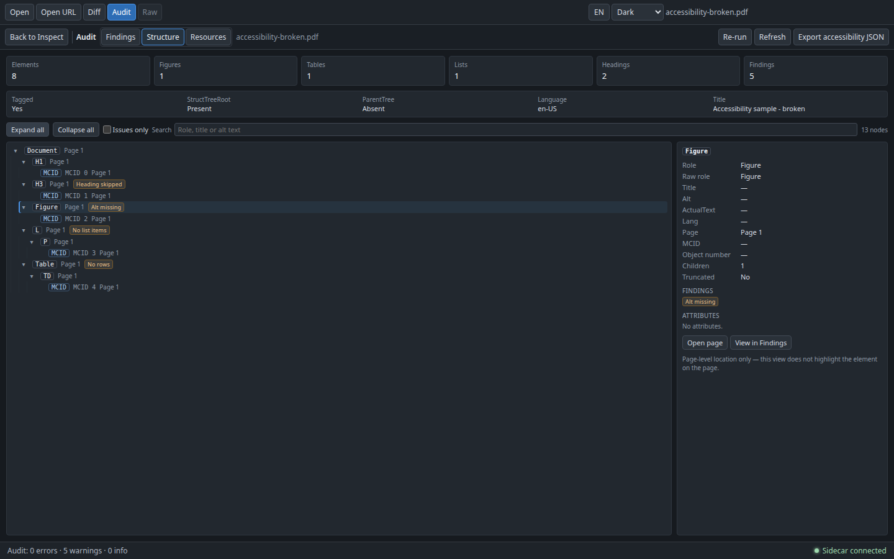

# 无障碍与结构树检查

`pdf-inspector accessibility` 以文档为单位读取 tagged PDF 的结构信息：是否有 `/StructTreeRoot`、`/RoleMap` 与 `/ParentTree`，阅读顺序如何，每个结构元素的 role、Alt、ActualText、Lang、页码与 MCID 是什么，以及哪些常见 PDF/UA 要求看起来没有满足。它回答的是“这份文档的标记结构是什么样”，不是“这份文档是否通过 PDF/UA”。

检查是完全只读的：

- 不编辑、创建或删除 tag/structure element，不写回 PDF，不提供“修复”入口；
- 不执行页面内容流，不解析文字/字体/坐标，不计算 bbox，不做 OCR；
- 不跟随外部资源或链接，不访问网络，不读取 PDF 之外的任意文件；
- 所有 PDF 名称、角色与字符串只作为有界文本展示，不解释为代码。

入口：

- **Audit 工作区**：工具栏 `Audit` 内的 `Findings / Structure / Resources` 模式切换；`Structure` 展示结构树与选中元素详情，`Findings` 保留原有审计发现。
- **CLI**：`python sidecar/cli.py accessibility FILE.pdf`，支持摘要、确定性 JSON 与单文件 HTML。
- **引擎**：`sidecar/accessibility.py` 采集结构资源，`sidecar/audit.py` 的 `accessibility_findings` 生成 `structure` 类别的启发式发现，`sidecar/accessibility_report.py` 渲染摘要与单文件 HTML。桌面端、Web 端与 CLI 共用同一份 `AccessibilityReport` 契约。

## Audit 工作区

工具栏 `Audit` 打开文档体检工作区；标题后的分段控件在 `Findings`、`Structure` 与 `Resources` 之间切换，默认 `Findings`。

- **模式切换**：`Findings` 保留严重级别汇总、筛选、发现列表、详情与 `Export JSON`；`Structure` 用整块结构视图替换三栏内容；`Resources` 是安全资源视图。切换只改变视图，不关闭 Audit，也不改变 Inspect 的文档、页码、缩放或选中对象。
- **懒加载与缓存**：第一次进入 `Structure` 时通过后台 `accessibility_document` 请求读取结构，界面显示 `Reading the structure tree…`；结果按文件缓存，切回 `Findings` 再进入不会重复解析。切换文件会清空缓存；Audit 的 `Re-run` 也会清空结构缓存，若当前正停在 `Structure` 则立即重新读取。
- **工具栏**：`Structure` 模式下显示 `Refresh` 与 `Export accessibility JSON`。`Refresh` 忽略缓存重新解析；`Export accessibility JSON` 通过保存对话框写出完整 `AccessibilityReport`，建议文件名为 `<pdf 文件名>.accessibility.json`。
- **加载失败**：读取失败只在结构视图内显示错误与 `Retry`；Audit 报告与 `Findings` 不受影响。导出失败也只在 Audit 顶部显示本地提示，不会写成审计错误。
- **只读**：结构视图不渲染内容流、不执行脚本、不打开外部资源，也没有编辑、重排或修复 tag 的入口。

`Structure` 顶部是汇总卡：Elements、Figures、Tables、Lists、Headings 与 Findings（本次报告的全部 finding 数）。下方一行文档事实：Tagged、StructTreeRoot、ParentTree（`Present` / `Absent`）、Language 与 Title。

树区域：

1. **树控件**：`Expand all` / `Collapse all`、`Issues only` 复选框、`Search` 输入框（匹配 role、原始 role、title、alt 与 ActualText）以及节点计数（`N nodes` 或 `shown of total`）。搜索与 `Issues only` 会保留命中节点的祖先并自动展开，使结果始终是一条可读的路径。
2. **树**：默认只展开根与第一层，未展开的分支不渲染，因此 5000 节点的文档也不会一次铺开。每个节点显示 role 徽标、页码、MCID/OBJR 占位符与状态徽标：`Alt missing`、`Unknown role`、`No role`、`No description`、`Heading skipped`、`No list items`、`No LBody`、`No rows`、`No scope`。树使用 `role="tree"` / `treeitem`，支持键盘展开、收起与选择。
3. **状态说明**：结构树被上限截断时显示截断提示，解析时跳过畸形元素时显示跳过数量；未标记、`/StructTreeRoot` 不可读或结构树为空时显示对应说明卡与 `View in Findings`。
4. **详情**：选中节点后显示 Role、Raw role、Title、Alt、ActualText、Lang、Page、MCID、Object number、Children、Truncated，以及该节点的 finding 徽标与有界 Attributes 表。有页码时提供 `Open page`，点击后关闭 Audit 并在 Inspect 中导航到该页；`View in Findings` 切回 `Findings` 并把类别筛选设为 `structure`，严重级别重置为全部。
5. **无 bbox 高亮**：详情底部固定提示 `Page-level location only — this view does not highlight the element on the page.`。本阶段只做页级定位与树定位。

结构视图的文案随界面语言切换；role 名称、MCID/OBJR、属性键与 PDF 原文保持原样。

## 数据来源

结构资源全部来自侧车已经打开的 pdfminer 文档（`PdfExtractor._pdf.doc`），不重新下载、不发起网络请求、不解析页面内容流：

| 资源 | 来源 |
|---|---|
| 文档事实 | 页树、trailer、catalog 与 `%PDF-` 头 |
| 标记状态 | catalog `/StructTreeRoot` 是否存在、`/MarkInfo /Marked` 是否为 true |
| 语言与标题 | catalog `/Lang`；trailer `/Info` 或 pdfplumber 元数据中的 Title |
| RoleMap | `/StructTreeRoot /RoleMap`；按键排序后最多读取 100 项，并递归解析到标准角色 |
| 结构树 | `/StructTreeRoot /K` 的深度优先遍历；条目可以是嵌套 `/StructElem`、整数 MCID、`/Type /MCR` 或 `/Type /OBJR` |
| 结构元素字段 | `/S`、`/T`、`/Alt`、`/ActualText`、`/Lang`、`/A` |
| 页码 | 结构元素或其祖先的 `/Pg` 引用；无法匹配时回退到祖先页码 |
| 内容引用 | MCR/MCID 的 `/MCID`；OBJR 的 `/Obj` 只读取对象号，不解析目标内容 |
| ParentTree | `/StructTreeRoot /ParentTree` 是否存在与条目计数；条目映射的存在性检查来自页面 `/StructParents` |

解析细节：

- 阅读顺序就是 `/K` 数组顺序的深度优先遍历；子项数组顺序不作排序。
- 角色先经 RoleMap 解析：`/S` 是原始 role，`role` 是解析后的值。身份映射（如 `/P /P`）视为已解析，不算循环；循环链会被截断并记入 `RoleMap cycle`。
- 标准角色集合采用 ISO 32000-1 Table 333；不在其中且未在 RoleMap 中定义的角色会报告为未知角色。MCID/OBJR 是内容占位符，不参与未知角色判断。
- 页面 `/StructParents` 只做存在性检查。缺失页检查只在“文档已标记且存在 `/ParentTree`”时进行，并且忽略没有内容的页面。
- 结构树、RoleMap 与 ParentTree 都用对象 id/路径集合与深度上限防止循环引用与恶意深树。
- 不读取页面内容流、不提取文本或字体、不计算 bbox、不做 OCR。

## JSON 报告（`AccessibilityReport`）

`--format json` 输出完整契约：

```json
{
  "schemaVersion": 1,
  "tool": { "name": "pdf-inspector", "version": "0.2.0" },
  "document": {
    "pages": 1,
    "version": "1.7",
    "encrypted": false,
    "tagged": true,
    "hasStructTreeRoot": true,
    "hasParentTree": false,
    "language": "en-US",
    "title": "Accessibility sample - broken",
    "roleMap": {},
    "truncated": false,
    "skipped": 0
  },
  "structure": [
    {
      "id": "0/2",
      "kind": "element",
      "role": "Figure",
      "rawRole": "Figure",
      "title": null,
      "alt": null,
      "actualText": null,
      "lang": null,
      "page": 1,
      "mcid": null,
      "objectNumber": null,
      "attributes": {},
      "children": [
        {
          "id": "0/2/0",
          "kind": "mcid",
          "role": "MCID",
          "rawRole": null,
          "title": null,
          "alt": null,
          "actualText": null,
          "lang": null,
          "page": 1,
          "mcid": 2,
          "objectNumber": null,
          "attributes": {},
          "children": [],
          "truncated": false
        }
      ],
      "truncated": false
    }
  ],
  "findings": [
    {
      "category": "structure",
      "severity": "warning",
      "page": null,
      "title": "Structure tree has no ParentTree",
      "detail": "The catalog has a /StructTreeRoot but no /ParentTree, so assistive technology cannot map content items (MCIDs) back to their structure elements.",
      "evidence": "hasStructTreeRoot=true; hasParentTree=false",
      "recommendation": "Add a /ParentTree number tree (and a /StructParents entry per page) when producing the PDF."
    },
    {
      "category": "structure",
      "severity": "warning",
      "page": 1,
      "title": "Figure has no alternative text",
      "detail": "Figure elements have no /Alt text, so a screen reader cannot describe the image. 1 node affected.",
      "evidence": "nodes=0/2 (Figure, page 1)",
      "recommendation": "Add /Alt text to every Figure element, or mark the image as an artifact."
    }
  ],
  "summary": { "total": 5, "errors": 0, "warnings": 5, "info": 0 }
}
```

示例取自 `accessibility-broken.pdf`；为便于阅读，`structure` 只保留了选中的 Figure 子树（`id` 仍是真实路径），`findings` 只列出其中两条，`summary` 是完整报告的真实计数。

| 字段 | 类型 | 说明 |
|---|---|---|
| `schemaVersion` | `1` | 当前固定为 `1`。 |
| `tool` | `{name, version}` | 生成报告的引擎名称与版本。 |
| `document` | `object` | 文档事实，见下表。 |
| `structure` | `array` | 根结构元素森林；通常只有一个根，但允许多个。 |
| `findings` | `array` | 复用 `AuditFinding` 契约，`category` 固定为 `structure`。 |
| `summary` | `{total, errors, warnings, info}` | 按严重级别计数。 |

`document` 字段：

| 字段 | 说明 |
|---|---|
| `pages` | 页数。 |
| `version` | PDF 版本，优先取文档版本，其次 trailer/catalog `/Version`，最后读文件头；不可读时为 `"unknown"`。 |
| `encrypted` | 是否存在 `/Encrypt`，或 pdfminer 报告文档已加密。 |
| `tagged` | catalog 存在 `/StructTreeRoot`，或 `/MarkInfo /Marked` 为 true。 |
| `hasStructTreeRoot` | catalog 中是否存在 `/StructTreeRoot`；引用不可读时仍为 `true`。 |
| `hasParentTree` | `/StructTreeRoot /ParentTree` 是否存在。 |
| `language` | catalog `/Lang` 的展示文本；缺失为 `null`。 |
| `title` | 文档信息字典的 Title；缺失为 `null`。 |
| `roleMap` | 解析后的 RoleMap（自定义角色 → 标准角色），最多 100 项，按键排序。 |
| `truncated` | 结构树是否因节点、深度、子项、扫描或循环上限被截断。 |
| `skipped` | 解析时跳过的畸形结构条目数量。 |

`structure` 中的每个 `StructureNode`：

| 字段 | 类型 | 说明 |
|---|---|---|
| `id` | `string` | 稳定路径，例如 `"0/2/1"`；不依赖对象 id。 |
| `kind` | `"element" \| "mcid" \| "object"` | 结构元素 / MCID 内容项 / OBJR 对象引用。 |
| `role` | `string` | 解析后的 role；MCID 节点为 `"MCID"`，OBJR 节点为 `"OBJR"`。 |
| `rawRole` | `string \| null` | 原始 `/S`；MCID/OBJR 为 `null`。 |
| `title` | `string \| null` | `/T`。 |
| `alt` | `string \| null` | `/Alt`。 |
| `actualText` | `string \| null` | `/ActualText`。 |
| `lang` | `string \| null` | 该元素自己的 `/Lang`。 |
| `page` | `number \| null` | 1 起的页码；无法确定时为 `null`。 |
| `mcid` | `number \| null` | MCID 值；普通元素与 OBJR 为 `null`。 |
| `objectNumber` | `number \| null` | OBJR 的目标对象号；普通元素与 MCID 为 `null`。 |
| `attributes` | `object` | 有界属性表（值为 `string \| null`），见“资源上限”。 |
| `children` | `array` | 子节点；超过上限时父节点带 `truncated` 标记。 |
| `truncated` | `boolean` | 子节点是否被截断。 |

## 资源上限

所有上限都在 Python 侧执行，目的是让畸形或恶意文档只降级，不让整次检查失败或耗尽资源：

| 限制 | 值 | 行为 |
|---|---:|---|
| 结构元素节点 | 5000 | 超出停止展开，`document.truncated: true` |
| 树深度 | 32 | 超出停止展开，父节点 `truncated: true` |
| 每节点子项 | 200 | 超出截断并标记父节点 |
| RoleMap 条目 | 100 | 按键排序后只保留前 100 项 |
| ParentTree 条目 | 10000 | 超出停止计数（树深度上限 16） |
| 属性条目 | 20 | 超出截断，并报告 `Structure tree truncated` |
| 单字符串 | 512 字符 | 截断后展示 |
| 结构元素扫描 | 5000 | 超出停止遍历并标记截断 |
| 对象引用解析 | 单节点最多 8 次 | 更长的引用链按不可读处理，防止恶意链 |
| 缺 `/StructParents` 的页面列举 | 10 | 其余页只计入总数，不逐页生成 finding |
| 未知 role 名称逐条报告 | 20 | 其余合并为一条汇总 finding |

`document.truncated` 只覆盖结构树本身的上限（节点、深度、子项、扫描、结构元素循环）；RoleMap 与 ParentTree 的列表截断、属性截断仍会通过 `Structure tree truncated` finding 显式报告，因此被截断的解析结果不会看起来“干净”。畸形条目、不可读引用与缺失字段按“跳过”或 `null` 处理，其余元素继续输出。

## 检查项

所有 finding 都是启发式的，带证据与建议；`page` 只在能确定时给出。严重级别只有 `warning` 与 `info`，不提供 0–100 的健康分。

| 检查 | 级别 | 触发条件 |
|---|---|---|
| `PDF is not tagged` | `info` | 既没有 `/StructTreeRoot`，也没有 `/MarkInfo /Marked true`。这是诊断提示，不是 PDF/A 认证。 |
| `Structure tree has no ParentTree` | `warning` | 有 `/StructTreeRoot` 但缺 `/ParentTree`，MCID 无法映射回结构元素。 |
| `Page N has no structure parent entry` | `warning` | 文档已标记且存在 `/ParentTree`，但某页有内容却没有 `/StructParents`；只列举前 10 页，证据带总数。 |
| `Structure element has no role` | `warning` | 结构元素缺少可读的 `/S`。 |
| `Unknown structure role: X` | `warning` | 角色不在 ISO 32000-1 标准集合中，也未在 RoleMap 中定义。 |
| `RoleMap cycle` | `warning` | RoleMap 的解析出现循环，部分角色无法映射到标准角色。 |
| `Figure has no alternative text` | `warning` | `Figure` 元素缺少 `/Alt`。 |
| `Formula has no alternative text` | `warning` | `Formula` 元素缺少 `/Alt`。 |
| `Link has no alternate description` | `warning` | `Link` 元素没有 `/Alt`、`/ActualText` 或 `/T`。 |
| `Heading levels are skipped` | `warning` | 按树顺序出现 `H1 → H3` 这类跨级；首个标题之前的层级缺失不报告。 |
| `List has no list items` | `warning` | `L` 下没有 `LI` 子项。 |
| `List item has no LBody` | `info` | `LI` 缺少 `LBody`，条目文本没有被分组。 |
| `Table has no rows` | `warning` | `Table` 下没有 `TR`。 |
| `Table header cell has no scope` | `info` | `TH` 缺少 `/Scope` 属性。 |
| `Structure tree truncated` | `warning` | 节点/深度/子项/属性/扫描/循环上限或 RoleMap/ParentTree 列表上限触发，证据列出计数与上限。 |
| `Accessibility parse skipped N element(s)` | `warning` | 有畸形或不可读的结构条目被跳过。 |

聚合与排序：

- 同一条件只产生一条 finding，`evidence` 列出前 3 个受影响的节点路径/role/页码，超出部分以 `+N more` 结尾；未知 role 逐条报告前 20 个名称，其余合并。
- 未标记文档只输出 `PDF is not tagged`，不再叠加依赖结构树的其他检查，避免重复报告同一问题。
- finding 按 `AuditReport` 的固定规则排序：`structure` 类别、页码升序（文档级 `page: null` 在前）、同页按标题/说明/证据/建议排序，并去重。
- 不检查：颜色对比度、字体可读性、实际阅读顺序是否符合内容语义、OCR 文本、表单字段标签与 widget 的完整匹配、结构元素是否覆盖全部页面内容。

## CLI

```bash
pdf-inspector accessibility report.pdf
pdf-inspector accessibility report.pdf --format json --output report.accessibility.json
pdf-inspector accessibility report.pdf --format html --output report.accessibility.html
pdf-inspector accessibility report.pdf --fail-on warning
```

等价的直接入口：

```bash
python sidecar/cli.py accessibility report.pdf
node bin/pdf-inspector.mjs accessibility report.pdf --format json --output report.accessibility.json
```

| 选项 | 说明 |
|---|---|
| `--format` | `summary`（默认）/ `json` / `html`。 |
| `--output PATH` | 把格式化结果写入文件；stdout 仍打印摘要。 |
| `--fail-on` | `error` / `warning` / `none`（默认 `none`）。`warning` 同时覆盖 errors；`error` 只覆盖 errors；`none` 永不返回 1。 |
| `--quiet` | 不打印人类摘要，只保留 JSON/HTML 输出。 |

退出码：

| 退出码 | 含义 |
|---|---|
| `0` | 没有严重级别命中 `--fail-on`。 |
| `1` | `--fail-on` 命中。 |
| `2` | 参数、输入、读取或报告错误（文件不存在、非 PDF、URL、输出路径不可写等）。 |

CLI 只接受本地文件：`http(s)://` URL、目录和非 `%PDF-` 输入都会在引擎打开前以退出码 2 拒绝；`--output` 不允许覆盖输入 PDF。选择 `json` / `html` 且省略 `--output` 时 payload 写到 stdout；所有诊断信息写到 stderr，因此 JSON 可以安全地管道给其他工具。

当前所有无障碍检查只产生 `warning` 与 `info`，没有 `error` 来源，因此 `--fail-on error` 通常不会命中；需要质量门禁时使用 `--fail-on warning`。

### 摘要与 HTML 报告

`--format summary`（默认）输出人类可读文本，包含：

- 文档事实：页数、版本、是否加密、是否标记、语言与标题；
- 结构计数：Elements、Figures、Tables、Lists、Headings；
- 树事实：`StructTreeRoot`、`ParentTree`、是否截断、跳过的元素数；
- 严重级别计数；
- 最多 20 条 finding，按 `error` → `warning` → `info` 排序，其余以计数结尾；没有 finding 时输出 `findings: none - no accessibility findings`。

摘要里的文件名只显示最后一段路径，避免把本地绝对路径写入终端记录或报告。

`--format html` 输出单文件报告：内联 CSS、无 `<script>`、无外部资源；包含文档信息、结构计数、严重级别计数与全部 finding。文档标题、角色、Alt/ActualText 与 finding 文本全部经过 HTML 转义，因此 PDF 中的 `<script>` 只会显示为文本；报告不写入时间戳或绝对路径。

## 样例

仓库提交了两份确定性样例，由 `scripts/generate-accessibility-samples.py` 用最小原始对象写入器生成，不依赖 reportlab，也不需要网络：

```bash
python scripts/generate-accessibility-samples.py
```

| 样例 | 内容 |
|---|---|
| `web-samples/accessibility-valid.pdf` | 单页 tagged PDF：`Document → H1 → P → Figure(/Alt) → Table/TR/TH(/Scope)/TD`，带 `/ParentTree` 与页面 `/StructParents`；审计无无障碍 finding。 |
| `web-samples/accessibility-broken.pdf` | 单页结构树：`Document → H1 → H3`（跨级）、`Figure`（无 Alt）、`L`（无 LI）、`Table`（无 TR），且没有 `/ParentTree` 与页面 `/StructParents`；共 5 条 warning。 |

两份样例的每个内容项都是真实标记内容序列（MCID），可被 pdfplumber 打开并提取文本。生成脚本逐字节确定，重复运行会得到同一份文件；`.github/workflows/ci.yml` 的 `accessibility-cli` 任务会重新生成并断言样例、summary/json/html 输出、`--fail-on warning` 的退出码，以及 HTML 不含 `<script>`。

## 截图

| 截图 | 说明 |
|---|---|
|  | 暗色主题 1440×900：`accessibility-broken.pdf` 的 `Structure` 视图。顶部为 Elements / Figures / Tables / Lists / Headings / Findings 汇总与文档事实（ParentTree `Absent`）；左侧结构树显示 `Document → H1 → H3`（`Heading skipped`）、`Figure`（`Alt missing`）、`L`（`No list items`）、`Table`（`No rows`）与 MCID 占位符；右侧是选中的 `Figure` 详情（Alt 为空、Page 1、无属性、`Open page` / `View in Findings`）以及 `Page-level location only` 提示。 |

## 确定性、安全边界与非目标

- **确定性**：相同 PDF 产生相同的结构顺序、finding 顺序与 JSON/HTML 字节；结构按 `/K` 顺序深度优先，RoleMap 按键排序，报告不含时间戳、绝对路径、随机 id 或运行环境信息。
- **只读边界**：没有 `eval`、没有 PDF.js 脚本执行、没有 shell 调用；不写入、不重排、不修复 tag；不读取页面内容流、不计算 bbox、不打开外部资源。所有字符串都有长度上限，HTML 报告对全部用户文本转义。
- **启发式**：结构基于 pdfminer 能解析出的对象枚举，畸形对象可能被跳过；role 集合与层级规则是通用近似，不能作为无障碍合规结论。需要质量门禁时，应结合项目实际设置 `--fail-on` 阈值。
- **传输层**：Audit `Structure` 视图通过后台 `accessibility_document` 请求读取（主进程 120s、渲染层 125s 预算），桌面端与 Web 端共用同一份 `AccessibilityReport`；读取失败只影响 `Structure`，不清空 Audit 报告。Web 端与检查器其他接口一样没有身份认证，请仅在可信网络使用，或放在带认证的反向代理之后。
- **非目标**：
  - 不做 PDF/UA、PDF/A 或 WCAG 合规认证、评分或盖章；
  - 不编辑、创建、删除 tag/structure element，不修复或重排 PDF；
  - 不做 OCR、扫描页文字识别或阅读顺序的人工重排；
  - 不做 MCID → 内容流 → 对象 bbox 的映射，不在画布上绘制结构元素框或与对象叠加层联动，只提供页级跳转与树定位；
  - 不合并或比对 PDF.js `getStructTree` 与侧车结构树；
  - 不做表单字段标签与 widget 的完整交叉校验（仅做结构树内的基础检查）；
  - 不提供用户自定义规则、规则脚本、跨文档历史趋势或独立的 accessibility action。
