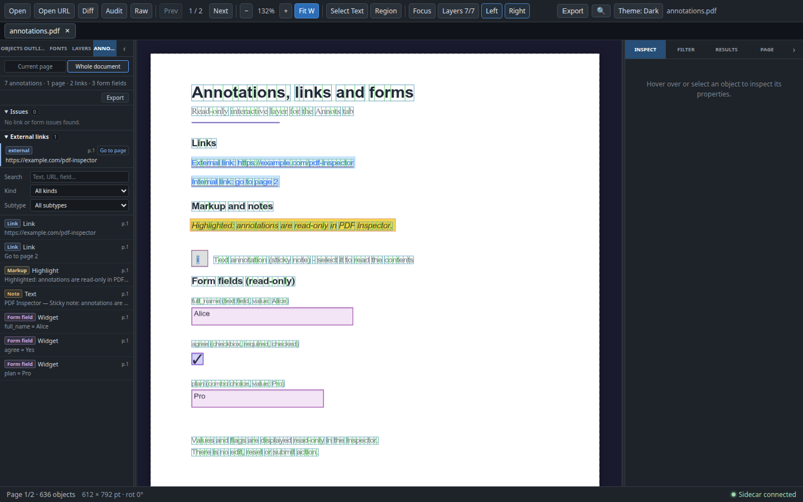
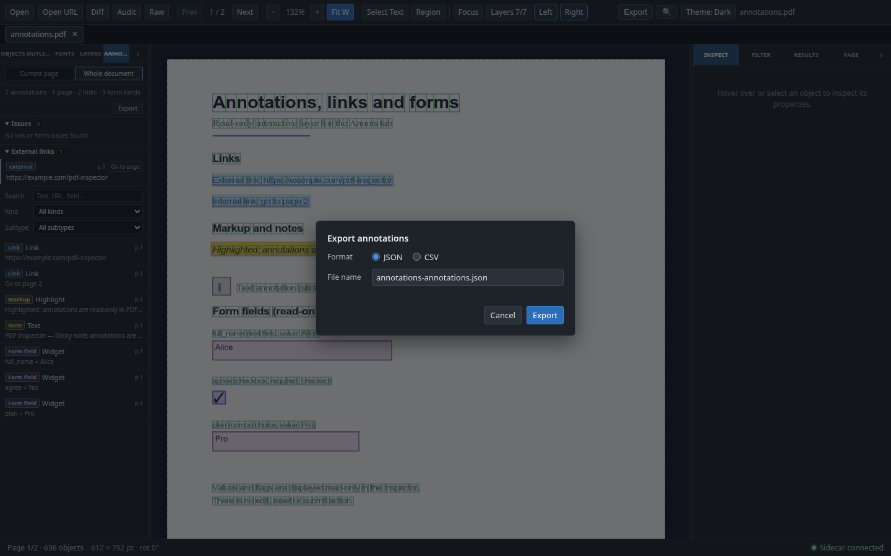

# 注释、链接与表单

PDF Inspector 在对象检查之外，用 PDF.js 的 `page.getAnnotations({ intent: 'display' })` 读取交互层：链接（Link）、表单字段（Widget）、标记（Highlight 等）与注释（Text 等）。`Annots` 标签页提供两种范围：

- `Current page`（默认）：只读取当前页，画布绘制只读注释框，选中后在 Inspector 查看详情。
- `Whole document`：在渲染层分批读取整份文档，列出全部注释/链接/表单字段，提供跨页搜索、全局过滤、链接与表单健康检查、跳页与 JSON/CSV 导出。

全部能力都是**纯只读检查**：不新建、编辑或删除注释，不填写或提交表单，不验证数字签名，也不修改 PDF 文件。整档索引不新增侧车（sidecar）RPC，也不引入额外的 Python 依赖；桌面端与 Web 端使用同一套归一化逻辑与界面。

## 数据来源

- 唯一数据源是渲染层的 PDF.js；`src/renderer/services/annotations.ts` 负责逐页读取与归一化。
- Python 侧车不提供注释 RPC，索引结果只保存在渲染层内存中，不写 sidecar 缓存、不落盘，也没有独立索引文件。
- 链接目标解析复用 `pdfDoc.getDestination()` / `getPageIndex()`；不会请求目标 URL。
- 页面注释按 `PDFDocumentProxy` 缓存，文档关闭后随 `WeakMap` 一起回收。

## 支持的数据

每个注释归一化为一个与 UI 解耦的模型（`src/renderer/types/annotations.ts`）：

| 字段 | 说明 |
|---|---|
| `subtype` / `kind` | PDF.js 原始 subtype 与派生类别：`link` / `form` / `markup` / `note` / `stamp` / `other` |
| `page` | 所属页码（1 起）；当前页列表按页限定，整档索引按页升序排列 |
| `rect` | 相对读取时 MediaBox 原点的未旋转 PDF 点坐标；几何不可用时为 `null`，注释仍保留在列表中 |
| `title` / `contents` | 标题与内容，优先使用 PDF.js 的 `titleObj` / `contentsObj`，并清理控制字符 |
| `modificationDate` | 可解析的 PDF 日期会转为 ISO 8601，否则显示原始字符串 |
| `color` / `opacity` | `#rrggbb` 颜色与不透明度 |
| `hidden` | `data.hidden` 或 `HIDDEN` / `NOVIEW` 注释标志 |
| `link` | 外部 URL、原始 `unsafeUrl`、解析出的内部页码、是否要求新窗口 |
| `form` | 字段名、字段类型（`Tx` / `Btn` / `Ch` / `Sig`）、值、默认值、Flags 与选项 |

处理规则：

- Popup 注释不单独列出，改为显示其父注释的内容。
- 隐藏注释保留在列表中并带 `Hidden` 标记，但默认不绘制画布框。
- 矩形必须由四个有限数字组成且 `x0 <= x1`、`y0 <= y1`；非法几何只影响画布框，不影响文字与表单数据。
- 归一化结果按 `PDFDocumentProxy` + 页 + MediaBox origin 缓存，调用方拿到的是副本，UI 无法改动缓存。

## 整档索引架构

索引服务位于 `src/renderer/services/annotation-index.ts`，是独立于 React 状态的异步读取服务：

```ts
buildAnnotationIndex(pdfDoc, pageCount, {
  batchSize?: number,                 // 默认 ANNOTATION_INDEX_BATCH_SIZE = 10
  onProgress?: (done, total) => void, // 先报 (0, total)，之后每读一页报一次
  isCancelled?: () => boolean,        // 每页与每批前轮询；取消时返回 null
}): Promise<AnnotationIndexResult | null>
```

- **渲染层、PDF.js、无 sidecar**：索引在浏览器/渲染进程中完成；不调用 `extract_page`，也不新增 RPC 方法或 Python 依赖。
- **10 页一批**：逐页顺序读取，每批之间 `setTimeout(…, 0)` 让出事件循环，大文档下界面仍能翻页与重绘。
- **进度与取消**：面板显示 `Indexing annotations 40/120…` 与进度条；面板没有单独的 Cancel 按钮，切换/关闭文档或组件卸载会取消运行，`buildAnnotationIndex` 返回 `null`，过期的进度与结果不会写回。
- **文档键守卫**：整档 store 用 `filePath`（Web 为 `/doc/:id`）作为 `documentKey`，`sourceUrl` 只作为兜底；文档变化会 `reset()`，`finish` / `fail` 校验文档键，hook 再用运行代数丢弃过期进度，慢索引不能写进下一个文档。
- **不保留 PDF.js 页面对象**：每页只留下归一化的 `PdfAnnotation[]`；`PDFPageProxy` 用完即弃。
- **origin 感知缓存**：缓存键是 `page + origin.x + origin.y`。当前页使用 sidecar 的 MediaBox 原点，整档索引使用 PDF.js `page.view` 的 `x0/y0`（不可用时回退 `{0, 0}`）；两种原点不会共用缓存条目，也不会互相污染 Rect。
- **稳定顺序与一次汇总**：结果按页升序、页内保持 PDF.js 顺序；`summary`、`linkIssues`、`formIssues`、`formFields` 在构建时一次计算，列表渲染不再重复统计。
- **失败即中止**：任一页读取失败会终止整次索引，错误信息带页码；`Retry` 从第 1 页重新构建，不保留部分结果，也没有断点续建。
- **幂等复用**：同一文档索引完成后，切回 `Current page` 再切回来不会重新读取；重复渲染或模式切换不会重复启动索引，只有失败后的 `Retry` 才开启新的一次运行。

整档 store 位于 `src/renderer/store/annotation-index-store.ts`，状态为 `idle / indexing / ready / error`，并保存 `progress`、`result`、`error`、`query`、`kindFilter`、`subtypeFilter`。查询与过滤属于文档模式自己的视图状态，不与当前页列表共享；同一文档内切换模式会保留，切换文档会随结果一起清空。

`src/renderer/hooks/useAnnotationIndex.ts` 负责生命周期：hook 在两种模式下都保持挂载（面板隐藏而不是卸载），所以切回 `Current page` 不会取消正在进行的索引；文档变化、`retry` 与卸载才会作废旧运行。索引页数取 `pdfDoc.numPages`（校验为有限正数后向下取整），`pageCount` 只在 `numPages` 不可用时兜底，元数据偏小不会漏读尾页。

## `Annots` 标签页

左侧面板的第五个标签页，标签简写为 `Annots`（完整名称在按钮 tooltip 中），在 200px 最小面板宽度下与其他标签一样使用省略号截断，不会为它单独加宽面板。顶部是紧凑的 `Current page` / `Whole document` segmented control，默认 `Current page`。

### `Current page`

- **汇总**：`N annotations · L links · F form fields`；启用过滤时显示为 `2 of 5 annotations`，后两个计数描述当前可见行。
- **Show boxes**：控制画布上的注释框，默认开启；关闭后画布点击回到对象层。该开关只在当前页模式显示。
- **过滤**：`Kind`（All kinds / Link / Form field / Markup / Note / Stamp / Other）与 `Subtype`（当前页出现的原始 subtype）。过滤条件在翻页后保留；如果新页面没有该 subtype，选项仍会保留以避免筛选器变空。
- **列表行**：类别徽标、subtype、`p.N` 页码、`Hidden` 标记，以及一行预览——链接目标、`字段 = 值`，或标题/内容。点击行会选中注释并自动切到 Inspector 的 `Inspect`。
- **状态**：加载中、没有注释、没有匹配项、加载失败（带 `Retry`）都有独立提示；页面几何未就绪时不会误报为“无注释”。

### `Whole document`

- **首次索引**：第一次切到该模式时启动整档索引；索引期间显示进度与进度条，不阻塞翻页、缩放或当前页检查。
- **汇总**：`N annotations · P pages · L links · F form fields`，其中 `P` 是含注释的页数、`F` 是去重后的表单字段名数量（不是 Widget 数）。
- **搜索**：输入框占位符为 `Text, URL, field…`，匹配页码、subtype/kind、标题与内容、链接的 `url` / `unsafeUrl` / 内部页、表单字段名/类型/值/默认值/选项；匹配前统一折叠大小写并 trim。
- **全局过滤**：`Kind` 与 `Subtype` 都作用于整份文档的索引结果，Subtype 选项来自全部索引注释（不随当前页变化）。
- **列表**：按页升序，行内显示 `p.N`、类别、subtype、`Hidden` 与预览；行使用 CSS `content-visibility` 窗口化，大文档索引不会一次布局全部行。
- **导出**：仅在索引 `ready` 后显示 `Export`；索引中或失败时没有导出入口。
- **状态**：未打开文档、等待 PDF.js 文档、索引中、索引失败（带 `Retry`）、无注释、无匹配项都有独立提示；失败提示包含出错页码，`Retry` 从头重建。

## 跳转与选中

点击文档模式的行时：

1. 若该注释已在当前页的注释 store 中，直接选中并把 Inspector 切到 `Inspect`；
2. 否则清除旧选中、记录 `pendingSelectionId = annotation.id`，再 `navigate(annotation.page)`；
3. 目标页加载完成后，`setPageData` 在列表里按 id 查找：找到就设为选中并消费 pending，找不到就只保留跳页（best effort）；
4. 无 id 的旧注释、或整档索引与当前页因 origin 不同产生的 id 差异，都只跳页，不强行选中。

表单问题的 `Go to page` 只打开该字段出现的第一个页面，不自动选中 Widget；`unnamed` 记录虽然带 Widget id，也仅用于稳定区分行，不进入选中流程。链接问题会按 `annotationId` 在索引里找到对应注释，再走与行点击相同的路径，找不到时只跳到记录页。选中后仍复用 Inspector 的 `AnnotationDetails`；文档模式不要求未激活页绘制画布框。

## 健康检查（Issues）

文档模式在汇总下方显示两个可折叠区：

- **`Issues`**：默认展开，计数为“非 external 的链接问题 + 全部表单问题”。0 条时显示 `No link or form issues found.`。
- **`External links`**：只在存在可打开的 `http(s)` 链接时出现，默认折叠，计数不进入 `Issues`。

### 链接

| 分类 | 条件 | 级别 |
|---|---|---|
| `external` | PDF.js 提供了已清洗的 `http(s)` URL | info（清单，不算问题） |
| `unsafe` | 有 `unsafeUrl`，且协议不是 `http(s)`（如 `mailto:` / `file:` / `data:` / `javascript:`） | warning（`Issues`） |
| `unresolved` | 既无安全外部 URL，也无解析出的内部页码 | warning（`Issues`） |
| 无问题 | 解析出内部页码，或目标可安全打开 | 不列出 |

每条链接记录包含 `annotationId`、`page`、`subtype`、`kind`、可显示的目标与说明；`Go to page` 跳转并尽力选中该注释。健康检查只分类，**从不打开、预取或探测任何外部 URL**；打开外部链接仍然只能通过 Inspector 的 `Open link`（见下）。

### 表单

字段先按字段名合并：`pages`（升序去重）、`widgetCount`、`required` / `readOnly`（任一 Widget 为真即为真）、`values`（去重后的值）。合并后再判定：

| 分类 | 条件 | 级别 |
|---|---|---|
| `unnamed` | Widget 没有字段名 | warning（`Issues`） |
| `conflicting-type` | 同名字段在不同 Widget 上的 `fieldType` 不一致 | warning（`Issues`） |
| `duplicate-name` | 同名字段出现在多个页面 | info（`Issues`，但只是提示） |

跨页同名是 PDF 表单的常见用法，因此只作为信息展示，不默认判错；表单问题的 `Go to page` 跳到第一个页面，不选中 Widget。每条表单问题都带 `annotationId`：`unnamed` 是该 Widget 的 id（同一页有多个无名字段时是两条独立记录，`Issues` 的行 key 也靠它区分），按字段名合并的 `duplicate-name` / `conflicting-type` 为 `null`。空文档没有注释时两个健康检查区都不显示。

## 导出

`Export` 只在 `Whole document` 且索引完成（`ready`）后出现，打开 `Export annotations` 对话框；导出的是面板已持有的索引结果，不会重新解析页面，也不会读取 PDF。

- **格式**：JSON（默认）或 CSV；切换格式会更新自动生成的文件名，用户编辑过的名称只替换可识别的 `.json` / `.csv` 扩展名。
- **文件名**：默认 `<document>-annotations.json/csv`（由显示名或 `sourceUrl` 派生，把对象导出的 `-all` 后缀替换为 `-annotations`，无法派生时回退到 `document-annotations.<ext>`）；可自定义。保存前用 `sanitizeExportFileName` 去掉目录、控制字符与多余扩展名，不可用时回退到建议名称。
- **保存**：桌面端走原生保存对话框，Web 端触发浏览器下载；取消保存直接关闭对话框、不显示错误；保存失败在对话框内显示。
- **不写本地绝对路径**：payload 只包含文档显示名与 `sourceUrl`，URL 下载产生的临时文件路径、桌面本地路径都不会出现。

### JSON

```json
{
  "schemaVersion": 1,
  "tool": { "name": "pdf-inspector", "version": "0.2.0" },
  "exportedAt": "2026-01-01T00:00:00.000Z",
  "document": { "name": "annotations.pdf", "sourceUrl": "/doc/<id>", "pages": 2 },
  "summary": {
    "annotations": 7, "pagesWithAnnotations": 1, "links": 2, "forms": 3,
    "markup": 1, "notes": 1, "stamps": 0, "other": 0, "hidden": 0,
    "unresolvedLinks": 0, "unsafeLinks": 0, "formFields": 3
  },
  "pages": [{ "page": 1, "annotations": [/* PdfAnnotation */] }],
  "linkIssues": [/* AnnotationLinkIssue */],
  "formIssues": [/* AnnotationFormIssue */],
  "formFields": [{ "name": "plan", "fieldType": "Ch", "pages": [1], "widgetCount": 1, "required": false, "readOnly": false, "values": ["Pro"] }]
}
```

- `schemaVersion` 独立于对象导出与 Diff/Audit；`exportedAt` 是导出时刻的 ISO 时间。
- `pages` 只包含有注释的页，按页升序；没有注释的页不会补空组。
- `summary` 是整档构建时算好的计数；`formFields` 是去重合并后的字段，`summary.forms` 仍是原始 Widget 数。

### CSV

文件以 UTF-8 BOM 开头，包含固定顺序的三段：

```text
# annotations
page,subtype,kind,rect,hidden,title,contents,target,field_name,field_type,value,options
# links
page,subtype,url,unsafe_url,internal_page,status
# form_fields
name,field_type,pages,widget_count,required,read_only,values
```

- 按 RFC 4180 转义：含 `"`、`,`、换行或回车的字段加引号，内部引号翻倍。
- `rect` 作为单个带引号字段写成 `x0,y0,x1,y1`；数组（页码、字段值、选项）用 `; ` 连接。
- `# links` 的 `status` 取 `external` / `unsafe` / `internal` / `unresolved`，与健康检查同一套规则。
- 三段始终存在（即使文档没有注释），下游可依赖表头。

## 链接策略

链接永远不会自动打开，也不会在加载、索引或渲染页面时触发网络请求。

**外部链接**

- 只有 `http(s)` 绝对 URL 可以打开；`javascript:`、`data:`、`file:`、`mailto:`、空值与相对地址都是显示用。
- 使用 PDF.js 的 `url`（已清洗）作为点击目标，原始 `unsafeUrl` 只用于展示“这个链接原本指向哪里”。
- 用户必须显式点击 `Open link`。渲染层先校验一次，桌面端通过 IPC 调用主进程的 `shell.openExternal` 再校验一次；Web 端由 `window.open(url, '_blank', 'noopener,noreferrer')` 打开，同样只接受清洗后的 URL。
- 打开失败或目标不安全时，错误显示在 Inspector 内，不弹系统对话框，也不影响文档状态。

**内部链接**

- 字符串命名目标先经 `pdfDoc.getDestination(name)` 解析，数组目标直接取第一项，再用 `getPageIndex` 得到 1 起页码。
- 解析成功才显示 `Go to page N`，并使用与 Prev/Next 相同的受保护翻页导航 `usePageNavigation().navigate(page)`。
- 无法解析的目标显示 `No resolvable link target.`，不提供跳转。

## 表单只读

表单字段只以文本形式呈现：字段名、字段类型、当前值、默认值、Flags 与选项。实现中没有 `<input>`、没有表单元素、没有提交或写回路径，也不存在“重置”“应用”之类的动作。

- 多选/下拉字段的值可能是数组，显示时用 `, ` 连接。
- 选项统一显示为 `label (value)`，同时保留 export value 与 display value。
- 签名字段只作为 `Sig` 字段展示，并明确标注未验证。
- 表单值来自 PDF.js 读取，不会写回 PDF，也不会触发 AcroForm 事件或 JavaScript。

## 画布与 Inspector

**画布**

- 注释框按类别着色：链接蓝、表单紫、标记黄、注释橙、图章青、其他灰；悬停时更亮，选中为金色描边。
- 选中注释与选中对象互斥：点击注释会清除对象选中与悬停，点击对象会清除注释选中，空白处点击两者都清除。
- 注释命中测试优先于对象命中测试；关闭 `Show boxes` 后注释框不绘制，也不再参与命中测试。
- 旋转页（`/Rotate` 90/180/270）不绘制注释框，只提供列表与 Inspector 详情，与对象叠加层的限制一致。
- 画布只绘制 `page` 与当前页一致的注释数据；整档索引为未激活页保留 Rect 仅供列表展示，不承诺画布框。

**Inspector**

选中注释后，`Inspect` 标签页显示注释详情，而不是对象详情：

- **Annotation**：类别、subtype、页码、Rect、是否隐藏。
- **Content**：标题、内容、修改时间、颜色（含色块）与不透明度。
- **Link**：目标 URL 或内部页码；安全的外部链接提供 `Open link`，解析出的内部目标提供 `Go to page N`。
- **Form field**：字段名、字段类型、值、默认值、Flags（Read only / Required / Check box / Radio button / Push button / Multi-line / Combo box）与选项（`label (value)`）；签名字段附“Signature not verified”。
- **Clear selection**：清除当前注释选中。

`Filter` / `Results` / `Page` 标签页保持原有对象与页面功能不变。

## 当前页与整档状态

- 当前页列表、画布框与选中都是页级状态；`usePageAnnotations` 在页码或文档变化时重新加载，并用请求守卫丢弃过期结果。
- 翻页会清除上一页的选中与悬停，避免出现“列表是第 2 页、详情还是第 1 页”的情况。
- 当前页的过滤条件与 `Show boxes` 会跨页保留；整档模式的搜索/过滤是另一份状态，二者互不影响。
- 整档索引只在渲染层内存中，切换文档即丢弃；同一文档切回 `Current page` 不会丢失已完成的结果。

## 非目标

以下能力不在本阶段范围内，代码中也没有对应入口：

- 注释的创建、编辑、删除、回复、图章、密文标注。
- 表单填写、重置、提交、导入 XFA 数据。
- 数字签名验证。
- 注释级 Diff、Audit 注释检查、CLI/action 集成；Diff 与审计仍只处理对象层，注释导出也不写入对象导出 JSON/CSV。
- 外部链接批量网络探测或自动打开。
- 画布上为未激活页绘制注释框，旋转页的注释框修复。
- 部分索引的断点续建（失败后只能从头 `Retry`）。
- 使用 PDF.js 原生 `AnnotationLayer` 渲染控件外观；自定义列表与只读框才是唯一数据来源。

## 已知限制

- 整档索引按 10 页一批串行读取，超大文档需要较长时间；批次之间界面可用，但索引期间不会有单独的后台进程或持久缓存。
- 任一页读取失败会中止整次索引并显示页码，`Retry` 从头重建；没有部分结果、断点续建或单页跳过。
- 索引条目带 `page`，但列表没有按页折叠分组；大文档依靠 `content-visibility` 窗口化，DOM 中仍保留每条注释一个行节点。
- 文档模式不绘制未激活页的注释框；点击行跳页后由当前页正常加载，选中是 best effort（无 id 或 id 不一致时只跳页）。
- 旋转页只提供列表与详情，不绘制画布框，也不参与画布命中测试。
- CropBox 小于 MediaBox 时，当前页注释框以 MediaBox 为基准，可能与 PDF.js 按 CropBox 渲染的内容整体偏移，与既有对象叠加层表现一致；整档索引的 Rect 以 `page.view` 为原点，只用于列表展示。
- 外部链接只支持 `http(s)`；其他协议只能查看原始目标字符串，健康检查把它们标为 `unsafe`，不会尝试打开或探测。
- 内部链接只跳转到解析出的页码，不恢复滚动位置或缩放。
- 注释健康检查是启发式的：只依据 PDF.js 解析出的链接与表单数据，不做 PDF 合规认证；跨页同名字段是 info，未命名 Widget 与类型冲突才是 warning。
- 加密或权限受限的 PDF 是否能读到注释取决于 PDF.js 的解密结果；读不到时当前页列表为空，整档索引得到 0 条注释并显示空状态。

## 验证

自动化测试：

```bash
npx vitest run \
  src/renderer/services/__tests__/annotations.test.ts \
  src/renderer/services/__tests__/annotation-index.test.ts \
  src/renderer/services/__tests__/annotation-export.test.ts \
  src/renderer/services/__tests__/annotation-view.test.ts \
  src/renderer/store/__tests__/annotation-store.test.ts \
  src/renderer/store/__tests__/annotation-index-store.test.ts \
  src/renderer/hooks/__tests__/usePageAnnotations.test.ts \
  src/renderer/hooks/__tests__/useAnnotationIndex.test.ts \
  src/renderer/components/LeftPanel/AnnotationsTab.test.ts \
  src/renderer/components/LeftPanel/AnnotationExportDialog.test.ts \
  src/renderer/components/PdfViewport/AnnotationOverlay.test.ts \
  src/renderer/components/PdfViewport/OverlayCanvasAnnotations.test.ts \
  src/renderer/components/InspectorPanel/AnnotationDetails.test.ts
```

类型检查与构建：

```bash
npx tsc -b
npx tsc -p tsconfig.web.json
```

`annotation-index.test.ts` 覆盖分批读取、批间让出事件循环、进度、取消、失败中止、空文档、`page.view` origin、链接分类与表单分组；`annotation-index-store.test.ts` 覆盖文档键守卫与进度归一化；`annotation-export.test.ts` 覆盖 JSON 结构、按页分组、不写入本地路径、CSV 三段/BOM/RFC 4180 与链接状态；`AnnotationsTab.test.ts` 与 `AnnotationExportDialog.test.ts` 覆盖模式切换、搜索/过滤、跳页选中、Issues、导出按钮可用性与保存流程。

演示文档由 `scripts/generate-web-samples.py` 生成，输出 `web-samples/annotations.pdf`（已 gitignore，可用 `.venv/bin/python scripts/generate-web-samples.py` 重建）。第 1 页包含外部链接、指向第 2 页的内部链接、一条 Text 注释、一条 Highlight、`full_name` 文本字段（值为 Alice）、必填复选框 `agree`（选中）与组合框 `plan`；第 2 页是内部链接与 `page2` 书签目标。生成过程固定元数据、注释日期与 URL，`invariant=1`，两次运行输出逐字节一致；PDF.js `getAnnotations` 能看到 Link / Widget / Text / Highlight 四类注释。

真实 Web 构建 E2E（1440×900，`/samples/annotations.pdf`）：

- `Whole document` 汇总为 `7 annotations · 1 page · 2 links · 3 form fields`；`Issues` 为 `0` 并显示 `No link or form issues found.`；`External links` 为 `1`，目标为 `https://example.com/pdf-inspector`。
- JSON 导出包含 7 条注释、1 个按页分组、3 个合并后的表单字段（`document.pages` 仍为 2）。
- CSV 导出包含 `# annotations`、`# links`、`# form_fields` 三段，分别对应 7 条注释、2 条链接、3 个表单字段。
- 1440×900 下 `Annots` 面板、`Issues` / `External links` 区与导出对话框均无横向溢出。
- 1000 页文档的索引进度与“索引期间仍可翻页”目前由自动化测试（分批读取、批间让出事件循环、取消与文档键守卫）和上述设计保证，尚未在真实 1000 页文档上手工观察；`docs/images/large-doc-search.png` 记录的是搜索索引，不是注释索引。

手工检查（Web 构建）：

1. 打开 `/samples/annotations.pdf`，切到 `Annots`，默认 `Current page` 汇总为 `7 annotations · 2 links · 3 form fields`。
2. 选中 `plan` 行：Inspector 显示 `Choice (Ch)`、值 `Pro`、`Combo box` 与三个选项，画布框与页面上的组合框对齐。
3. 切到 `Whole document`，等待索引完成，确认汇总与截图一致；点击第 2 页的内部链接行，确认跳到第 2 页并尽力选中。
4. 打开 `Export` 分别导出 JSON/CSV，确认文件名、BOM/中文/转义与三段表头。
5. 在 1280 / 1440 / 1600 宽度与 200px 左侧面板下检查：无横向溢出、`Annots` 标签可用且有 tooltip、无控制台或页面错误。

## 截图

| 截图 | 说明 |
|---|---|
|  | Web 构建 1440×900：`Whole document` 下 `7 annotations · 1 page · 2 links · 3 form fields`，`Issues 0`、`External links 1`（已展开），列表按 `p.1` 定位。 |
|  | 同一文档的 `Export annotations` 对话框：JSON 选中、默认文件名 `annotations-annotations.json`，可切换 CSV 或修改名称。 |
