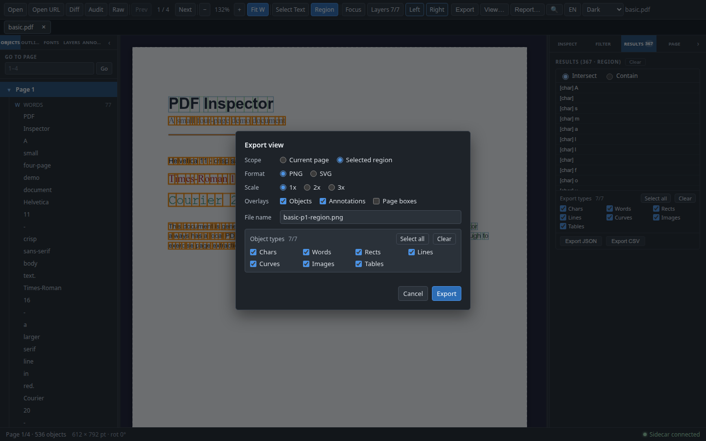
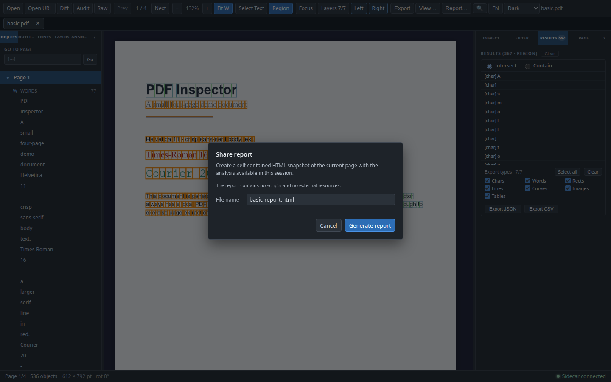

# 导出与分享

PDF Inspector 的导出分为三类：

- **对象 JSON/CSV**：原有的当前页/整档结构化数据导出，按 char / word / rect / line / curve / image / table 过滤。
- **导出视图（PNG/SVG）**：把当前页或选中区域渲染成带叠加层的图片快照，文件名可编辑。
- **分享报告（HTML）**：生成单文件、自包含的 HTML 检查报告，包含当前页截图与本次会话已有的分析结果。

三类导出都是**只读快照**：不修改 PDF、不改变当前缩放或选中状态，也不写入新的 PDF。对象/注释导出沿用原有 schema；视图导出和 HTML 报告不改变侧车协议，也不新增 Python 依赖。

**结论：**

- 视图导出支持当前页/选中区域、PNG/SVG、1x/2x/3x、Objects / Annotations / Page boxes 叠加层、对象类型过滤与可编辑文件名。
- PNG 以 base64 通过保存通道传输，桌面端与 Web 端都解码回二进制；Web 端触发浏览器下载。
- SVG 是“PNG 栅格底图 + 矢量叠加框”的自包含文件，不是把 PDF 内容重新矢量化的 SVG。
- HTML 报告内联 CSS、嵌入一张 PNG data URL，无 `<script>`、无外部资源；所有动态文本都做 HTML 转义。
- 报告只覆盖当前页，截图最长边目标 2400 px，报告上限 20 MB；缺失的字体/注释索引/审计数据会降级为说明文字。

## 对象 JSON/CSV 导出

入口是工具栏 `Export`。对话框可选择：

| 选项 | 行为 |
|---|---|
| 范围 | `Current page` 只导出当前页；`Whole document` 逐页导出整档 |
| 格式 | `JSON` 或 `CSV` |
| 对象类型 | char / word / rect / line / curve / image / table，可单选或全选；未勾选的类型不写入 |
| 文件名 | 默认 `<文档>-p<N>.json|csv` 或 `<文档>-all.json|csv`，可编辑；导出时统一扩展名并去掉目录部分 |

JSON 结构为：

```json
{
  "metadata": { "...": "..." },
  "exportedAt": "2026-01-01T00:00:00.000Z",
  "pageCount": 1,
  "objectTypes": ["char", "word", "rect", "line", "curve", "image", "table"],
  "pages": [
    {
      "page": 1,
      "width": 612,
      "height": 792,
      "chars": [],
      "words": [],
      "rects": [],
      "lines": [],
      "curves": [],
      "images": [],
      "tables": []
    }
  ]
}
```

未选中的类型写成空数组，而不是删除字段。JSON 还可能包含 `metadata.fontInfo`（字体嵌入详情）、`page.boxes` / `page.rotation`、表格的 `table.cellBoxes` / `table.cellSpans`，以及图片的 `content_hash`（可读取时的 SHA-256）。

CSV 是单个文件、按类型分段，顺序固定为 `# chars` → `# words` → `# rects` → `# lines` → `# curves` → `# images` → `# tables`，带 BOM 与 RFC 4180 转义。表格段每行一个单元格，列为 `page, table_index, row, col, text`；其他段沿用各自的 BBox 与属性列。

桌面端使用原生保存对话框；Web 端把内容写成 Blob 并触发浏览器下载。对象导出不写入本地绝对路径。

## 导出视图（PNG/SVG）

### 入口与选项

工具栏的 `View…`（中文 `视图…`）打开对话框；这只是可见的短标签，按钮的 `aria-label`、tooltip 与命令面板命令仍是完整的 `Export view…`（中文 `导出视图…`）。无文档或页面数据未就绪时按钮与命令都禁用。

| 选项 | 行为 |
|---|---|
| 范围 | `Current page`；只有当前存在区域选择（`subset.source === 'region'` 且 bbox 有效）时，`Selected region` 才可用 |
| 格式 | `PNG` 或 `SVG` |
| 缩放 | `1x` / `2x` / `3x`，最终受像素上限夹取 |
| 叠加层 | `Objects`、`Annotations`、`Page boxes` 三个 checkbox，默认前两个开启 |
| 对象类型 | 复用 `ExportTypeSelector` 的七种类型；关闭 Objects 时类型选择器禁用 |
| 文件名 | 默认 `<文档>-p<N>.png|.svg`，区域导出带 `-region`；编辑后保留自定义名称，仅随格式切换替换已知扩展名 |

每次打开对话框都会恢复到“当前页 / PNG / 1x / Objects+Annotations / 全部类型 / 自动文件名”。区域导出前需要在画布上按 `R` 或点击 `Region` 拖出矩形；没有区域时选项保持禁用并显示提示。

### 截图实现

核心在 `src/renderer/services/export-capture.ts`：

- `capturePage(pdfDoc, pageNumber, pageData, annotations, options)` 用独立离屏 canvas 调用 PDF.js `page.render`，渲染比例与当前画布缩放无关。
- 对象框、注释框沿用现有坐标 helper 与 overlay 调色板；页面框使用 rotation-aware 的 PDF.js viewport 映射。
- `region` 使用 MediaBox 相对坐标（PDF pt）裁剪最终 canvas；裁剪前先绘制叠加层，框仍保持在页面坐标上。
- 缩放先夹到 `1..3`，再按最长边 `8192 px`、总像素 `32 MP` 缩小；返回实际应用的 `appliedScale` 与尺寸。
- 空区域或无效区域回退整页，并返回 `Region is empty; exported the full page.` 警告。
- 旋转页（`/Rotate` 90/180/270）跳过对象框与注释框，返回限制警告；页面本身与页面框仍可导出。
- 页面未加载、2D context 不可用、`toDataURL` 失败等错误会抛出可读消息，不写半成品文件。

### PNG/SVG 保存

- PNG：`capturePage` 生成 `data:image/png;base64,...`；对话框去掉前缀，把 base64 字符串作为 `content` 传给 `ipc.saveFile`，并设置 `encoding: 'base64'`、`mimeType: 'image/png'`。桌面主进程按 base64 解码写文件，Web 端用 `atob` 解码成 `Uint8Array` 后下载。
- SVG：`capturePageSvg(captured, pageData, annotations, options)` 生成单个 `<svg>`，包含 `<image href="data:image/png;base64,...">` 底图与 `<rect>` / `<line>` / 文本等矢量叠加框，按裁剪偏移对齐。SVG 以 utf8 文本保存，`mimeType: 'image/svg+xml'`。
- SVG 不包含 `<script>`，不引用外部字体、图片或样式；所有文本都是纯文本节点。它不是 PDF 的矢量重排，底图中的文字与图形仍是位图。
- 保存被取消时对话框保持打开，已有的截图警告仍可见，方便重试；保存或生成中不允许关闭对话框。

### 测试

```bash
npx vitest run \
  src/renderer/services/__tests__/export-capture.test.ts \
  src/renderer/services/__tests__/export-data.test.ts \
  src/renderer/components/Toolbar/ExportViewDialog.test.ts
```

`export-capture.test.ts` 覆盖全页/裁剪尺寸、对象类型过滤、注释框、页面框、scale 上限与超限拒绝、空区域回退、旋转页降级、失败路径，以及 SVG 的底图与无脚本结构。`ExportViewDialog.test.ts` 覆盖默认状态、区域禁用/启用、base64 PNG 参数、SVG utf8 参数、文件名校验与扩展名切换、取消/失败/生成中关闭，以及命令注册与中英文切换。

## HTML 检查报告

### 输入与数据归属

`src/renderer/services/export-report.ts` 的 `buildInspectionReport(input)` 是纯函数，输入包括：

- 文档显示名、`sourceUrl`、`metadata`；
- 当前页 `PageData` 与 `capturePage` 生成的截图；
- 当前页注释；
- 可选的整档注释索引与审计报告；
- 可选的字体统计；
- 生成时间与 BCP 47 语言标签。

工具栏 `ShareReportButton` 只纳入属于当前文档的数据：

- 当前页注释只在 `annotation-store.page === 当前页` 时使用；
- 整档注释索引只在 `documentKey`（本地路径或 URL）与当前文档一致时使用；
- 审计报告只在 `auditReport.filePath === 当前文件路径` 时使用；
- 字体统计直接取当前文档的 store 数据。

这样切换文档后不会把上一份文件的分析结果写进新报告。

### 报告结构

单个 HTML 依次包含：

| 小节 | 内容 |
|---|---|
| 文档摘要 | 文档名、页数、当前页、页面尺寸、旋转、PDF 版本、是否加密、metadata 标题/作者/Producer |
| 页面截图 | 嵌入的 PNG、页面号、像素尺寸与实际缩放；超出 2400 px 时附警告 |
| 页面组成 | 七类对象计数，以及 MediaBox / CropBox / TrimBox / BleedBox / ArtBox 表格 |
| 字体 | 字体名、页数、页面列表、字符数、字号范围、颜色；未分析时显示说明 |
| 注释 | 当前页注释数；有整档索引时追加汇总、链接问题、表单问题，问题表最多 100 条 |
| 审计 | 错误/警告/信息/总数与工具版本；发现表最多 200 条；未运行审计时显示说明 |
| 页脚 | 只读快照免责声明：无脚本、无外部资源，也不代表 PDF/A 合规或无障碍认证 |

### 安全、体积与语言

- 所有动态文本（文档名、注释、字体、审计发现、URL）都经过 `escapeHtml`，同时转义标签与引号。
- 不使用 `<script>`、`<style>` 外部链接、外部字体或图片；截图只接受 `data:image/png;base64,` 前缀。head 中设置 `default-src 'none'; img-src data:; style-src 'unsafe-inline'` 的 CSP。
- 截图缩放由 `reportCaptureScale()` 计算：优先让最长边落在 2400 px 内，并夹到 `1..2`；页面在 1x 已超出时保留 1x，并在报告中写警告。
- `REPORT_MAX_BYTES = 20_000_000`，超出时抛错并提示缩小截图或省略可选分析，不静默截断。
- `<html lang>` 使用当前 UI locale（`en` / `zh-CN`），但报告的小节标题与正文目前固定为英文；对话框本身会随 UI 切换语言。

### 入口与文件名

- 工具栏 `Report…`（中文 `报告…`）打开确认对话框；可见标签同样只是缩写，`aria-label`、tooltip 与命令面板命令为完整的 `Share report…`（中文 `分享报告…`）。
- 默认文件名 `<文档>-report.html`，可编辑；`sanitizeReportFileName` 会去掉目录、非法字符与重复的 `.html`。
- 保存使用 `encoding: 'utf8'`、`mimeType: 'text/html'`；Web 端下载，桌面端使用原生保存对话框。
- 生成或保存中不允许关闭；取消保存时保留对话框与截图警告。

### 测试

```bash
npx vitest run \
  src/renderer/services/__tests__/export-report.test.ts \
  src/renderer/components/Toolbar/ShareReportButton.test.ts
```

`export-report.test.ts` 覆盖完整文档、无脚本/无外部资源、转义、摘要与页面组成、截图警告、字体/注释索引/审计的缺失降级、问题表截断、语言回退、20 MB 上限与截图缩放。`ShareReportButton.test.ts` 覆盖当前文档数据归属、HTML utf8 保存、文件名回退、取消/失败/生成中关闭、命令注册与中英文切换。

## 真实验证

本次工具栏标签修复只改了三个触发按钮的 CSS、`ExportViewDialog` / `ShareReportButton` 的标签渲染、中英文目录与 Toolbar 测试，没有改动导出/截图/服务的实现，也没有新增依赖。最终确认命令：

```bash
npx tsc -b
npx tsc -p tsconfig.web.json --noEmit
npm run build:web
npm run build:web-server
npx vitest run \
  src/renderer/services/__tests__/export-capture.test.ts \
  src/renderer/services/__tests__/export-report.test.ts \
  src/renderer/services/__tests__/export-data.test.ts \
  src/renderer/components/Toolbar/ExportViewDialog.test.ts \
  src/renderer/components/Toolbar/ShareReportButton.test.ts \
  src/renderer/components/Toolbar/Toolbar.test.ts \
  src/renderer/store/__tests__/theme-store.test.ts \
  src/renderer/store/__tests__/theme-css.test.ts \
  src/renderer/components/Toolbar/ThemePicker.test.ts \
  src/renderer/components/Toolbar/LanguagePicker.test.ts \
  src/renderer/i18n/__tests__/translate.test.ts \
  src/renderer/i18n/__tests__/store.test.ts
git diff --check
```

当前结果：`npx tsc -b`、`npx tsc -p tsconfig.web.json --noEmit`、`npm run build:web`、`npm run build:web-server` 均通过；本轮相关 Vitest 共 12 个文件、262 个用例通过（含 Toolbar 新增的短标签/可访问名称用例）；`git diff --check` 无空白错误。

工具栏标签在 1280×900、1440×900、1600×900 的英文与中文界面下都不再换行：`Export` / `View…` / `Report…`（中文 `导出` / `视图…` / `报告…`）均为单行，按钮内部没有换行或省略号截断；按钮的 `aria-label` 与命令面板标题仍是完整名称 `Export view…` / `Share report…`（中文 `导出视图…` / `分享报告…`）。工具栏使用 3px 间距与 84px 主题选择器，`<1440px` 还会隐藏文件名，因此 1280 px 下固定控件也没有横向裁切。

真实 Web 构建（1440×900，`basic.pdf`）的导出验证：

| 检查 | 结果 |
|---|---|
| 工具栏 `View…`（可访问名称 `Export view…`） | 打开对话框；未选区域时 `Selected region` 禁用，拖出区域后启用，文件名变为 `basic-p1-region.png` |
| PNG 区域导出 | 下载文件为 `267 × 222`、8-bit RGBA（`srgba`）、首字节 `89 50 4E 47 0D 0A 1A 0A` |
| PNG 当前页 2x | 下载文件为 `1224 × 1584`，对应 612 × 792 pt 页面 |
| SVG 区域导出 | 文件以 `<svg ...>` 开始，包含 `data:image/png;base64,` 底图，无 `<script>` |
| 工具栏 `Report…`（可访问名称 `Share report…`） | 下载 `basic-report.html`，208,976 字节；含 `<!doctype html>`、1 个 `data:image/png;base64`、0 个 `<script>`，资源引用只有该 data URL |





## 已知限制与边界

- **只读：** 不修改 PDF、不写回内容、不做 OCR、不做 PDF/A 认证；导出只读取当前文档与当前页。
- **单页/单区域：** 视图导出一次只处理当前页或一个区域；没有整档 1000 页图片导出、批量截图或缩略图打包。
- **SVG 不是矢量 PDF：** SVG 底图是 PNG 栅格，只有叠加框是矢量。需要真正矢量内容时应使用其他工具重新导出 PDF。
- **旋转页降级：** 对象框与注释框依赖未旋转的页面坐标，旋转页会省略它们并返回警告；页面框仍按 rotation-aware 映射绘制。
- **区域语义：** 区域来自当前框选（`subset`），切换页面、清除选择或重新筛选后不再可用；空区域回退整页而不是报错。
- **报告只含当前页：** 不会为整档每页生成截图；注释索引与审计只在属于当前文档时纳入，且问题/发现表有 100/200 条上限。
- **报告正文英文：** UI locale 会写入 `<html lang>`，但报告小节标题、状态文案与免责声明目前固定英文；需要中文正文时应在实现层增加报告消息目录，而不是在本文档中承诺。
- **体积上限：** 截图最长边目标 2400 px，报告上限 20 MB；超限会失败并提示，不做自动裁剪分析数据。
- **保存通道：** PNG 以 base64 文本经过 `ipc.saveFile`；Web 端下载目录由浏览器决定，文件名可能被浏览器去重（例如 `basic-p1 (1).png`）。
- **依赖边界：** 视图导出与报告全部在渲染层完成，不新增侧车 RPC、不增加 Python 依赖，也不改变对象/注释导出的 JSON/CSV schema。
