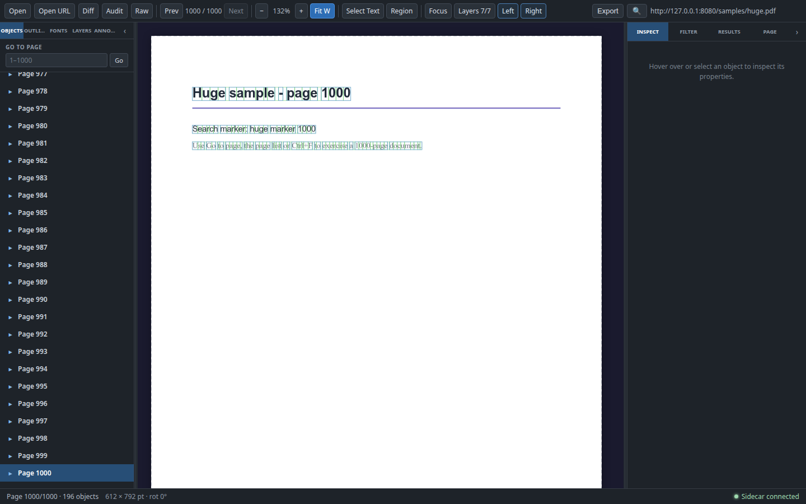
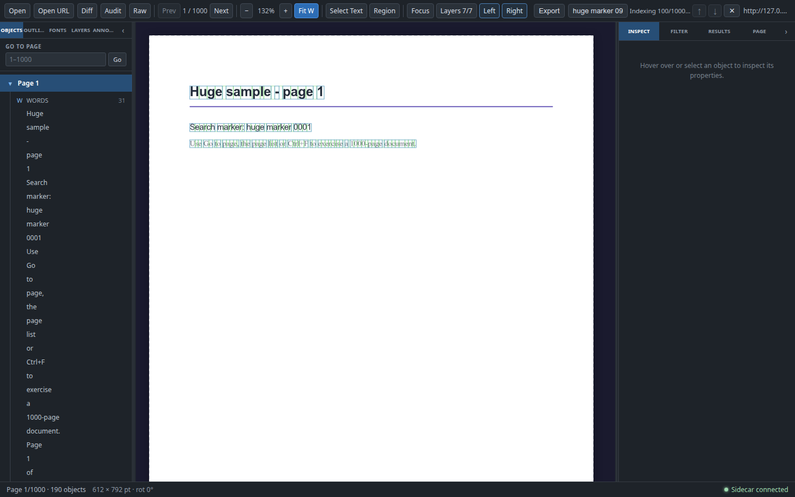
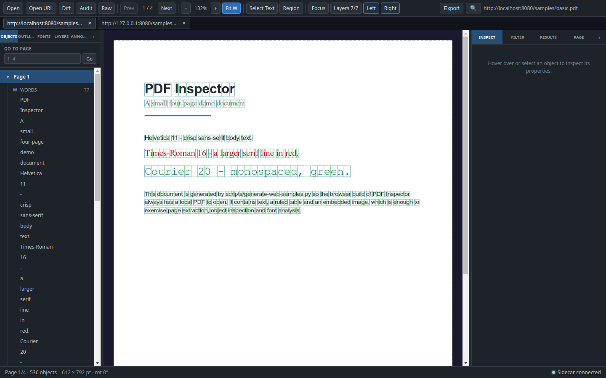

# 大文档与多文档工作台

PDF Inspector 的大文档工作分为两部分：先让 1000 页级文档的翻页、搜索与后台分析互不阻塞，再让桌面端在多个文档标签之间切换。本文记录 H1–H3 的实现边界、桌面标签页的快照语义、Web 端的单文档现状，以及 **H4（Web 多文档注册表）被显式延期的原因和后续设计要求**。

**结论：**

- H1–H3 已实现：双通道 sidecar、搜索分批与进度、页面列表窗口化与跳页、桌面文档标签页。
- **H4 未实现，Web 仍是单文档。** Web 端没有文档标签栏，也不会把第二次打开静默地当成新标签；H4 需要改服务端注册表与临时文件所有权，已记录为后续设计。
- 桌面端最多两个 Python 进程（交互通道 + 懒启动的后台通道），且两个通道打开同一份文档；标签页只保存视图快照，不保存分析结果或第二份 PDF.js 文档。

## 双通道 sidecar

桌面端（Electron 主进程）与 Web 端（Node HTTP 后端）使用同一张路由表：`laneForMethod()` 位于 `src/main/sidecar-pool.ts`，Web 后端直接导入它，避免两侧策略漂移。

```
React 渲染层
  │ Electron IPC / HTTP /api/rpc
  ▼
SidecarPool
  ├─ interactive 通道 ── open / extract_page / extract_metadata / get_image_data / shutdown
  └─ background 通道 ─── analyze_fonts / audit_document / audit_pages
                          raw_document / raw_object / raw_page_content / diff_documents
        （lazy：第一次后台请求才创建）
```

### 请求路由表

| 方法 | 通道 | 超时（主进程/后端） | 说明 |
|---|---|---|---|
| `open` | interactive | `OPEN_PDF_TIMEOUT_MS` = 120s | 打开文档并扫描字体资源；新文档替换旧文档 |
| `extract_page` | interactive | `EXTRACT_PAGE_TIMEOUT_MS` = 120s | 当前页提取，正常远低于 1s |
| `extract_metadata` | interactive | 默认 30s | 轻量元数据 |
| `get_image_data` | interactive | 默认 30s | 图片对象预览 |
| `analyze_fonts` | background | `ANALYZE_FONTS_TIMEOUT_MS` = 120s | 整档字体分析 |
| `audit_document` / `audit_pages` | background | `AUDIT_TIMEOUT_MS` = 120s | 文档级审计 + 每 10 页一批 |
| `raw_document` / `raw_object` / `raw_page_content` | background | `RAW_TIMEOUT_MS` = 120s | 只读原始对象与内容流 |
| `diff_documents` | background | `DIFF_TIMEOUT_MS` = 300s（**无进展**预算） | 同时提取两份文档；每页指纹/配对完成后上报进度并重置该预算，因此总时长可以超过 300s |
| 未知方法 | interactive | 默认 30s | 保持引入双通道前的行为 |

所有预算都是**空闲（no-progress）预算**，不是总时长上限：sidecar 在处理过程中会为当前请求写独立的 stdout 行 `{"id": <request id>, "progress": {...}}`，主进程与 Web 后端的管理器收到后只重置该请求的计时器，既不 resolve 也不 reject，并保留 pending 条目。目前只有 `diff_documents` 会上报进度（`start` → 每页 `fingerprints` → 配对后 `pages` 0/N → 每页结果后 `pages` i/N → `done`），其他方法不产生进度行，行为与以前一致。超时文案统一为 `Request "<method>" timed out after <budget> without progress`。

渲染层在 IPC 之外还有一层计时器，统一比主进程预算多 5s（例如 `ANALYZE_FONTS_RENDERER_TIMEOUT_MS = 125s`）。这样主进程能先返回清晰的 `Request "…" timed out after …`，而不会先触发渲染层的 “Sidecar timeout” 重启。**Diff 是例外**：`diffPdfs` 不再经过渲染层计时器（也没有 `DIFF_RENDERER_TIMEOUT_MS`），因为固定的总时长会在合法的长时间 diff 上误判失败并重启健康的 sidecar；Diff 的超时完全由主进程/Web 后端的、可被进度续期的 300s 空闲预算决定。

### 懒启动与文档同步

- 交互通道在应用启动时创建；后台通道在**第一次**字体/审计/Raw/Diff 请求时才创建，因此只看页面的文档始终只跑一个 Python 进程。
- 后台通道首次使用时启动并打开**当前文档**一次；`backgroundOpenedPath` 记录已确认打开的路径，避免同一次启动重复 `open`。
- 文档切换时，交互通道先 `open` 新文件；如果后台通道已经运行，它在后台队列中异步同步到新路径，调用方不等待。队列每次执行都会重新读取 `documentPath`，因此连续切换最终落在最新文档上。
- 后台打开失败只记录日志，不影响交互式翻页；下一次后台请求会重试并返回自己的错误。
- `restart()` 重启两个通道：交互通道失败会向上返回；后台重启失败只记录，后续请求可自愈。`stop()` 同时停止两个通道，退出路径不会因为某条通道卡住而留下 Python 进程。
- 两个通道始终打开**同一份文档**，没有“每文档一个 sidecar”的实现；切换文档就是重新打开，不保留 N 份解析结果。

## 搜索分批与进度

搜索索引由 `usePdfSearch` 在第一次输入非空查询时构建，数据是每页 PDF.js `getTextContent()` 的字符串数组，不保存 PDF.js 页面对象。

- **分批：** `SEARCH_INDEX_BATCH_SIZE = 10`，按 `pageBatches()` 的闭区间批次读取。
- **进度：** `searchIndexProgress` 初始为 `{ done: 0, total }`，每批结束写入 `{ done: end, total }`。SearchBox 的计数槽显示 `Indexing 40/1000…`，索引完成后同一位置恢复为 `1/1` 形式的匹配计数；槽位宽度预留，避免工具栏抖动。
- **让出渲染：** 每页/每批之间都有 `await`，长文档索引期间当前页仍可滚动、翻页与渲染。
- **取消：** 查询被清空、搜索框关闭、组件卸载、文档切换时都会递增 `buildId` 并清空进度。正在运行的构建在每页与每批边界检查自己是否过期，过期立即返回，不写入结果。
- **合并请求：** 并发的 `ensureIndex()` 复用同一个 `pageTextsPromise`，不会为同一次输入启动多个索引。
- **陈旧查询：** 索引完成后会再次比较 `searchQuery`；用户继续输入时，旧查询的匹配结果被丢弃。空查询不会构建索引，并会取消正在运行的构建。
- **匹配导航：** 索引完成后计算全部匹配；有结果时跳到第一条，Enter/↓ 与 Shift+Enter/↑ 在结果间环绕，并复用带边界保护的页面导航。

搜索索引只保存文本，因此 1000 页的开销远小于保留 1000 个 PDF.js 页面对象；它属于当前文档，文档切换/关闭后释放，本阶段没有按字节的索引上限。

## 页面列表、跳页与对象上限

`StructureTree` 的页面列表面向 1000+ 页：

- **窗口化绘制：** 每个页面行使用 CSS `content-visibility: auto` 与 `contain-intrinsic-size: auto 30px`；滚动条高度保持真实，只有视口附近的行真正绘制。DOM 中仍有每页一个行节点，这是 CSS 窗口化而不是第三方虚拟列表。
- **只展开当前页：** 只有当前页的对象组会挂载；点击当前页的行可折叠/展开对象组，访问其他页时新页默认展开。1000 页时不会同时展开 1000 份对象树。
- **Go to page：** 面板顶部固定一个输入框和 `Go` 按钮，占位符显示 `1–1000`。输入必须是非负整数；空值、`3a`、负数被忽略并保留文本以便修正；超出范围会夹到 `1..pageCount`，然后走与 Prev/Next 相同的受保护导航。
- **对象上限：** 当前页 Words 最多显示 50 条，Rects/Lines/Curves/Images/Tables 每组最多 200 条；超出时显示 `Showing first N of M …`，不会静默截断。选中对象仍按类型/页/BBox 映射回完整对象，命中测试不受截断影响。

## 桌面文档标签页

标签页只在桌面端出现：`supportsDocumentTabs()` 检查 `window.pdfInspector.openPdfPath` 是否存在，浏览器适配器故意不实现它，因此 Web 端保持单文档。

### 快照语义

```ts
interface DocumentTab {
  id: string;
  path: string;          // 本地路径，或 URL 文档的临时副本
  sourceUrl: string | null;
  name: string;          // 标签显示名（URL 或 basename）
  metadata: PdfMetadata;
  snapshot: {
    currentPage: number;
    zoom: number;
    overlayVisibility: Record<string, boolean>;
    leftTab: LeftPanelTab;
    inspectorTab: InspectorTab;
    searchQuery: string;
  };
}
```

快照只包含**视图状态**。切换时：

1. `saveActiveSnapshot()` 把当前 `pdf-store` / `workspace-store` 的状态写回旧标签；
2. 用 `openPdfPath`（本地文件）或 `openPdfUrl`（URL）无对话框地重新打开目标文档；
3. `setFile()` 换入新文档，同时重置旧文档的字体/审计/Raw 结果与选中对象；
4. `restoreViewSnapshot()` 恢复缩放、叠加层可见性、左右面板标签与查询字符串；
5. `navigate(clampSnapshotPage(...))` 恢复页码，超出新文档页数时夹到有效范围，并重新提取该页。

因此页面、缩放、叠加层和面板标签会保留；**字体分析、审计结果、Raw 展开状态不进入快照**，切回后需要重新运行。搜索查询会写回 store，但匹配结果与文本索引不跨文档保留，切换后搜索按当前文档重新建立。标签是会话状态，不写入 localStorage。

### 打开、切换与关闭

- 打开本地文件或 URL 会新增标签；相同本地路径或相同 `sourceUrl` 再次打开时聚焦已有标签，不重复创建。
- 标签栏位于工作区顶部，关闭按钮独立于标签文字；标签过多时横向滚动。
- 关闭活动标签会激活同位置的邻居（最后一个则前一个），关闭最后一个标签回到空状态并停止文档跟踪。
- URL 标签的临时下载文件由“当前文档”持有：切换到另一个文档会删除上一个下载副本，因此重新激活 URL 标签会**重新下载**并得到新的临时路径与元数据，标签用新的路径/元数据更新，但 `sourceUrl` 保持不变。
- Diff/Audit/Raw 工作区打开时标签栏隐藏，避免对不可见的 Inspect 文档执行切换。
- 切换期间只接受最新一次请求，慢的旧打开结果不会覆盖新选择；关闭活动标签复用同一流程。

## Web 模式与 H4 评估（延期）

### 当前实现：单文档注册表

`server/web-server.ts` 的 `DocumentRegistry` 只有一个 `current: OpenDocument | null` 槽位：

- `open(filePath, name, isTemp)` 调用 sidecar `open`；成功后生成新的 `id` 并替换 `current`。
- `findById(id)` 只匹配当前文档，否则返回 `null`。
- `/doc/:id/:name` 只负责按 Range 流式返回当前文档文件；它不是“切换文档”接口，也不会激活 sidecar 中的另一份文档。
- `/api/open`（上传）和 `/api/open-url`（下载）都走同一个替换式 `open`。上传的临时文件先由 `uploadedTempFiles` 跟踪，打开成功后所有权转给注册表；被替换的旧临时文件在成功打开后删除。
- `/api/rpc` 的白名单方法全部作用于 sidecar 当前打开的文档；没有按 id 激活、列举或关闭文档的接口。
- Web 适配器 `src/web/ipc-adapter.ts` **故意省略** `openPdfPath`，因此 `supportsDocumentTabs()` 为 false；Web 不渲染文档标签栏，第二次打开会替换当前文档，而不是新增可切换标签。
- Diff 的上传走独立的 `DiffUploadStore`，不替换当前文档；它的 token 存储有 16 份 / 512 MiB / 10 分钟上限，并逐份删除临时文件。

### 为什么延期

H4 是**服务端设计变更**，不是给渲染层补一个标签栏：

1. **sidecar 只有一份打开文档。** 两个通道都只打开一个文件；即使注册表保存两个 `OpenDocument`，`/api/rpc` 仍只能作用于 sidecar 当前打开的那一份。标签切换必须重新 `open`（串行化），或者改成每文档 sidecar，而后者是明确的非目标。
2. **临时文件所有权是单槽的。** 注册表只在替换当前文档和关闭服务时删除临时文件；没有“按标签关闭只删除该文档副本”的所有权模型。直接加第二份文档会删除/泄漏错误文件。
3. **`/doc/:id` 的可寻址性依赖 current。** 浏览器标签要保留 PDF.js 对象 URL，必须让旧 id 的文件在未激活时仍可读取；当前 `findById` 对旧 id 返回 404。
4. **API 契约会扩散。** 需要新增按 id 激活/关闭/列举、错误语义、上传清理与并发串行化；`/api/open`、`/api/open-url`、`/api/rpc`、Web 适配器、标签 store 与现有 `web-open`/`web-pool` 测试都会受影响。
5. **会威胁 H1–H3 的稳定性。** 当前单文档假设贯穿 Inspect、Diff/Audit/Raw 的当前文档、桌面标签的重新打开逻辑和 Web 单文档测试。H4 若在 H1–H3 刚稳定时强行修改注册表，容易把“打开失败恢复上一个文档”“临时文件清理”“后台通道同步”这些已验证路径一起改坏。

计划本身把 H4 标为 conditional，并明确允许“时间或范围不足时显式延期，Web 保持单文档”。本阶段按此执行：**不实现 H4，不声称 Web 支持标签页，也不暴露半可用的切换入口。**

### 下一版需要什么

如果后续实现 H4，至少需要：

- `DocumentRegistry` 从单槽改为 `Map<id, OpenDocument>`，带文档数上限（例如 8）与临时文件总字节上限；LRU/显式关闭时删除对应临时文件。
- `/api/open` 与 `/api/open-url` 返回文档 id，但**不替换**其他文档；新增 `POST /api/documents/:id/activate`（或等价的选择接口）返回元数据并让 sidecar 打开该文档；新增 `DELETE /api/documents/:id` 关闭并清理该文档；可选 `GET /api/documents` 列举。
- 注册表维护 `activeDocumentId`；`/api/rpc` 明确作用于活动文档；激活操作串行化，失败时恢复上一个活动文档，不能破坏交互通道。
- `/doc/:id/:name` 按 id 服务文件，与活动状态解耦；浏览器标签的 PDF.js 对象 URL 在未激活时仍有效。
- Web 适配器增加按 id 打开/关闭/列举能力，标签 store 才能把 `supportsDocumentTabs()` 打开；否则继续隐藏标签栏。
- 每个文档独立的临时文件所有权、关闭标签只删自己的副本、服务关闭清理全部副本，并测试两文档可寻址、关闭不误删、数量/字节上限与 LRU 淘汰。
- 明确内存/磁盘上限文档；本阶段不引入认证或多用户隔离。

在这些条件满足前，Web 多文档保持延期，Web 仍是单文档工作区。

## 清理与内存边界

| 资源 | 边界 |
|---|---|
| 交互 sidecar | 应用启动即创建，1 个进程；退出时优雅关闭后强制结束 |
| 后台 sidecar | 第一次后台请求才创建，最多再 1 个进程；本阶段不做空闲自动退出，退出/重启统一处理 |
| 打开文档 | 每个 sidecar 通道 1 份；切换即重新打开，不保留 N 份解析结果 |
| PDF.js | 仍只保留当前活动文档；标签不持有第二份 PDF.js 文档 |
| 标签快照 | 仅页码、缩放、叠加层、面板标签、查询字符串与元数据，不保存字体/审计/Raw/搜索索引 |
| 搜索索引 | 当前文档每页一个文本字符串数组；文档切换/关闭/搜索取消时丢弃 |
| 桌面 URL 临时文件 | 当前文档持有一个下载副本；替换文档或退出时删除；标签切回 URL 会重新下载 |
| Web 上传/下载临时文件 | 系统临时目录 `pdf-inspector-web/uploads`、`downloads`；注册表当前文档持有，替换/关闭服务时删除 |
| Web Diff 上传 | `pdf-inspector-web/diff`；最多 16 份、总计 512 MiB、10 分钟 TTL，token 单次使用并在 finally 删除 |
| 异常退出 | 清理是尽力而为；崩溃或强杀可能残留系统临时目录文件，需要手动清理 |

## 验证

### 命令

```bash
npx tsc -b
npx tsc -p tsconfig.web.json
npx vitest run
.venv/bin/python -m pytest sidecar/__tests__ -q
npm run build:web
npm run build:web-server
```

本阶段记录（Linux，Node 22 / Python venv；Chrome 157 headless）：

- `npx tsc -b`：通过；`npx tsc -p tsconfig.web.json`：通过。
- `npx vitest run`：97 个测试文件、1276 个用例全部通过。
- `.venv/bin/python -m pytest sidecar/__tests__ -q`：489 个用例通过。
- `npm run build:web`、`npm run build:web-server`：构建成功（Vite 仅提示既有 chunk > 500 kB）。
- `git diff --check`：无空白错误。

### `huge.pdf` 夹具

`python scripts/generate-web-samples.py` 现在额外输出 `web-samples/huge.pdf`，并打印其绝对路径：

- 1000 页，固定元数据、固定文本、`invariant=1`，无时间戳/随机数，两次生成 SHA-256 一致。
- 每页只有标题、`Search marker: huge marker NNNN`、一行说明和页脚，便于验证翻页/跳页/搜索规模，而不是字体或版面复杂度。
- 既有 `basic.pdf`、`large.pdf`、`annotations.pdf`、`raw.pdf`、Diff 示例的 SHA-256 在重新生成前后保持不变。
- 文件约 735 KB；用 pdfplumber 抽查第 1/500/1000 页的文本与页码均正确。

### 浏览器实测（1440×900 截图；1280/1440/1600 宽度检查）

| 检查 | 结果 |
|---|---|
| 打开 `/samples/huge.pdf` | 工具栏显示 `1 / 1000`，左侧页面树有 1000 个页面行，Go to page 占位符 `1–1000` |
| Go to page 输入 `1000` | 工具栏变为 `1000 / 1000`，页面 1000 被标记为当前页并重新提取 |
| 页面列表 | 滚动到末尾显示 `Page 977 … Page 1000`，当前页折叠时仍保持选中 |
| `Ctrl+F` 搜索 `huge marker 0999` | SearchBox 显示 `Indexing 100/1000…`；索引结束后显示 `1/1`，并跳到第 999 页 |
| 控制台/页面错误 | 无 |
| 横向溢出（搜索框展开） | 1280/1440/1600 均 `scrollWidth == clientWidth`；≤1280 隐藏文件名但输入框、计数、上/下与关闭按钮全部可见；1440/1600 文件名继续显示 |

截图（均为 1440×900，来自真实 Web/桌面构建）：

| 截图 | 内容 |
|---|---|
|  | `/samples/huge.pdf` 跳到第 1000 页：工具栏 `1000 / 1000`，左侧页面列表末尾与 Go to page 输入框 |
|  | `huge marker 0999` 搜索期间 SearchBox 显示 `Indexing 100/1000…`，输入框、计数与上/下/关闭按钮全部可见，页面仍可查看 |
|  | Electron 桌面端通过 URL 打开两个文档后的真实标签栏；切回第一个文档后工具栏显示 `1 / 4` |

桌面标签截图由真实 Electron 28 + `xvfb` 驱动（通过 CDP 固定 1440×900 视口）：先打开 `http://localhost:8080/samples/basic.pdf`，再打开 `http://127.0.0.1:8080/samples/large.pdf`，随后点击第一个标签切回。两个标签都保留，切回后工具栏显示 `1 / 4`；页码、缩放与面板快照的恢复逻辑由 H3 单元测试覆盖。

搜索进度截图是在 CDP 将渲染进程 CPU 限速为 6× 时捕获的，以便让 1000 页索引的瞬态进度可见；截图中的 `Indexing 100/1000…` 是真实状态，没有合成或手工绘制。

## 已知限制与后续

- **Web 单文档：** H4 延期，Web 没有标签栏，第二次打开替换当前文档；这是明确行为，不是未完成的多标签。
- **切换 URL 标签会重新下载：** 单个下载副本归当前文档所有；重新激活 URL 标签需要重新下载，可能比本地文件慢，并产生新的临时路径。
- **分析结果不随标签保留：** 字体、审计、Raw 结果切换后重置/重新运行；搜索索引也不跨标签保留。
- **后台通道不自动空闲退出：** 一旦使用过字体/审计/Raw/Diff，第二个 Python 进程会保留到退出或重启；这是当前阶段的简化。
- **搜索索引没有字节上限：** 只保存文本，1000 页可接受；更大的文档仍依赖取消与文档切换释放。
- **页面列表是 CSS 窗口化：** 1000 页仍有 1000 个行节点，只是减少绘制；更大数量若出现卡顿，再评估真正的虚拟列表。
- **窄窗口搜索：** 搜索框展开时工具栏使用可收缩的 SearchBox；窗口宽度 ≤1280px 时隐藏文件名（不是控件），输入框、计数、上/下与关闭按钮保持可见；>1280px 时文件名继续显示。1280/1440/1600 实测均无横向溢出。
- **标签是会话状态：** 不写入 localStorage，重启应用后不恢复标签或最近文件。
