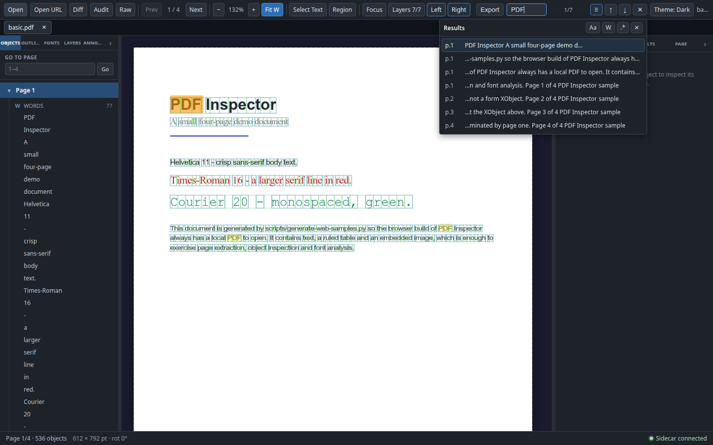
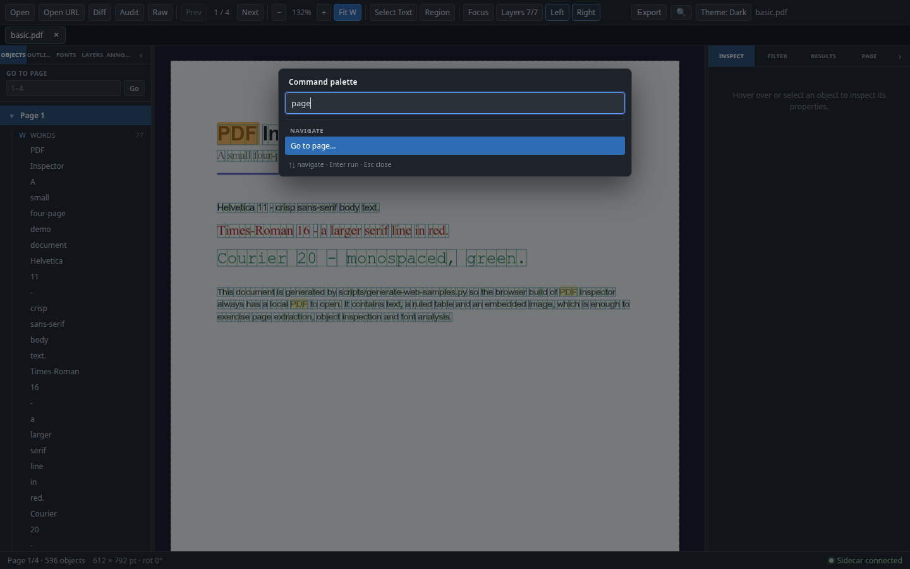

# 搜索 2.0 与命令面板

搜索 2.0 把当前文档的本地全文搜索从“上一处/下一处”扩展为带选项、结果列表和上下文预览的跳转工作流；命令面板把分散在工具栏、工作区和 store 中的入口集中到一个键盘驱动的列表。两者都只复用渲染层已有能力：搜索仍读取 PDF.js 的页面文本，命令面板只调用现有 handler，不引入新的 Python 依赖，也不改变 PDF 解析、注释数据或外部网络行为。

**结论：**

- 搜索支持大小写、整词、正则三种选项，结果面板按页列出命中与预览，点击或键盘选择后跳转；非法正则显示内联错误，零长度匹配被跳过。
- 结果最多保留 5,000 条并明确显示截断提示；模式长度上限为 500 字符；匹配不跨页，也不会把不同页面拼成一段文本。
- 输入有 300ms 防抖，文本索引按 10 页一批建立并缓存；切换选项复用缓存，不重建索引。
- `Ctrl/Cmd+K` 打开命令面板，按 File / Navigate / View / Analyze / Export 分组执行已注册命令；命令复用现有 IPC、handler 和 store，没有第二套打开/导出/分析逻辑。
- 没有新增命令面板或搜索的 Python 依赖；外部行为（网络、OCR、注释/表单数据）保持不变。

## 搜索 2.0

### 索引、防抖与缓存

`usePdfSearch` 在第一次需要搜索时构建当前文档的文本索引：

- 对每一页调用 PDF.js `getTextContent()`，把文本项用换行连接成 `buildPageText()` 的页面字符串；索引只保存字符串，不保存 DOM 或 `PDFPageProxy`。
- `SEARCH_INDEX_BATCH_SIZE = 10`，按闭区间批次读取页面；SearchBox 的计数槽在索引期间显示 `Indexing 40/120…`，完成后恢复为 `1/7` 形式的命中计数。
- SearchBox 输入使用 **300ms 防抖**：连续输入只会在停顿后触发一次 `setQuery`；选项切换通过 `setOptions` 立即重算当前查询。
- 索引按当前文档缓存在 `usePdfSearch` 中。`Aa` / `W` / `.*` 变化只重新执行匹配，不重新读取 PDF.js 页面；切换文档会使缓存失效，离开 Inspect（SearchBox 卸载）后重新进入会重建索引。
- 清空查询或关闭搜索会取消正在进行的构建并清空进度；已完成的索引不会因为关闭搜索框而自动丢弃，但会在文档切换或 SearchBox 生命周期结束时失效。
- 索引期间翻页与当前页检查仍可用；同一时刻并发的 `ensureIndex()` 复用同一个构建 Promise，不会为一次查询启动多份索引。

### 匹配语义

| 选项 | 行为 |
|---|---|
| 默认 | 字面量搜索，大小写不敏感；字面量查询会先 trim 并转义正则元字符，所以 `.`、`(`、`$` 等按普通字符匹配 |
| `Aa`（大小写） | 开启后区分大小写，字面量与正则模式都生效 |
| `W`（整词） | 使用 Unicode 字母/数字边界 `(?<![\p{L}\p{N}_])(?:…)(?![\p{L}\p{N}_])`；`over` 不会匹配 `cover`，`书签` 不会匹配 `书签单`，下划线视为词字符 |
| `.*`（正则） | 直接使用用户 pattern，带 `u` 与 `g`；大小写不敏感时再加 `i`，字面量模式下的转义不再适用 |

其他规则：

- 空查询返回空结果，不抛错，也不会构建索引。
- 查询长度超过 `MAX_SEARCH_PATTERN_LENGTH = 500` 个字符时直接返回错误，不执行匹配。
- 非法正则（例如未闭合的 `(` 或字符类 `[`）返回 `SearchResultSet.error`，界面显示内联错误，不抛异常、不跳页，也不把错误伪装成“没有命中”。
- 零长度匹配（例如 `(?:)`、`\b` 或 `a*` 的空匹配位置）会被跳过，并按 Unicode code point 前进，避免死循环，也不会产生不可高亮的零宽结果。
- 每页独立扫描，匹配结果不跨页拼接；同一页内按出现偏移排序，跨页按页号排序。页内文本项用 `\n` 连接，因此页内换行可以被匹配，但 `end` 与下一页的 `start` 不会被拼成 `endstart`。
- `findMatchesDetailed()` 返回 `{ matches, truncated, total, error }`；兼容入口 `findMatches()` 只返回 `{ page, begin, length }` 的裸偏移。

### 上限、截断与预览

- `MAX_SEARCH_MATCHES = 5000`。达到上限后停止扫描并设置 `truncated = true`；此时 `total` 是已收集的命中数，不是精确总数。
- 结果面板显示 `Showing first 5,000 matches`，不静默截断；非截断结果不会显示该提示。
- 每条命中最多保留命中位置前后各约 36 个字符的上下文，连续空白折叠为一个空格，按位置添加省略号。
- 结果行的预览来自该 `preview`；如果旧调用方没有提供预览，面板回退显示 `Match at <offset>`，不会出现空行。

### 结果面板 UI

搜索框展开时，点击计数旁的 `≡`（`Search results`）打开结果面板；输入查询产生命中或正则错误时面板会自动打开。没有查询时 `Results` 按钮禁用。面板是搜索框下方的浮层，不推挤工具栏：

- 宽度约 420px，`max-width: calc(100vw - 24px)`，最大高度 50vh，内部滚动；结果行使用 CSS `content-visibility`，不为 5,000 条结果引入虚拟列表依赖。
- 头部显示 `Results`、`Aa` / `W` / `.*` 三个 toggle 和关闭按钮；toggle 的 `aria-pressed` 反映当前选项。
- 每行显示 `p.N`、上下文预览和当前命中状态；当前行用 `aria-current="true"` 标识，并随当前命中滚动到可视区域。
- 点击行调用 `goToMatch(index)`，跳到对应页并高亮；面板关闭，但搜索框保持打开。
- 选项 toggle 只调用 `setOptions` 重算，不关闭面板，也不重建文本索引。
- 状态覆盖：索引期间显示 `Indexing N/M…`；无命中显示 `No matches`；非法正则显示 `role="alert"` 的内联错误；截断显示 `Showing first 5,000 matches`。没有命中时计数槽显示 `0/0`。
- 关闭搜索使用搜索框的 `✕`（`Close search`）或 `Escape`；关闭时会清空查询、结果、错误和进度，但保留用户的搜索选项偏好。

### 键盘与关闭顺序

| 位置 | 按键 | 行为 |
|---|---|---|
| 搜索输入框 | `Enter` | 跳到下一处命中 |
| 搜索输入框 | `Shift+Enter` | 跳到上一处命中 |
| 搜索结果面板 | `↑` / `↓` | 在命中之间环绕移动当前项，并自动滚动到可视区域 |
| 搜索结果面板 | `Enter` | 激活当前获得焦点的结果行；行本身也是按钮，点击同样跳转 |
| 搜索结果面板 / 搜索框 | `Escape` | 先关闭结果面板；再按一次关闭搜索框 |
| 全局 | `Ctrl/Cmd+F` | 打开并聚焦搜索输入框（有文档时） |

`Escape` 是分层关闭的：结果面板先消费第一次，避免同时清空画布上的选中对象或筛选；搜索框与 App 级快捷键都遵守这一顺序。关闭搜索后再次按 `Ctrl/Cmd+F` 会重新打开搜索，但不会保留上一次的查询。

## 命令面板

### 打开、分组与注册

- `Ctrl/Cmd+K` 在全局捕获阶段打开命令面板，即使焦点在输入框中也能打开；打开后自动聚焦过滤输入框。
- 面板已打开时再次按 `Ctrl/Cmd+K`：命令模式会重新聚焦过滤框；页码子视图会返回命令列表。
- 命令按 `File` → `Navigate` → `View` → `Analyze` → `Export` 分组，组内按标题不区分大小写排序；过滤只做标题与 `keywords` 的小写 includes 匹配，不引入模糊匹配库。
- 命令注册由 `command-registry.ts` 管理：`registerCommands(owner, commands)` 按 owner 幂等替换；返回的函数是 token-guarded 的注销函数，组件卸载时只移除自己注册的那一组。重复 id 由最后注册的 owner 覆盖；同一个 owner 内重复 id 保留第一条。
- 工具栏、ExportDialog 与 App 分别在 `toolbar`、`export-dialog`、`app` owner 下注册命令；`Go to page…` 与 `Close palette` 是面板内置命令。命令的 `isEnabled` 在面板渲染时求值，异常时按禁用处理。
- 禁用的命令仍显示在列表中（带 `aria-disabled`），但 `↑/↓` 会跳过，鼠标点击与 `Enter` 都不会执行。
- 运行普通命令前先关闭面板，避免后续对话框叠在面板上；命令返回 rejected Promise 时只记录错误，不会让面板崩溃。`Go to page…` 是例外：它先留在面板内收集页码，提交后再关闭面板并导航。

### 命令集合

| 分组 | 命令 | 说明 |
|---|---|---|
| File | Open PDF…、Open URL… | 复用工具栏的打开/URL 对话框 handler |
| Navigate | Search document…（`Ctrl+F`）、Go to page… | 打开搜索；或进入页码子视图 |
| View | Toggle theme (Dark / Islands)、Toggle focus mode、Toggle left/right panel、Show layers panel、Clear selection、Close palette（`Esc`） | 调用主题、工作区与 pdf store 的现有状态方法 |
| Analyze | Compare PDFs…、Audit document…、Browse raw objects… | 复用 Diff/Audit/Raw 的现有打开流程 |
| Export | Export objects… | 打开现有 Export 对话框，不复制导出实现 |

依赖当前文档或工作区的命令通过 `isEnabled` 禁用：

- 无文档时禁用 `Search document…`、`Go to page…`、`Audit document…`、`Browse raw objects…` 与 `Export objects…`。
- 文档加载中时禁用打开与导出；Diff 激活时禁用 Audit/Raw/Layers，Audit 激活时禁用 Raw/Layers，Raw 激活时禁用 Layers。
- 禁用状态是命令可用性，不是隐藏；用户仍能看到入口和原因相关的当前上下文。

### 页码子视图

选择 `Go to page…` 后，面板切换到 `Go to page` 子视图：

- 显示 `Page number` 输入框，默认填入当前页；没有文档时命令本身不可用。
- 输入 `Enter` 或点击 `Go` 提交；只接受纯数字，页码夹取到 `1..pageCount`。
- 非法或空输入不会导航，面板保持打开；`← Back to commands` 返回命令列表。

### 与现有 UI 的关系

命令面板不是新的命令执行层：打开、URL、搜索、主题、面板、Diff/Audit/Raw、导出和清除都调用原有 handler 或 store action，面板只负责注册表、过滤、键盘选择和子视图。因此工具栏、快捷键与 store 仍是事实来源，不存在第二套 IPC 调用或重复的文件打开/导出逻辑。

## 快捷键

| 快捷键 | 作用域 | 行为 |
|---|---|---|
| `Ctrl/Cmd+F` | 全局（有文档时） | 打开并聚焦当前文档搜索 |
| `Enter` / `Shift+Enter` | 搜索输入框 | 下一处 / 上一处命中 |
| `↑` / `↓` | 搜索结果面板、命令面板 | 移动当前项（两端环绕） |
| `Enter` | 搜索结果行、命令面板 | 激活结果行 / 执行当前命令 |
| `Ctrl/Cmd+K` | 全局 | 打开命令面板；已打开时聚焦过滤框或返回命令列表 |
| `Escape` | 搜索 / 结果面板 / 命令面板 | 结果面板 → 搜索框 → App 的选中/筛选清理；命令面板直接关闭 |

## 验证

### 命令

```bash
npx tsc -b
npx tsc -p tsconfig.web.json --noEmit
TMPDIR=$(mktemp -d) npx vitest run
npm run build
npm run build:web
git diff --check
```

### 当前结果

- `npx tsc -b`：通过。
- `npx tsc -p tsconfig.web.json --noEmit`：通过。
- `TMPDIR=$(mktemp -d) npx vitest run`：**108 个测试文件、1653 个用例全部通过**。
- `npm run build`：通过；Vite 仅提示既有 chunk 超过 500 kB。
- `npm run build:web`：通过；同样只有既有的 chunk 体积提示。
- `git diff --check`：无空白错误。
- 本阶段没有修改 Python sidecar，也没有新增 Python 依赖；搜索与命令面板全部在渲染层完成。

### 真实 Web E2E 记录

在真实 Web 构建、1440×900 视口下验证：

| 检查 | 结果 |
|---|---|
| 打开 `basic.pdf`，`Ctrl/Cmd+F` 搜索 `PDF` | SearchBox 显示 `1/7`，结果面板列出 7 条命中，每条带 `p.N` 与上下文预览 |
| 开启 `.*` 后输入 `[` | 结果面板显示内联非法正则错误，不抛异常、不跳页 |
| `Ctrl/Cmd+K` 打开命令面板并过滤 `page` | 显示 `Navigate` 分组的 `Go to page…`，键盘选中后可进入页码子视图 |

截图（均为 1440×900，来自真实 Web 构建）：

| 截图 | 内容 |
|---|---|
|  | 查询 `PDF` 时计数为 `1/7`；结果面板列出 7 条 `p.N` 命中与上下文预览，头部为 `Aa` / `W` / `.*` 选项 |
|  | `Ctrl/Cmd+K` 打开命令面板，过滤 `page` 后只剩 `Navigate` 分组与 `Go to page…`，底部显示方向键/Enter/Esc 提示 |

更多相关说明：

- [README](../README.md)：功能截图、键盘快捷键与使用步骤。
- [大文档与多文档](large-docs.md)：搜索分批索引在大文档中的进度与取消行为。
- [注释、链接与表单](annotations.md)：`Annots → Whole document` 的独立注释搜索，不与本文的 PDF 文本搜索共享结果。

## 已知限制与边界

- **仅当前文档：** 搜索只覆盖当前打开的 PDF；没有跨文档搜索、搜索历史或查询收藏（标签快照只保留当前查询字符串，不保存结果或索引）。
- **仅 PDF 文本：** 不执行 OCR，不搜索注释、表单字段、链接或原始对象；注释/表单搜索属于 `Annots` 的独立索引。
- **不跨页拼接：** 正则可以匹配单页内的换行，但不会把不同页面拼成一段文本；跨页短语不会命中。
- **结果有上限：** 最多保留 5,000 条命中，截断后不保证精确总数；模式长度超过 500 字符直接报错。
- **没有结果导出：** 结果列表用于定位，不提供搜索结果导出或保存；对象/注释导出仍使用各自的 Export。
- **命令是注册集合：** 面板只列出当前构建注册的命令，不支持插件、用户自定义命令或快捷键编辑器；无文档或工作区冲突时命令会被禁用。
- **外部行为不变：** 搜索仍只读取 PDF.js 文本，不访问网络、不改变注释/表单/对象数据；命令面板不复制 IPC，也不新增后端接口。
- **关闭方式：** 搜索框通过 `✕`（`Close search`）或 `Escape` 关闭，不提供额外的取消入口。
- **选项是会话偏好：** 切换文档或关闭搜索只清空结果/错误/面板，搜索选项仍保留；`Aa` / `W` / `.*` 不写入 localStorage（[会话恢复](session.md) 只把查询字符串放进标签快照，不保存这些选项）。
