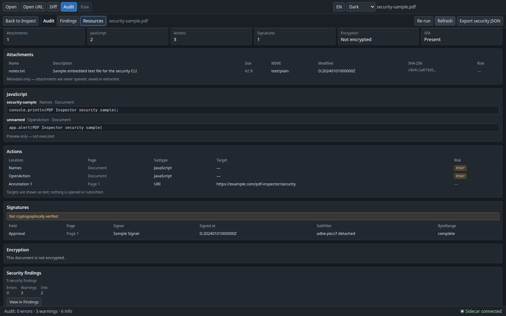

# 文档安全与附件检查

`pdf-inspector security` 以文档为单位列出一份 PDF 的安全资源：内嵌附件、JavaScript、动作、XFA、签名字段、加密与权限。它回答的是“这份文档带了哪些值得在打开或分发前确认的东西”，不是“这份文档是否安全”。

检查是完全只读的：

- 不执行 JavaScript，不做沙箱模拟，不判断脚本是否恶意；
- 不跟随 Launch、URI、SubmitForm、ImportData 等动作，不访问任何目标；
- 不打开、保存、下载、解压、预览或导出附件；附件只展示元数据与（有限大小内的）哈希；
- 不验证数字签名、证书链或时间戳；签名字段只报告“存在”；
- 不修改 PDF，不写回任何对象。

入口：

- **Audit 工作区**：工具栏 `Audit` 内的 `Findings / Resources` 模式切换；`Resources` 展示本文描述的资源清单，`Findings` 保留原有审计发现。
- **CLI**：`python sidecar/cli.py security FILE.pdf`，支持摘要、确定性 JSON 与单文件 HTML。
- **引擎**：`sidecar/security.py` 采集资源，`sidecar/audit.py` 的 `security_findings` 把它们并入 Audit 的 `security` 类别，`sidecar/security_report.py` 渲染摘要与单文件 HTML。桌面端、Web 端与 CLI 共用同一份 `SecurityReport` 契约。

## Audit 工作区

工具栏 `Audit` 打开文档体检工作区；标题后的分段控件在 `Findings` 与 `Resources` 之间切换，默认 `Findings`。

- **模式切换**：`Findings` 保留严重级别汇总、筛选、发现列表、详情与 `Export JSON`；`Resources` 用整块安全资源视图替换三栏内容。切换只改变视图，不关闭 Audit，也不改变 Inspect 的文档、页码、缩放或选中对象。
- **懒加载与缓存**：第一次进入 `Resources` 时通过后台 `security_document` 请求读取资源，界面显示 `Reading document resources…`；结果按文件缓存，切回 `Findings` 再进入不会重复扫描。切换文件会清空缓存；Audit 的 `Re-run` 也会清空资源缓存，若当前正停在 `Resources` 则立即重新读取。
- **工具栏**：`Resources` 模式下显示 `Refresh` 与 `Export security JSON`。`Refresh` 忽略缓存重新读取；`Export security JSON` 通过保存对话框写出完整 `SecurityReport`，建议文件名为 `<pdf 文件名>.security.json`。
- **加载失败**：读取失败只在资源视图内显示错误与 `Retry`；已经加载的资源会保留，Audit 报告与 `Findings` 不受影响。导出失败也只在 Audit 顶部显示本地提示，不会写成审计错误。
- **只读**：资源视图不执行脚本、不跟随动作、不打开或下载附件、不验证签名，也不修改 PDF；附件只展示元数据，没有打开、下载或导出附件内容的入口。

`Resources` 顶部是汇总卡：Attachments、JavaScript、Actions、Signatures、Encryption（`Encrypted` / `Not encrypted`）与 XFA（`Present` / `Absent`）。下方依次是：

1. **Attachments**：Name、Description、Size、MIME、Modified、SHA-256（短显示，完整值在悬浮提示中）与 Risk。名称含路径分隔符、`..` 或可执行扩展名时标记 `Risky`。
2. **JavaScript**：名称、位置、页码与有界源码预览；固定提示 `Preview only — not executed`，被截断的预览会单独提示。
3. **Actions**：Location、Page、Subtype、Target 与 Risk；目标只以文本展示，不打开、不提交。
4. **Signatures**：Field、Page、Signer、Signed at、SubFilter 与 ByteRange（`complete` / `incomplete`），并固定显示 `Not cryptographically verified`。
5. **Encryption and permissions**：Filter、V、R 与密钥长度；权限以 `Allowed` / `Denied` / `Unknown` 徽标展示。
6. **Security findings**：安全发现数量与 errors/warnings/info 计数；`View in Findings` 切回 `Findings` 并把类别筛选设为 `security`（严重级别重置为全部），没有安全发现时按钮禁用。

资源视图的文案随界面语言切换；schema 字段与动作 subtype 保持英文。

## 数据来源

资源全部来自侧车已经打开的 pdfminer 文档（`PdfExtractor._pdf.doc`），不重新下载、不发起网络请求：

| 资源 | 来源 |
|---|---|
| 文档事实 | trailer、catalog、页树与 `%PDF-` 头 |
| 附件 | catalog `/Names /EmbeddedFiles` 名称树 → `/Filespec` → `/EF /F`（或 `/UF`）流 |
| JavaScript | `/Names /JavaScript`、catalog `/OpenAction`、catalog/页面/注释/表单字段的 `/AA`、注释 `/A` |
| 动作 | 上述位置的 `/A` 与 `/AA` 动作字典，读取 `/S`、`/URI`、`/F`、`/D`、`/N` |
| XFA | `/AcroForm /XFA` 是否存在（数组或 stream） |
| 签名字段 | `/AcroForm /Fields` 递归查找 `/FT /Sig`，读取 `/T` 与 `/V` 的 `/Name`、`/M`、`/Reason`、`/Location`、`/SubFilter`、`/ByteRange` |
| 加密 | trailer `/Encrypt`（或 pdfminer 的 `doc.encryption`）的 `/Filter`、`/V`、`/R`、`/Length`、`/P` |

名称树同时支持 `/Names` 数组与 `/Kids` 节点，并用对象 id + 深度上限防止循环引用与恶意深树。

## 检查项

### 文档事实

`document` 固定输出以下字段：

| 字段 | 说明 |
|---|---|
| `pages` | 页数。 |
| `version` | PDF 版本，优先取文档版本，其次 trailer/catalog `/Version`，最后读文件头；不可读时为 `"unknown"`。 |
| `encrypted` | 是否存在 `/Encrypt`，或 pdfminer 报告文档已加密。 |
| `xfa` | `/AcroForm /XFA` 是否存在，即使其内容不可读。 |
| `hasMetadata` | catalog 是否存在 `/Metadata`（XMP）。 |
| `outputIntents` | `/OutputIntents` 数组长度。 |

### 附件

每个附件条目包含：

| 字段 | 说明 |
|---|---|
| `name` | `/UF`、`/F` 或名称树键；不做文件系统路径解析。 |
| `description` | `/Desc`，缺失为 `null`。 |
| `size` | 优先取 `/Params /Size`（正值，未压缩大小），否则回退到流 `/Length`（编码后长度）；不可读为 `null`。 |
| `mimeType` | 嵌入流或 filespec 的 `/Subtype`。 |
| `modified` | `/Params /ModDate` 原始 PDF 日期字符串。 |
| `sha256` | 解码后字节的 SHA-256；仅当流 `/Length` 与 `/Params /Size` 均不超过 16 MiB 时计算，否则为 `null`。 |
| `risky` | 名称含 `/`、`\`、`..`，或扩展名属于常见可执行类型（`.exe`、`.js`、`.bat`、`.cmd`、`.ps1`、`.sh`、`.jar` 等）。 |

`size` 是文档声明的值：`/Params /Size`（未压缩大小）与 `/Length`（编码后流长度）都可能与实际解码字节数不同。附件永远只作为元数据展示；Audit 的 `Resources` 视图、CLI 与 HTML 报告都没有“打开附件”“下载附件”或导出附件内容的入口。

### JavaScript

`javascript` 每一项包含 `name`（名称树键或动作名，可能为 `null`）、`location`（`Names`、`OpenAction`、`Page 3`、`Annotation 12 AA` 等）、`page`、`source` 与 `truncated`。源码只读取有界预览（最多 4096 字符）；超过 256 KiB 的脚本流不会为预览而解码，直接标记 `truncated: true`。预览永远不会被执行。

### 动作

`actions` 每一项包含 `location`、`page`、`subtype`、`target` 与 `risky`。`target` 是 `/URI`、`/F`、`/D` 或 `/N` 的展示值，只作为文本显示，不解析、不访问。以下 subtype 标记 `risky: true`：

- `Launch`
- `JavaScript`
- `SubmitForm`
- `ImportData`

URI、GoTo、Named 等其余动作按 subtype 展示，不跟随。

### XFA 与签名字段

- `document.xfa = true` 表示存在动态表单描述；页面上的可见内容可能来自 XFA 而不是页面内容流。
- `signatures` 每一项包含 `fieldName`、`page`、`signer`、`signedAt`、`reason`、`location`、`subFilter`、`byteRangeValid` 与固定为 `false` 的 `verified`。
- `byteRangeValid` 只做结构检查：偶数个非负整数、从 0 开始、区间不重叠。它不代表签名有效。
- 本工具**不做密码学验证**，也不判断证书链或时间戳。

### 加密与权限

`encryption` 在没有 `/Encrypt` 时为 `null`，否则包含 `filter`、`version`（`/V`）、`revision`（`/R`）、`keyLength`（`/Length`）与 `permissions`。

权限按 `/P` 的低位读取（best-effort，不作为合规结论）：

| 位 | 权限 | 字段 |
|---:|---|---|
| 3 | 打印 | `print` |
| 4 | 修改内容 | `modify` |
| 5 | 复制/提取 | `copy` |
| 6 | 添加/修改注释 | `annotate` |
| 9 | 填写表单 | `fillForms` |
| 10 | 辅助技术访问 | `accessibility` |
| 11 | 文档组装 | `assemble` |
| 12 | 高质量打印 | `highQualityPrint` |

`/P` 不可读时 `raw` 与各权限字段均为 `null`。`/R < 3` 时部分位的语义不同，因此界面与报告只展示“按位解析结果”。

## 资源上限

所有上限都在 Python 侧执行，目的是让畸形或恶意文档只降级，不让整次检查失败或耗尽资源：

| 限制 | 值 | 行为 |
|---|---:|---|
| 名称树递归深度 | 8 | 超过深度停止展开，不报错 |
| 附件数量 | 100 | 超出部分不列举 |
| 单个附件哈希大小 | 16 MiB | `/Length` 或 `/Params /Size` 超过则 `sha256: null`，仍展示声明大小 |
| JavaScript 条目 | 100 | 超出不列举 |
| 单段脚本预览 | 4096 字符 | 超出标记 `truncated: true` |
| 动作数量 | 500 | 超出停止枚举 |
| 签名字段 | 100 | 超出停止枚举 |
| 名称/描述/目标字符串 | 512 字符 | 截断后展示 |
| 表单字段遍历 | 1000 个、8 层 | 防止循环引用与超深树 |

引用解析失败、损坏的流或不可读的 catalog 值按“缺失”处理：单个条目返回 `null` 或被跳过，其余资源继续输出。

## JSON 报告（`SecurityReport`）

`--format json` 输出完整契约：

```json
{
  "schemaVersion": 1,
  "tool": { "name": "pdf-inspector", "version": "0.2.0" },
  "document": {
    "pages": 1,
    "version": "1.7",
    "encrypted": false,
    "xfa": true,
    "hasMetadata": false,
    "outputIntents": 0
  },
  "attachments": [
    {
      "name": "notes.txt",
      "description": "Sample embedded text file for the security CLI",
      "size": 42,
      "mimeType": "text/plain",
      "modified": "D:20240101000000Z",
      "sha256": "c6b4c1a6f9d5c596d7e81f0ef4b4894439d64a9f8866cc52e64f448aed6e4035",
      "risky": false
    }
  ],
  "javascript": [
    {
      "name": "security-sample",
      "location": "Names",
      "page": null,
      "source": "console.println(PDF Inspector security sample);",
      "truncated": false
    }
  ],
  "actions": [
    {
      "location": "Annotation 1",
      "page": 1,
      "subtype": "URI",
      "target": "https://example.com/pdf-inspector/security",
      "risky": false
    }
  ],
  "signatures": [
    {
      "fieldName": "Approval",
      "page": 1,
      "signer": "Sample Signer",
      "signedAt": "D:20240101000000Z",
      "reason": "Approval",
      "location": "Sample",
      "subFilter": "adbe.pkcs7.detached",
      "byteRangeValid": true,
      "verified": false
    }
  ],
  "encryption": null,
  "findings": [
    {
      "category": "security",
      "severity": "warning",
      "page": null,
      "title": "Document contains JavaScript",
      "detail": "2 JavaScript action(s) were found. Sources are shown as bounded previews and are never executed.",
      "evidence": "entries=2; locations=Names, OpenAction",
      "recommendation": "Review or remove the JavaScript before distributing this document."
    }
  ],
  "summary": { "total": 5, "errors": 0, "warnings": 3, "info": 2 }
}
```

| 字段 | 类型 | 说明 |
|---|---|---|
| `schemaVersion` | `1` | 当前固定为 `1`。 |
| `tool` | `{name, version}` | 生成报告的引擎名称与版本。 |
| `document` | `object` | 文档事实，见上表。 |
| `attachments` | `array` | 附件元数据。 |
| `javascript` | `array` | 有界脚本预览。 |
| `actions` | `array` | 动作 subtype、展示目标与风险标记。 |
| `signatures` | `array` | 签名字段与固定的 `verified: false`。 |
| `encryption` | `object \| null` | 加密参数与权限位；未加密为 `null`。 |
| `findings` | `array` | 复用 `AuditFinding` 契约，`category` 固定为 `security`。 |
| `summary` | `{total, errors, warnings, info}` | 按严重级别计数。 |

`findings` 与 Audit 完全一致：`security` 类别、固定排序、无时间戳与绝对路径。当前安全清单只产生 `warning` 与 `info`（例如 JavaScript、XFA、加密、内嵌文件、签名字段），因此在安全命令里 `--fail-on error` 通常不会命中。

## 摘要与 HTML 报告

`--format summary`（默认）输出人类可读文本，包含：

- 文档事实：页数、版本、是否加密、XFA、XMP、OutputIntents；
- 资源计数：附件、JavaScript、动作、签名字段；
- 加密参数与权限（有加密时）；
- 严重级别计数；
- 最多 20 条 finding，按 `error` → `warning` → `info` 排序，其余以计数结尾。

摘要里的文件名只显示最后一段路径，避免把本地绝对路径写入终端记录或报告。

`--format html` 输出单文件报告：内联 CSS、无 `<script>`、无外部资源；附件名、脚本预览、动作目标、签名字段与 finding 文本全部经过 HTML 转义，因此 PDF 中的 `<script>` 只会显示为文本。HTML 按报告顺序列出全部资源与 finding，不写入时间戳或绝对路径。

## CLI

```bash
# 人类可读摘要（默认），退出码 0/1/2
python sidecar/cli.py security report.pdf

# 确定性 JSON 与单文件 HTML
python sidecar/cli.py security report.pdf \
  --format json --output report.security.json
python sidecar/cli.py security report.pdf \
  --format html --output report.security.html

# 出现 warning/error 时退出 1
python sidecar/cli.py security report.pdf --fail-on warning

# Node 包装器：解析 Python 并原样转发参数与退出码
node bin/pdf-inspector.mjs security report.pdf --format json --output report.security.json
```

| 选项 | 说明 |
|---|---|
| `--format` | `summary`（默认）/ `json` / `html`。 |
| `--output PATH` | 把格式化结果写入文件；stdout 仍打印摘要。 |
| `--fail-on` | `error` / `warning` / `none`（默认 `none`）。`warning` 同时覆盖 errors；`error` 只覆盖 errors；`none` 永不返回 1。 |
| `--quiet` | 不打印人类摘要，只保留 JSON/HTML 输出。 |

退出码：

| 退出码 | 含义 |
|---|---|
| `0` | 没有严重级别命中 `--fail-on`。 |
| `1` | `--fail-on` 命中。 |
| `2` | 参数、输入、读取或报告错误（文件不存在、非 PDF、URL、输出路径不可写等）。 |

CLI 只接受本地文件：`http(s)://` URL、目录和非 `%PDF-` 输入都会在引擎打开前以退出码 2 拒绝。选择 `json`/`html` 且省略 `--output` 时 payload 写到 stdout；所有诊断信息写到 stderr，因此 JSON 可以安全地管道给其他工具。`--output` 不允许覆盖输入 PDF。

## 样例

仓库提交了一份确定性样例 `web-samples/security-sample.pdf`（2 KB 左右，未压缩对象），由 `scripts/generate-security-sample.py` 用最小原始对象写入器生成，不依赖 reportlab，也不需要网络：

```bash
python scripts/generate-security-sample.py
```

样例内容（单页，可用 pdfplumber 打开并提取文本 `PDF Inspector security sample`）：

- `/Names /EmbeddedFiles` 中一个 `notes.txt` 附件，`/Subtype /text/plain`、`/Params /Size 42`、固定 `ModDate`；
- `/Names /JavaScript` 中的 `security-sample` 脚本与 catalog `/OpenAction` 脚本；
- 注释 1 上的 URI 动作 `https://example.com/pdf-inspector/security`；
- `/AcroForm /XFA` 标记与一段最小 XDP 流；
- 签名域 `Approval`，签名值为 `Sample Signer`，`/SubFilter /adbe.pkcs7.detached`，`/ByteRange` 结构有效，但 `verified: false`；
- 没有加密。

对应报告为 3 个 warning（JavaScript、自动执行的 JavaScript、XFA）与 2 个 info（内嵌文件、签名字段），共 5 条 finding。生成脚本逐字节确定，重复运行会得到同一份文件；`.github/workflows/ci.yml` 的 `security-cli` 任务会重新生成并断言这些资源与退出码。

## 截图

| 截图 | 说明 |
|---|---|
|  | 暗色主题 1440×900：Audit 的 `Resources` 模式显示 `notes.txt` 附件、两个 JavaScript 预览、三个动作（两项 `RISKY`）、签名域 `Approval` 与 5 条安全发现；附件仅展示元数据，不能打开或下载。 |

## 确定性、安全边界与非目标

- **确定性**：相同 PDF 产生相同的资源顺序、finding 顺序与 JSON/HTML 字节；报告不含时间戳、绝对路径、随机 id 或运行环境信息。
- **只读边界**：没有 `eval`、没有 PDF.js 脚本执行、没有 shell 调用；附件流只为哈希读取且受 16 MiB 上限约束；URI 与 Launch 目标只作为字符串展示。
- **不做密码学验证**：`verified` 固定为 `false`；`byteRangeValid` 只描述结构。
- **启发式**：资源按 pdfminer 能解析出的对象枚举，畸形对象可能被跳过；大小、MIME、修改时间都可能缺失或不可信，不能作为合规或取证结论。
- **非目标**：不执行/模拟 JavaScript，不判断恶意性；不打开、解压、预览或导出附件；不验证签名、证书、时间戳或 DocMDP 的密码学有效性；不做 PDF/A、PDF/UA 合规认证；不做附件 Diff、附件 OCR、XFA 渲染或表单填写；不改变既有对象 JSON/CSV、Diff、Annotations 导出 schema；不新增运行时 Python 依赖。
- **界面与传输层**：Audit `Resources` 视图通过后台 `security_document` 请求读取，桌面端与 Web 端共用同一份 `SecurityReport`；读取失败只影响 `Resources`，不清空 Audit 报告。界面、CLI 与 HTML 报告都不需要凭据，只读本地文件。
