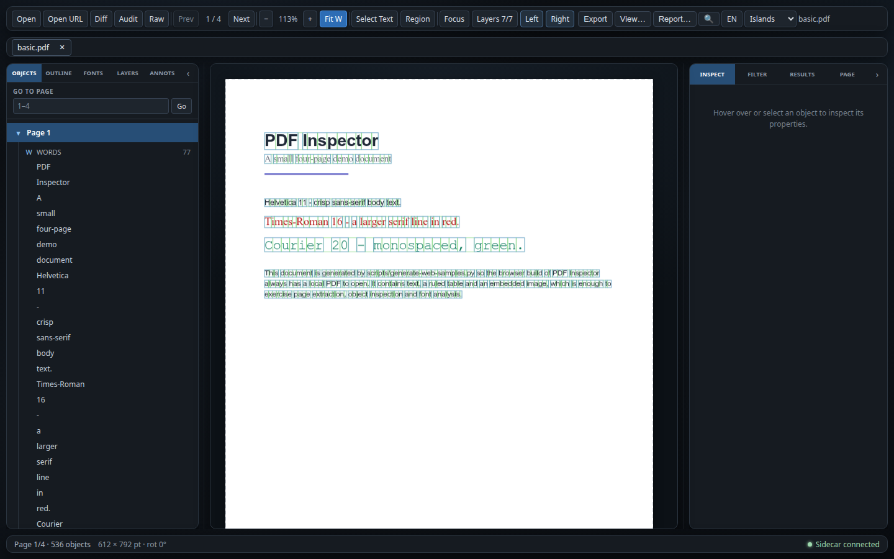
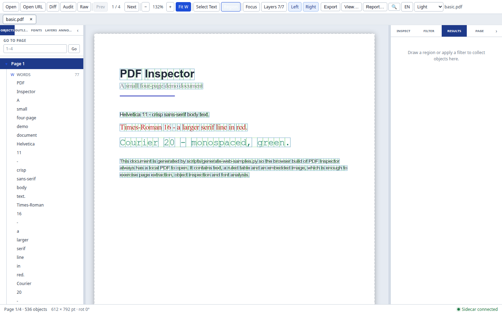
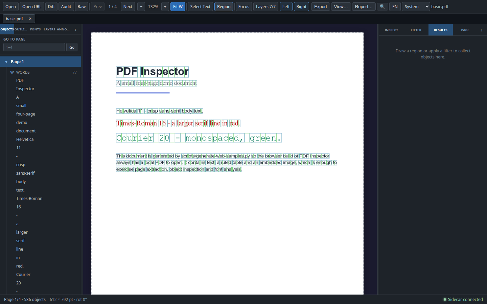

# 主题系统与中英文切换

主题与语言都是**渲染层用户偏好**：它们只改变界面外观与文案，不改变 PDF 解析结果、对象/注释数据、JSON/CSV schema 或侧车协议。两者都独立持久化，启动时在首帧前应用，并分别通过命令面板提供入口。

**结论：**

- 主题是注册表驱动的四个选项：`Dark`、`Islands`、`Light`、`System`；工具栏使用原生 `<select>`，不再使用双态按钮。
- `theme` 是用户选择（可能是 `system`），`resolvedTheme` 是实际应用的配色（`dark` / `islands` / `light`）；DOM 分别写入 `data-theme` 与 `data-theme-mode`。
- `System` 跟随 `prefers-color-scheme`，解析为 `Dark` 或 `Light`，系统外观变化时实时更新。
- 语言默认英文，可在 `EN` / `中文` 间切换；持久化 key 为 `pdf-inspector:locale:v1`，并同步 `<html lang>` 与 `data-locale`。
- i18n 只覆盖渲染层 UI 文案；命令标识、JSON/CSV 字段、PDF 对象标识、sidecar/CLI 错误与生成报告正文保持英文。
- 工具栏导出入口使用短可见标签（`View…` / `Report…`，中文 `视图…` / `报告…`）；完整名称保留在 `aria-label`、tooltip 与命令面板中，短标签不会削弱可访问名称。

## 主题系统

### 注册表

主题定义在 `src/renderer/theme/themes.ts`：

```ts
type ThemeId = 'dark' | 'islands' | 'light' | 'system';
type ResolvedTheme = 'dark' | 'islands' | 'light';

interface ThemeDefinition {
  id: ThemeId;
  label: string;
  description?: string;
  colorScheme: 'dark' | 'light';
}

const THEMES: readonly ThemeDefinition[]; // Dark, Islands, Light, System
const DEFAULT_THEME_ID = 'dark';
```

- `THEMES` 的顺序同时是下拉框顺序与 `toggleTheme()` 的循环顺序：`dark → islands → light → system → dark`。
- `label` / `description` 是注册表中的英文数据；实际显示文案来自 i18n 目录（`theme.dark` 等），因此切换语言不需要改注册表。
- `colorScheme` 描述主题期望的配色。`system` 无法预先知道，声明 `dark` 只作为没有 `matchMedia` 时的回退。
- `isThemeId` 校验用户偏好，`isResolvedTheme` 校验实际配色；两者分开，避免把 `system` 写进 CSS 选择器。
- `resolveTheme(id, prefersLight)` 是唯一解析入口：`islands` 始终为深色，`system` 按 `prefersLight` 返回 `light` 或 `dark`。

### theme 与 resolvedTheme

`src/renderer/store/theme-store.ts` 维护两个状态：

| 状态 | 含义 | 示例 |
|---|---|---|
| `theme` | 用户选择，包含 `system` 模式 | `system` |
| `resolvedTheme` | 实际应用的配色，对应 `theme.css` 的 token 块 | `light` |

`applyTheme(resolvedTheme, theme)` 写入：

```html
<html data-theme="light" data-theme-mode="system">
```

- `data-theme` 只可能是 `dark` / `islands` / `light`，CSS 不需要 `data-theme="system"` 分支。
- `data-theme-mode` 保留用户选择，便于 UI 与测试确认当前是 `System` 模式。
- `setTheme(id)` 校验 id、持久化到 `pdf-inspector:theme:v1`、解析并同步 DOM 与 store。
- store 初始化时也读取存储，因此即使入口没有调用 `initializeTheme()`（测试、嵌入场景），首帧仍显示保存的主题。
- 一个模块级 subscription 兜底处理直接 `setState({ theme })`：重新解析并同步 DOM，但直接写入不等于用户选择，不会持久化。

### System 监听

- `SYSTEM_LIGHT_QUERY = '(prefers-color-scheme: light)'`；`prefersLightTheme()` 在 `matchMedia` 缺失或抛错时返回 `false`，即回退深色。
- `initializeTheme()` 由桌面与 Web 两个入口在首次渲染前调用：读取存储、应用主题、注册 listener。
- listener 最多附加一次；优先 `addEventListener('change')`，旧环境回退 `addListener`，都没有时保持未附加。
- 收到变化时调用 `syncSystemTheme(matches)`：重新解析当前 `theme`；即使解析结果不变，也会重写 DOM 属性，避免外部改写后失同步。
- 只有 `theme === 'system'` 时解析结果才会随系统变化；`Dark` / `Islands` / `Light` 始终保持各自配色。
- 存储不可用（隐私模式、opaque origin、jsdom）时回退 `Dark`，写入失败不会破坏下拉框；旧的 `dark` / `islands` 值无需迁移。

### CSS token 与 Light

`src/renderer/theme.css` 是结构色的唯一来源：

- `:root` 与 `html[data-theme='dark']` 是原始深色配色。
- `html[data-theme='islands']` 把结构 token 重映射为近黑画布 + 更亮的浮动卡片。
- `html[data-theme='light']` 重映射**全部结构 token**：浅灰背景、白色面板、深色文字与蓝色强调色。

Light 的规则：

- `color-scheme: light`，让原生控件、滚动条与表单控件跟随浅色。
- 结构 token 必须完整定义，不能只覆盖背景与文字；`theme-css.test.ts` 会检查 Light 是否覆盖每个结构 token，以及所有 renderer CSS 模块是否引用未定义变量。
- Light 画布是平的：`html[data-theme='light'] body` 清除 Islands 的渐变背景，避免白页边缘被染色；`#root` 保持透明。
- Dark / Light 使用无间隙、无边界的经典布局；island chrome token（padding、gap、border、shadow）在这些主题下为 0 / 透明 / none。Islands 只在自身 token 块中填入浮动卡片参数。
- **语义色不是 token**：PDF 页面白底、对象类型色、注释类型色、页面框颜色在四个主题下保持不变，避免导出截图与画布颜色不一致。

### ThemePicker

`src/renderer/components/Toolbar/ThemePicker.tsx` 使用原生 `<select>`：

- 一个可聚焦控件，自带键盘与无障碍语义，不需要自己实现菜单焦点管理。
- `aria-label` 为 `Theme` / `主题`；`title` 显示当前主题，`System` 模式显示解析结果，例如 `Theme: System (Dark)` / `主题：跟随系统（深色）`。
- 每个 `<option>` 的 `title` 使用主题描述；选项文字来自 i18n，因此 `Dark` / `Islands` / `Light` / `System` 在中文界面显示为 `深色` / `岛屿` / `浅色` / `跟随系统`。
- 宽度保持 84px，配合工具栏 3px 间距，1280px 下仍可完整显示；没有额外的 `Theme:` 可见标签。

### 如何新增主题

1. 在 `ThemeId` 中加入新 id；若它是具体配色（不是模式），同时加入 `ResolvedTheme`。
2. 在 `THEMES` 中按希望的下拉/循环顺序加入定义。
3. 在 `resolveTheme()` 中处理该 id；模式型主题在这里按媒体查询解析。
4. 在 `theme.css` 增加对应 `html[data-theme='<id>']` 块；Light 的 token 完整性测试会要求覆盖所有结构变量。
5. 在两个消息目录中加入 `theme.<id>` 与 `theme.description.<id>`，并扩展 `THEME_LABEL_KEYS` / `THEME_DESCRIPTION_KEYS`。
6. 运行主题测试；命令面板的 `Cycle theme` 会自动按注册表顺序工作。

不需要修改 store 的分支逻辑，也不需要在工具栏增加按钮。

## 中英文切换

### 架构

`src/renderer/i18n/` 分为：

| 文件 | 职责 |
|---|---|
| `locales.ts` | `Locale`（`en` / `zh-CN`）、`DEFAULT_LOCALE`、存储 key、`<html lang>` 映射、`applyLocale` / `readStoredLocale` / `persistLocale` |
| `messages/en.ts` | 英文完整目录，同时定义 `MessageKey` 的 key 集合 |
| `messages/zh-CN.ts` | 简体中文目录，用 `Record<MessageKey, string>` 标注，保证与英文 key 完全一致 |
| `messages/index.ts` | `messages` 表与 `MessageKey` / `MessageParams` 类型 |
| `translate.ts` | `translate`、插值、fallback、复数解析 |
| `store.ts` | Zustand store、`initializeLocale`、`useT` / `useI18n` |
| `index.ts` | 对组件公开的统一入口 |

### 类型、fallback 与复数

- `MessageKey = keyof typeof en`：`t('typo.key')` 是编译错误；中文目录少一个 key 也无法通过类型检查。
- `translate(locale, key, params)` 的 fallback 链是：请求语言 → 英文 → key 本身。缺失 key 不会抛错，而是把 key 显示出来，便于发现漏迁移。
- 插值使用 `{name}` 占位符，例如 `t('status.pageOf', { page, count })`；未提供的占位符原样保留，不会变成 `undefined`。
- 计数文本用显式 key（`one` / `other`）或 `Intl.PluralRules`；`translatePlural()` 自动注入 `{count}`。中文只有 `other` 类别，但中文目录仍定义 `one` 以保持与英文 key 对称。
- `Intl.PluralRules` 缺失或抛错时回退到 `count === 1 ? 'one' : 'other'`，保证确定性。

### Hook 与持久化

- `useT()` 返回绑定当前 locale 的 `t(key, params?)`，用 `useMemo` 随 locale 变化重建；只关心文案的组件使用它。
- `useI18n()` 返回 `{ locale, setLocale, toggleLocale, t }`，供语言按钮或其他需要完整状态的控件使用。
- `setLocale(locale)` 校验后立即持久化到 `pdf-inspector:locale:v1`、写入 `<html lang>` / `data-locale`、更新 store。
- 直接 `setState({ locale })` 通过 subscription 同步 DOM，但不持久化。
- `initializeLocale()` 由桌面与 Web 入口在首帧前调用，重复调用无害。
- **默认英文，不读取浏览器语言**：避免首次运行、测试与截图随环境漂移；用户必须显式切换。
- `LanguagePicker` 是紧凑按钮：可见文字为 `EN` / `中文`，`aria-label` 说明当前语言，`title` 说明下一步动作（`Switch to 简体中文` / `切换到 English`）。
- 工具栏的导出触发器使用同样的“短标签 + 完整名称”模式：可见文字是 `View…` / `Report…`（中文 `视图…` / `报告…`），`exportView.triggerShort` / `shareReport.triggerShort` 单独成 key；`aria-label` 与 tooltip 仍是 `Export view…` / `Share report…`，命令面板标题也不变。

### 翻译范围与非目标

翻译：

- 工具栏、文档标签、左右面板标签、状态栏、搜索框与结果面板；
- Inspector、Diff、Audit、Raw、Annots、Fonts、Layers、Page、Export 视图与分享报告对话框；
- 空状态、错误提示、按钮、checkbox/radio 标签、命令面板标题与分组；
- 主题名称与描述、语言命令、快捷键说明文案。

保持英文：

- 命令 id、IPC/API 名称、URL、文件路径；
- JSON/CSV schema 字段、`schemaVersion`、对象类型标识（`char` / `word` / …）、PDF 运算符与原始对象语法；
- sidecar `RpcError`、CLI 输出与错误；
- 生成 HTML 报告的小节标题、状态文案与免责声明。

这些是数据/协议边界，不是 UI 文案。把它们翻译会破坏现有测试、下游消费方或用户对原始 PDF 的定位。

### 如何新增 key

1. 在 `src/renderer/i18n/messages/en.ts` 中加入英文文案；key 建议按功能前缀分组（`exportView.*`、`shareReport.*`）。
2. 在 `zh-CN.ts` 中加入同名 key 的中文文案；类型会强制补齐。
3. 组件中 `const t = useT()`，使用 `t('your.key', { name })`；参数名与目录中的占位符一致。
4. 若用于命令标题，同时在命令定义的 `title` 中使用 `t(...)`，`keywords` 可保留英文以方便过滤。
5. 运行 `npx vitest run src/renderer/i18n` 与相关组件测试。

### 验证

```bash
npx tsc -b
npx tsc -p tsconfig.web.json --noEmit
npx vitest run \
  src/renderer/store/__tests__/theme-store.test.ts \
  src/renderer/store/__tests__/theme-css.test.ts \
  src/renderer/components/Toolbar/ThemePicker.test.ts \
  src/renderer/components/Toolbar/LanguagePicker.test.ts \
  src/renderer/i18n/__tests__/translate.test.ts \
  src/renderer/i18n/__tests__/store.test.ts
```

主题测试覆盖注册表顺序、id 校验、旧值读取、System 解析、媒体查询变化、持久化、直接 setState 同步、Light token 完整性与 Islands/Light 画布规则；语言测试覆盖默认英文、持久化、`html lang` / `data-locale`、插值、缺失 key fallback 与复数。组件测试覆盖下拉框可访问名称、四个选项、即时应用与中英文标签，以及语言按钮的切换、持久化与恢复。

### 真实 Web E2E 记录

1440×900 的真实 Web 构建：

| 检查 | 结果 |
|---|---|
| 主题下拉框 | 提供 `Dark` / `Islands` / `Light` / `System` 四个选项 |
| 选择 `Light` | `data-theme="light"`、`data-theme-mode="light"`，body 背景为 `rgb(243, 245, 248)`；刷新后仍为 Light |
| 选择 `System` | 浏览器媒体为 light 时解析为 `light`；媒体切到 dark 后解析为 `dark`；切回 light 再次解析为 `light`，`data-theme-mode` 始终为 `system` |
| 点击 `EN` | UI 切换为中文，`html lang="zh-CN"`、`localStorage["pdf-inspector:locale:v1"]="zh-CN"`；工具栏、标签、状态栏、对话框与命令面板均为中文 |
| 中文刷新 | 仍为 `zh-CN`，工具栏显示 `中文`；切回英文后 `lang="en"`、存储为 `en` |
| 工具栏短标签 | 1440×900 下英文显示 `Export` / `View…` / `Report…`，中文显示 `导出` / `视图…` / `报告…`；`Export` 按钮没有额外 `aria-label`，另两个按钮的 `aria-label` 为 `Export view…` / `导出视图…` 与 `Share report…` / `分享报告…`，tooltip 为完整说明 |
| 标签换行 | 1280×900、1440×900、1600×900 的英文与中文界面下，工具栏所有按钮标签都是单行，无按钮内部换行或文字截断 |
| 命令面板 | 同时列出 `Export view…`、`Share report…`、四个主题命令、`Language: English` / `Language: 简体中文` |
| 横向溢出 | 1280 / 1440 / 1600 宽度下，英文与中文界面 `documentElement.scrollWidth === innerWidth`，页面无横向滚动；工具栏使用 3px 间距与 84px 主题选择器，`<1440px` 还会隐藏文件名，确保固定控件不被裁切 |
| 1440px | 工具栏完整可见，文件名也显示；1440px 是当前完整工具栏的宽度下限 |

截图（1440×900）：

| 截图 | 说明 |
|---|---|
|  | 英文界面，主题选择 `Islands`：近黑渐变画布与带边框、圆角、阴影的浮动卡片 |
|  | 英文界面，主题选择 `Light`，白色面板与浅灰画布，PDF 页面保持白底 |
|  | 浏览器媒体为 dark 时 `System` 解析为深色；下拉框保留 `System`，tooltip 说明实际配色 |
|  | `中文` 模式下的完整界面，主题为 `深色`，状态栏与工具栏文案已翻译 |

## 常见陷阱

- **不要把 `t` 加进 FontsTab 的分析 effect 依赖。** 字体分析是一个多批次长任务；locale 变化会重建 `t`，若进入 effect 依赖就会从第 1 页重新开始。当前实现用 `tRef` 保存最新翻译函数，effect 只依赖文档与结果状态。
- **不要用直接 `setState` 代替用户操作。** `setTheme` / `setLocale` 才负责持久化；subscription 只同步 DOM，不会写 localStorage。
- **不要给 System 写 CSS 块。** `data-theme` 永远是解析后的具体配色；新增选择器会让 `system` 状态无法覆盖全部 token。
- **新增 Light token 要完整。** 只改背景/文字会留下深色边框、阴影或 hover 状态；运行 `theme-css.test.ts`。
- **System 的 `colorScheme` 不是解析结果。** 它只是没有 `matchMedia` 时的回退；实际解析必须走 `resolveTheme`。
- **语言目录要成对修改。** 只加英文 key 会直接类型报错；不要用 `any` 绕过，否则中文会显示英文 fallback 或 key 本身。
- **报告正文不会自动翻译。** `buildInspectionReport` 的 `lang` 只写入 `<html lang>`；正文与标题是固定的英文实现。需要中文报告时应在 `export-report` 中引入报告专用目录，而不是把 UI 的 `t` 直接传进去。
- **命令 id、schema 字段与 sidecar 错误不要翻译。** 命令 id 是注册/测试契约，schema 字段是下游数据契约，sidecar 错误是诊断信息。
- **语言切换不应重建文档状态。** 只改变文案，不重新打开 PDF、不重新跑字体/审计/注释索引；若新增依赖 `t` 的 effect，先确认它不会触发昂贵操作。
- **两个存储 key 独立。** `pdf-inspector:theme:v1` 与 `pdf-inspector:locale:v1` 分开读写；主题变化不会使语言失效，反之亦然。
